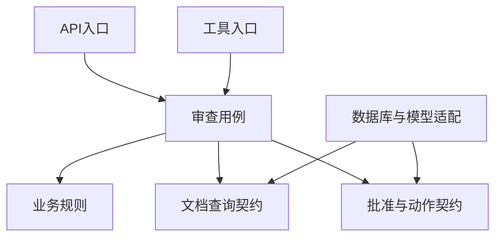

# 第3章　领域建模、模块与服务边界

[上一章](02-运行时网络与资源边界.md) · [本书目录](教材目录.md) · [下一章](04-接口契约与跨系统集成.md)

## 1. 目标、前置与问题

前置：第1章。能区分业务边界、代码模块与部署服务。问题：所有与“采购”有关的代码都应该放在一个模块吗？

## 2. 概念与基础

先看任务T1：标题可以修改，但它仍是原任务，因此要用稳定身份跟踪它，这叫实体。再看100元人民币：金额与币种共同表达含义，这类按值判断的模型叫值对象。若批准必须绑定同一报告版本，就要圈出需要共同保护的记录与规则，再认识聚合。先把这条业务约束画清楚，再讨论模块或服务拆分。

限界上下文让一套术语和规则在明确范围内成立。“供应商合格”在资料收集和最终审批中可能含义不同，不能只因名称相同就合并。模块是代码边界，服务是运行与部署边界；良好模块可先在同一进程中协作。

## 3. 机制与推导

模块边界首先保护规则，然后才是组织文件。采购任务有稳定身份，即使标题改变仍是同一任务；金额按数值与币种表达含义；批准必须绑定一份报告版本。这些差异决定数据如何比较、谁可以修改、哪些修改必须一起成立。

假设 API、定时任务和模型工具都能提交报告。如果每个入口各写一次批准检查，迟早有一个入口漏掉。应把“执行前必须检查批准版本”放在共同业务操作中，所有入口调用它。业务规则由一个所有者维护，HTTP 与模型只是输入输出方式。

依赖方向由变化决定：更换模型供应商应主要修改适配器；更换数据库应主要修改持久化；批准规则变化则修改业务与相应测试。把 SDK 响应对象传遍业务代码，会让一次协议升级变成全系统修改。

这里的箭头表示依赖关系，不是网络连接。先在一个应用中实现这些边界，仍可获得规则集中、可替换和可测试的收益。独立部署需要额外证明。

## 4. 案例逐步推演

为同一采购任务列所有权，而不是按表平均拆服务：

| 模块 | 拥有的数据与规则 | 对外提供 | 其他模块不能做什么 |
| --- | --- | --- | --- |
| documents | 来源、版本、访问范围 | 查询当前可见来源 | 直接改其授权表 |
| review | 发现与资料缺口 | 生成待审报告 | 把缺资料当通过 |
| approval | 批准人、载荷摘要、有效状态 | 校验某次动作是否已批准 | 自行伪造批准记录 |
| model_adapter | 协议、截止时间、供应商错误 | 返回候选结果 | 修改业务任务状态 |

需求变化：“更换模型，但批准后修改报告仍须重新批准。”先替换 model_adapter，再让相同批准测试运行。若不得不修改 approval 的供应商字段，检查是否把技术细节放进了业务规则。

再变化：“导入独立部署。”先确认 documents 的公开契约、任务持久化和失败负责人，再增加远程适配。模块拆清与部署拆开是两次决定。

### 4.1 从一条规则反推操作边界

以“批准后修改报告必须重新批准”为例，列出三个公开操作：修改报告、批准版本、执行已批准动作。修改报告时生成新版本并使旧批准不可继续使用；批准时绑定任务、载荷摘要与身份；执行时重新核对当前状态和同一摘要。

如果修改接口直接写report表，审批服务只保存一个approved布尔值，第三个操作就无法判断批准针对哪一份内容。修复首先是补全状态与共同规则，不是把数据库表搬到三个服务。业务核心接收任务与身份上下文，不接收某供应商的SDK响应对象。

现在做一次变更分析：增加“预算核查”只读能力，应影响规则与审查结果；更换模型应主要影响适配器；将文档存储换为对象存储，应主要影响文档读取。实际修改范围如果比预期大，记录哪些内部字段越过了边界。

这就是架构中的反馈：图先表达假设，需求变更用来检验它。不要用目录名称已经分开，推断业务耦合也已经降低。

## 5. 分层练习

先完成：选择一条不变量，分别从 API、CLI 和工具入口尝试绕过它。用一张表说明三个入口最终调用哪个共同业务函数。再模拟更换模型，列出应该变化与实际变化的文件。

完成后换一个约束或一组输入，解释原决定哪里需要改变。基础任务通过后再做深化；本章不要求把所有扩展同时实现。

## 6. 自测与参考推导

合上正文，复述问题怎样出现、机制为什么有效、哪些条件下仍会失败。再对照下面的诊断检查自己的成果。

完成独立任务后查看诊断

如果三个入口各自检查同一条规则，代码看似完整，规则仍可能分叉。如果所有模块都通过一个无限扩大的 utils 修改数据库，接口数量少也不表示低耦合。判断依据是规则与数据所有权，以及变化传播范围。

## 7. 项目交付与验收

保存一张模块依赖图与三条不变量，加入同一架构记录。下一章把模块公开能力写成有失败行为的接口契约。

验收时由你或同伴用新条件检查，记录输入、实际结果与解释。设计练习以推理和反例判断，代码任务用实际行为检查；涉及用户与商业的结论只使用相应真实证据。

## 8. 迁移与阅读

使用[C4模型](https://c4model.com/)分别展示系统、运行容器和组件，避免一图混杂所有层级；[限界上下文](https://martinfowler.com/bliki/BoundedContext.html)用于进一步理解模型边界。

[上一章](02-运行时网络与资源边界.md) · [本书目录](教材目录.md) · [下一章](04-接口契约与跨系统集成.md)
