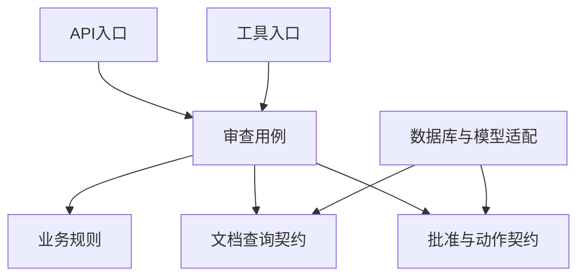

# 第3章　领域建模、模块与服务边界

[上一章](02-运行时网络与资源边界.md) · [本书目录](教材目录.md) · [下一章](04-接口契约与跨系统集成.md)

## 1. 目标、前置与问题

前置：第1章。能区分业务边界、代码模块与部署服务。问题：所有与“采购”有关的代码都应该放在一个模块吗？

**本章主线：** 从一条业务不变量出发，识别实体、值对象和聚合，再决定谁拥有数据与规则，最后用变更传播范围检验边界。

## 2. 概念与基础

### 2.1 实体靠稳定身份，值对象靠内容

**实体**是具有稳定身份的业务对象。采购任务T1改了标题，仍是T1，因此用ID跟踪，不能用整份字段判断“是不是同一个”。**值对象**按内容与类型判断含义，例如100元人民币由金额100和币种CNY共同表达，交换两个等值对象通常没有业务差别。

为什么需要区分？更新实体标题应修改原对象；修改金额时若只写100而丢失币种，含义可能从100元变成100美元。身份决定记录能否被找到，值语义决定何时能安全替换。

| 模型 | 判断相等依据 | 例子 | 修改方式 |
| --- | --- | --- | --- |
| 实体 | 稳定ID | 任务T1 | 更新原任务，不新建身份 |
| 值对象 | 类型与全部关键值 | `Money(100, "CNY")` | 用新值替换，并保持不可变语义 |
| 聚合 | 根身份及内部一致性 | 报告及其批准版本 | 通过根执行受保护操作 |

把100元与100美元都简化成数字100，会丢失业务含义；把每个任务副本都当新实体，又会让批准无法绑定原任务。建模不是套类名，而是先写清“什么变化后它还是同一个”。

### 2.2 聚合保护一组必须同时成立的规则

**聚合**是一组需要共同维护一致性的对象，通过聚合根执行修改。比如批准必须绑定同一报告版本，那么“批准某版本”不能只看任务ID，还要同时核对报告版本、批准人和载荷摘要。

若修改报告后旧批准仍有效，系统可能执行一份从未被批准的新内容。聚合的边界就是要让这类状态不能分别被改到互相矛盾。

最小数据流是：读取任务与报告版本 → 检查批准摘要等于当前载荷 → 在同一业务操作内记录动作。只保存 `approved=True` 无法回答“批准的是哪份内容”。

常见错误是让外部直接修改聚合内部表。即使所有写入最终成功，中间状态也可能出现“新报告＋旧批准”。边界先保护规则，然后才是组织文件。

### 2.3 限界上下文圈定术语与规则

**限界上下文**是一套术语和规则明确适用的范围。“供应商合格”在资料收集时可能只表示材料齐全，在最终审批时却表示通过合规检查。名称相同不代表含义与不变量相同。

需要分开的理由是变化方向不同：收集规则增加一种材料，不应自动改变审批结论；审批要求法务复核，也不应让上传模块拥有批准权。

| 上下文 | “合格”的含义 | 拥有规则 | 对外提供 |
| --- | --- | --- | --- |
| 资料收集 | 必填材料已提交 | 材料完整性与来源 | 收集结果 |
| 最终审批 | 满足批准条件 | 批准身份、版本与状态 | 批准结论 |

两个上下文可以处于同一数据库甚至同一进程，但应通过明确契约交换结果。若共用一个巨型 `Procurement` 对象，字段语义会随调用方漂移。

### 2.4 模块边界与服务边界是两次决定

**模块**是代码与责任边界；**服务**是独立运行、部署和扩展的边界。一个应用内可以有清晰的documents、review、approval模块，彼此通过接口协作，不产生网络调用。

为什么不能一次决定完？模块边界先让规则集中、可替换、可测试；独立服务还要求持久化、远程失败、版本兼容和运维负责人。先拆清模块，可以观察变更传播，再决定是否值得支付部署代价。

| 边界 | 主要收益 | 新增成本 | 成立证据 |
| --- | --- | --- | --- |
| 模块 | 规则内聚、依赖可替换 | 接口设计与测试 | 一次变更只影响预期模块 |
| 服务 | 独立部署、扩容与故障隔离 | 网络、协调、运维 | 独立需求明确且收益覆盖成本 |

目录名称相同、表放在同一库，都不足以说明边界好坏；真正要看谁能修改哪些数据，以及调用方是否依赖内部字段。

## 3. 机制与推导

### 3.1 让多个入口调用同一条业务规则

假设HTTP API、定时任务和模型工具都能提交报告。如果三个入口各写一次批准检查，迟早可能有一处遗漏。共同业务操作应负责“执行前核对批准的报告版本”，入口只转换输入并传递可信身份。



这里的箭头表示依赖关系，不是网络连接。规则集中在REVIEW，SDK与数据库细节在适配层；入口不能直接写批准表。这样增加一个CLI入口时，不需要复制规则。

机制推导：入口形式可以不同，但不变量相同；不变量应只有一个权威执行点。若每个入口直接访问内部表，入口数量增加就会线性增加规则遗漏点。

### 3.2 依赖方向跟着变化走

更换模型供应商应主要修改适配器；更换数据库应主要修改持久化；批准规则变化则修改业务与相应测试。依赖方向不是让所有模块都依赖一个巨大的工具类，而是让稳定的业务规则不依赖易变的协议。

一个简单检查是：给适配器换一个返回字段名，看多少业务文件需要修改。若SDK响应对象传遍业务代码，一次协议升级会变成全系统修改。

| 变化 | 预期修改范围 | 越界信号 |
| --- | --- | --- |
| 更换模型 | 模型适配器与契约测试 | approval出现供应商字段 |
| 更换数据库 | 持久化实现与迁移 | 业务SQL散布在入口 |
| 修改批准规则 | 业务规则与测试 | 工具调用方自行判断批准 |
| 新增预算核查 | 审查规则与只读能力 | 文档模块修改任务状态 |

依赖少不等于边界正确。一个无限扩大的 `utils` 让所有模块都能写库，虽然调用方便，却使数据所有权和变更影响不可判断。

### 3.3 用三个操作表达批准生命周期

“批准后修改报告必须重新批准”可以落成三个公开操作：修改报告、批准版本、执行已批准动作。修改报告生成新版本并使旧批准不可继续使用；批准绑定任务、载荷摘要与身份；执行时重新核对当前状态与同一摘要。

```text
报告v7 → 批准(v7, hashA) → 修改为v8
                       ↓
             旧批准不可执行
报告v8 → 批准(v8, hashB) → 执行(v8, hashB)
```

如果修改接口直接写report表，审批服务只保存approved布尔值，第三个操作就无法判断批准针对哪份内容。修复首先是补全状态与共同规则，不是把数据库表搬到三个服务。

## 4. 案例逐步推演

为同一采购任务列所有权，而不是按表平均拆服务：

| 模块 | 拥有的数据与规则 | 对外提供 | 其他模块不能做什么 |
| --- | --- | --- | --- |
| documents | 来源、版本、访问范围 | 查询当前可见来源 | 直接改其授权表 |
| review | 发现与资料缺口 | 生成待审报告 | 把缺资料当通过 |
| approval | 批准人、载荷摘要、有效状态 | 校验某次动作是否已批准 | 自行伪造批准记录 |
| model_adapter | 协议、截止时间、供应商错误 | 返回候选结果 | 修改业务任务状态 |

**输入：** 更换模型，同时要求批准后修改报告仍须重新批准。**变化：** 替换model_adapter，并运行相同批准测试。**输出：** 模型协议变化不进入approval；报告v8不能使用v7的批准。

**失败定位：** 若approval需要修改供应商字段，检查技术细节是否越过边界；若v8仍能执行，检查修改操作是否使旧批准失效，以及执行点是否比较载荷摘要。

再变化：“导入独立部署。”先确认documents的公开契约、任务持久化和失败负责人，再增加远程适配。模块拆清与部署拆开是两次决定。

### 4.1 从一条规则反推操作边界

以“批准后修改报告必须重新批准”为例，修改报告时生成新版本并使旧批准不可继续使用；批准时绑定任务、载荷摘要与身份；执行时重新核对当前状态和同一摘要。

如果修改接口直接写report表，审批服务只保存一个approved布尔值，第三个操作就无法判断批准针对哪一份内容。修复首先是补全状态与共同规则，不是把数据库表搬到三个服务。业务核心接收任务与身份上下文，不接收某供应商的SDK响应对象。

现在做一次变更分析：增加“预算核查”只读能力，应影响规则与审查结果；更换模型应主要影响适配器；将文档存储换为对象存储，应主要影响文档读取。实际修改范围如果比预期大，记录哪些内部字段越过了边界。

### 4.2 让三个入口执行同一个批准规则

```python
# track-example: A03
report = {"task_id": "T1", "version": 7, "payload_hash": "hash-v7"}
approval = {"task_id": "T1", "version": 7, "payload_hash": "hash-v7", "approved_by": "u1"}
trusted_approvers = {"u1"}
allowed_callers = {"u1", "u2"}

def submit(source, task_id, version, payload_hash, *, caller_id):
    return (approval["approved_by"] in trusted_approvers
            and caller_id in allowed_callers
            and approval["task_id"] == task_id
            and approval["version"] == version
            and approval["payload_hash"] == payload_hash)

assert submit("api", report["task_id"], report["version"], report["payload_hash"], caller_id="u2")
assert not submit("api", report["task_id"], report["version"], report["payload_hash"], caller_id="outsider")
report["version"] = 8
report["payload_hash"] = "hash-v8"
assert not submit("tool", report["task_id"], report["version"], report["payload_hash"], caller_id="u2")
assert not submit("tool", report["task_id"], 8, "hash-v7", caller_id="u2")
assert not submit("batch", "T2", 8, "hash-v8", caller_id="u2")
```

三个入口传入不同来源字符串，但判断都调用同一个 `submit`。首次批准对v7且授权调用者成立；改为v8、沿用v7摘要、换任务或换未授权调用者都会被拒绝。这个例子用集合模拟可信身份边界，用于观察版本、载荷与身份规则，不证明真实认证或事务安全。

生产实现还需让批准与报告版本在同一原子边界更新，并由可信身份初始化批准记录。不能因为入口都调用函数，就忽略批准人是否伪造。

## 5. 分层练习

1. **基础**：为任务、金额和批准分别说明它靠身份还是靠值判断相等，并各举一个修改后含义是否变化的例子。
2. **改造**：选择一条不变量，分别从API、CLI和工具入口尝试绕过；用表格说明三个入口最终调用哪个共同业务函数。
3. **独立**：模拟更换模型与修改报告版本，列出应该变化与实际变化的文件；解释任何越界字段为何不应进入业务规则。

## 6. 自测与参考推导

<details><summary>完成独立任务后查看诊断</summary>

如果三个入口各自检查同一条规则，代码看似完整，规则仍可能分叉。如果所有模块都通过一个无限扩大的utils修改数据库，接口数量少也不表示低耦合。若只按“采购”命名拆模块，仍可能把材料收集与最终审批的不同含义混在一起。

</details>

**自问：** 为什么模块边界清楚，不一定马上拆成服务？

**参考推导：** 模块化已经能集中规则、隔离依赖并验证变更范围。独立服务额外引入网络失败、版本协调和运维责任，只有独立扩容、发布或团队所有权产生足够收益时才值得。

## 7. 项目交付与验收

保存一张模块依赖图与三条不变量，加入同一架构记录。下一章把模块公开能力写成有失败行为的接口契约。

| 操作 | 预期结果 | 证据 |
| --- | --- | --- |
| 修改报告版本 | 旧批准不可继续使用 | 前后版本与批准摘要 |
| 三个入口提交 | 调用同一业务规则 | 调用轨迹与相同拒绝结果 |
| 更换模型 | 仅适配层与契约测试变化 | 实际修改文件列表 |
| 独立部署导入 | 公开契约、持久化、负责人齐备 | 远程失败与恢复记录 |

## 8. 迁移与阅读

### 8.1 一页知识地图

**本章主问题：** 所有与“采购”有关的代码都应该放在一个模块吗，边界按什么划？

**一条主线：** 业务不变量 → 实体、值对象与聚合 → 上下文与模块所有权 → 用变更传播范围检验。

**三个关键词：** 限界上下文、不变量、依赖方向。上下文圈定术语与规则，不变量决定数据所有权，依赖方向让换供应商主要落在适配器。

**最容易错：** 三个入口复制规则；按名称而非变化划模块；把SDK对象传遍业务层；把目录分开当低耦合；把模块拆分与服务拆分一次做完。

**学完应能：** 为一条不变量画共同业务函数；列出数据、规则、对外能力与禁止事项；用真实变更检验修改范围。

**就地参考：** [2.1实体与值对象](#21-实体靠稳定身份值对象靠内容)解释身份差异；[2.2聚合](#22-聚合保护一组必须同时成立的规则)保护跨对象规则；[3.3三个操作](#33-用三个操作表达批准生命周期)可直接用于设计。下一章把公开能力写成[接口契约](04-接口契约与跨系统集成.md)。

[C4模型](https://c4model.com/)分别展示系统、运行容器和组件；[限界上下文](https://martinfowler.com/bliki/BoundedContext.html)用于进一步理解模型边界。

[上一章](02-运行时网络与资源边界.md) · [本书目录](教材目录.md) · [下一章](04-接口契约与跨系统集成.md)
