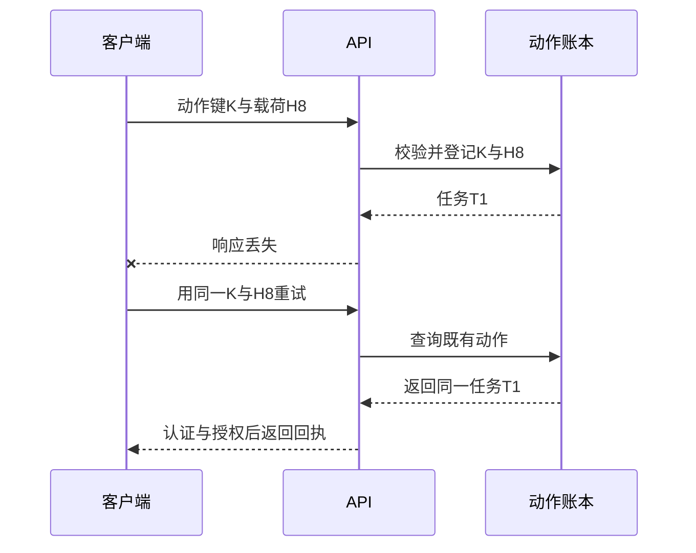

# 第4章　接口契约与跨系统集成

[上一章](03-领域建模模块与服务边界.md) · [本书目录](教材目录.md) · [下一章](05-数据库设计事务与并发正确性.md)

## 1. 目标、前置与问题

前置：第2–3章。能设计包含异常、版本和重试规则的接口。问题：客户端超时后，到底能不能再提交一次？

**本章主线：** 把一次业务意图变成稳定的键与载荷摘要，区分受理和完成，再让客户端能根据成功、冲突、未知和暂时失败采取不同动作。

## 2. 概念与基础

### 2.1 契约规定成功、失败与副作用

**接口契约**是调用双方对输入、输出、时限、错误与副作用的共同约定。它不仅规定字段类型，还规定重复调用、权限变化和部分完成时怎样行为。

“提交报告”可能同步完成，也可能耗时数分钟。长任务先返回任务ID与 `queued`，客户端再查询；`202 Accepted`只表示受理，不表示业务已经完成。把queued显示成completed，会让用户跳过实际校验。

一个可讨论的请求样本是：`task_id=T1`、`payload_version=8`、`idempotency_key=K`、`payload_hash=H8`。身份由服务端认证得到，不能从请求体任意指定。

| 契约部分 | 必须回答 | 缺失后果 |
| --- | --- | --- |
| 输入 | 必填、范围、身份来源 | 非法数据进入业务 |
| 成功 | 已受理还是已完成 | UI过早展示结果 |
| 失败 | 可否重试、如何修正 | 重复操作或无限重试 |
| 版本 | 新旧客户端怎样共存 | 升级时旧客户端崩溃 |
| 副作用 | 重复请求产生什么 | 重复提交与外部动作 |

### 2.2 幂等键绑定一次业务意图

**幂等**指重复相同操作不产生额外业务效果，不代表代码只执行一次。**幂等键**用于识别“这是不是上次那一个动作”。键应绑定租户、主体、操作和载荷摘要；同键不同内容应冲突。

为什么键不能只由客户端随意生成？若第一次超时后换新键，服务端会认为这是新意图，于是创建第二个任务。即使每个任务内部只执行一次，整体仍有两份业务效果。

最小规则是：第一次登记K与H8并返回任务T1；同租户、同主体、同操作、同K、同H8重试返回T1；同键但H9返回409冲突。权限仍需重新检查，旧回执不能被无权限主体读取。

常见错误是把幂等键当授权令牌。它只能防重复，不能证明当前用户有权操作，也不能替代批准状态检查。

### 2.3 结果未知与明确失败不同

**结果未知**表示客户端无法判断服务端是否已经生效，例如请求超时或响应丢失。**明确失败**表示服务端已返回可识别的业务错误，客户端知道没有完成。

请求超时至少有三种服务端状态：尚未收到、已经登记、已经完成。客户端看到的都只是“没拿到响应”。因此不能直接显示失败并引导换键重发，应先按原键查询或幂等重试。

| 客户端观察 | 服务端可能状态 | 正确动作 |
| --- | --- | --- |
| 连接失败 | 请求可能未到达 | 原键重试或先查询 |
| 读取超时 | 已受理或已完成 | 查询原任务，不新建动作 |
| 同键不同载荷冲突 | 原动作存在但内容不同 | 核对意图，不用旧结果冒充新结果 |
| 无权限 | 当前调用被拒绝 | 不自动重试，重新建立合法授权 |

未知状态不是永久悬置。接口应提供查询、对账或人工处理路径，以及动作键保留期限。超过期限后的行为必须写入契约。

### 2.4 兼容性是行为兼容

**兼容窗口**是新旧应用、客户端和数据同时存在的时间段。新增字符串状态 `partial` 虽然通过类型校验，仍可能让旧客户端的穷尽分支崩溃。

分页也需要契约：按 `created_at` 与 `id` 稳定排序，游标表达最后位置；每页重新维持授权。它解决位置推进，不自动提供整个数据集的历史快照。

| 变化 | 表面兼容 | 行为风险 | 验证 |
| --- | --- | --- | --- |
| 新增枚举状态 | 字段仍是字符串 | 旧客户端未知分支 | 旧客户端读新状态 |
| 新增必填字段 | JSON仍可解析 | 旧服务端拒绝 | 旧服务读新请求 |
| 改变排序 | 字段未删 | 重复、漏页 | 相同时间记录与插入场景 |
| 改变错误文本 | 状态码未变 | 客户端分类错误 | 按稳定错误码行动 |

## 3. 机制与推导

### 3.1 服务端怎样识别重复请求

同步调用容易造成错觉：没收到成功，就以为事情没有发生。实际上请求可能尚未到达，也可能已落库而回执丢失。服务端需要动作账本区分这几种情况。



处理顺序是：认证 → 当前授权 → 校验载荷并计算摘要 → 查询租户、主体、操作与键 → 同摘要返回原回执，不同摘要冲突 → 新动作原子登记。授权在返回旧回执前仍需成立。

机制推导：如果“查旧结果”发生在授权之前，攻击者可能借幂等键读取他人的任务结果；如果查询与登记不在原子边界，两个并发请求仍可能都认为键不存在。第5章会把它落成唯一约束。

### 3.2 长任务用状态机表达进展

建议把 `queued → running → completed` 作为正常路径，`failed` 表示已确认失败。`unknown` 更适合表达客户端观察不确定，不一定作为服务端永久状态；重试或对账后应转为明确状态。

每次状态变化都应可追溯：任务ID、请求ID、载荷摘要、状态、时间与错误类别。状态查询返回completed时，还要能核对真实结果与回执，而不是只信任一个字符串。

**失败定位：** 若客户端一直queued，先看是否已登记、worker是否消费、最老任务等待多久；若服务端completed但客户端超时，走原任务查询；若出现第二任务，检查重试是否换了键。

### 3.3 错误分类决定客户端动作

字段错误要求修改输入；未认证要求重新建立会话；无权限不自动重试；暂时依赖失败可在总预算内重试；载荷冲突要求核对意图。内部堆栈留在受控日志，客户端保留关联ID。

重试还要有总次数与截止时间。若入口、网关、业务和SDK各重试3次，最坏情况会放大为81次上游调用。通常在一层统一安排重试，其他层只传递剩余预算或明确不重试。

一个错误响应至少包含稳定 `code`、是否可重试、关联ID与用户可执行建议。错误文本可以本地化，但客户端分支不应依赖某句自然语言。

## 4. 案例逐步推演

为提交模拟报告写一个可执行讨论的契约：身份来自服务端；请求包含task_id、payload_version和idempotency_key；批准绑定同一载荷。

| 时间 | 服务端事实 | 客户端知道什么 | 正确动作 |
| --- | --- | --- | --- |
| 请求前 | 未登记 | 未执行 | 可发送 |
| 已提交、回执丢失 | 已登记T1 | 结果未知 | 用原键查询或重试 |
| 查询回执后 | T1仍存在 | 已受理 | 查询T1状态 |
| 修改报告后 | 新载荷H9 | 旧批准不适用 | 重新批准并产生新动作 |

**输入变化：** 客户端第一次提交K/H8后超时，再用K/H8重试，最后改为K/H9。**输出：** 前两次得到同一任务，第三次冲突。**失败定位：** 若第三次仍返回T1，检查是否比较载荷摘要；若前两次得到两个任务，检查键作用域与原子登记。

对比一个错误接口：每次POST都创建新任务，客户端超时后换键再发。它把同一次意图变成两次操作；即使每个任务内部都“幂等”，也不能避免重复业务效果。

### 4.1 客户端如何根据契约行动

响应样本 `{"task_id":"T1","status":"queued","request_id":"R1"}` 表示已受理。running时保留等待，completed时读取真实结果，failed时按错误类别提示，结果未知时引导查询或对账。

错误分类对应动作：字段错误修改输入；未认证重新建立会话；无权限不自动重试；暂时依赖失败在总预算内重试；载荷冲突核对意图而非盲目换键。

分页按created_at与id稳定排序，游标表达最后位置，并在每页重新维持授权。期间插入、删除和权限变化如何呈现，要按任务说明。

验证接口不能只拿新服务请求新客户端：让旧客户端读新枚举、让新客户端遇到旧记录，才能看到兼容窗口中的失败。

### 4.2 离线重放同一意图

```python
# track-example: A04
ledger = {}

def submit(tenant, actor, action, key, payload_hash):
    identity = (tenant, actor, action, key)
    old = ledger.get(identity)
    if old is not None:
        if old["payload_hash"] != payload_hash:
            return {"status": 409, "error": "payload_conflict"}
        return {"status": 200, **old}
    task_id = f"T{len(ledger) + 1}"
    ledger[identity] = {"task_id": task_id, "payload_hash": payload_hash, "state": "queued"}
    return {"status": 202, "task_id": task_id, "state": "queued"}

first = submit("acme", "u1", "approve", "K1", "H8")
retry = submit("acme", "u1", "approve", "K1", "H8")
changed = submit("acme", "u1", "approve", "K1", "H9")
other_tenant = submit("other", "u1", "approve", "K1", "H8")
assert first["task_id"] == retry["task_id"] == "T1"
assert changed["status"] == 409
assert other_tenant["task_id"] == "T2"
assert len(ledger) == 2
```

程序按稳定身份查账本：同键同载荷得到原任务，同键异载荷冲突，不同租户使用相同字符串键互不影响。它没有模拟真实并发，因此不能证明数据库唯一约束；第5章补上这一点。它也没有模拟认证与授权；实际接口必须在查询和返回旧回执前重新确认当前身份与权限，本程序不能作为撤权后的越权测试证据。

## 5. 分层练习

1. **基础**：覆盖首次提交、同键同载荷、同键不同载荷、其他租户同键四种输入，逐项写响应与账本变化。
2. **改造**：设计queued、running、completed、failed和未知结果的处理，给每类错误标“重试、修正、查询或转人工”。
3. **独立**：让旧客户端读取新增枚举，让分页数据发生同时间插入与删除；记录失败并修订兼容契约。

## 6. 自测与参考推导

<details><summary>完成独立任务后查看诊断</summary>

若“超时”后新建任务，先回看未知结果与失败的区别。若同键不同载荷直接返回旧结果，客户端无法发现自己提交了错误内容。若公开详细错误泄露其他租户存在与否，也破坏了契约的安全边界。

</details>

**自问：** 为什么“每个任务只执行一次”仍不能防止重复业务效果？

**参考推导：** 防重范围是一个任务，而客户端可能因超时创建了两个任务。必须在一次业务意图层面使用稳定键与载荷摘要，并让接收方按该键原子去重；只保证任务内部幂等不够。

## 7. 项目交付与验收

提交一份接口样本，包含成功、冲突、无权限与未知状态；不额外交一套业务规则。后续数据库与消息实验都使用同一动作身份。

| 操作 | 预期结果 | 证据 |
| --- | --- | --- |
| 首次提交 | 返回受理任务与请求ID | 请求摘要、任务状态 |
| 丢回执后重试 | 返回同一任务 | 两次请求与账本记录 |
| 撤权后查询或重试 | 拒绝且不返回旧回执 | 撤权事件、当前身份与拒绝响应 |
| 同键改载荷 | 冲突且不覆盖原动作 | 旧摘要、新摘要、响应 |
| 查询完成 | 结果与回执可核对 | 状态变化与真实输出 |
| 旧客户端读新枚举 | 未知分支可处理 | 兼容测试记录 |

## 8. 迁移与阅读

### 8.1 一页知识地图

**本章主问题：** 客户端超时之后，到底能不能用同一个键再提交一次？

**一条主线：** 动作身份 → 受理与完成分离 → 幂等与冲突 → 按错误分类行动。

**三个关键词：** 幂等键、受理、兼容窗口。键绑定业务意图；受理只表示登记成功；新旧共存要求行为兼容。

**最容易错：** 超时换键；同键异载荷返回旧结果；把queued当completed；只测新客户端；每层各自重试放大流量。

**学完应能：** 写四时刻状态表；提交成功、冲突、无权限、未知响应；验证旧客户端与分页边界。

**就地参考：** [2.2幂等键](#22-幂等键绑定一次业务意图)定义作用域；[3.1服务端识别流程](#31-服务端怎样识别重复请求)给出检查顺序；[4.2离线重放](#42-离线重放同一意图)展示四种结果。下一章把同一键落成[唯一约束与事务边界](05-数据库设计事务与并发正确性.md)。

[HTTP语义标准](https://www.rfc-editor.org/rfc/rfc9110)帮助核对方法与响应含义；可选查阅[HTTP与可靠调用](../python-book/14-外部数据模型、HTTP与可靠调用.md)。

[上一章](03-领域建模模块与服务边界.md) · [本书目录](教材目录.md) · [下一章](05-数据库设计事务与并发正确性.md)
