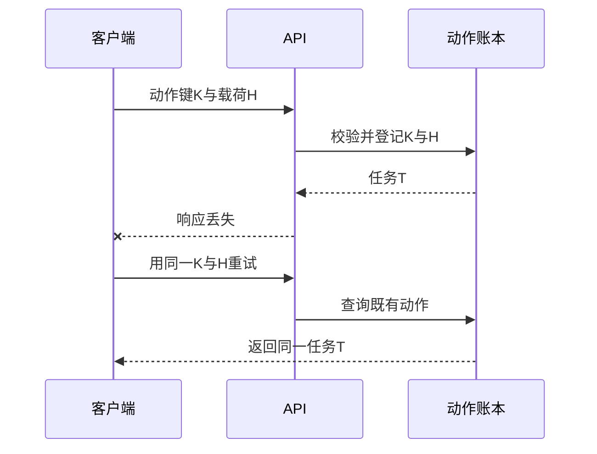

# 第4章　接口契约与跨系统集成

[上一章](03-领域建模模块与服务边界.md) · [本书目录](教材目录.md) · [下一章](05-数据库设计事务与并发正确性.md)

## 1. 目标、前置与问题

前置：第2–3章。能设计包含异常、版本和重试规则的接口。问题：客户端超时后，到底能不能再提交一次？

## 2. 概念与基础

接口契约不仅有路径和字段，还包括身份、输入约束、错误、时限、副作用及兼容规则。同步接口适合即时结果；异步接口先接受任务，再提供状态和结果。HTTP成功受理不等于业务任务已成功完成。

幂等指重复相同操作不产生额外业务效果；不代表代码只执行一次。请求键应绑定租户、主体、操作和载荷摘要；同一键不同内容应报冲突。敏感操作仍需重新检查权限。

## 3. 机制与推导

同步调用给客户端一个容易误解的错觉：没有收到成功，事情就没有发生。实际上网络只能让客户端知道“没有及时拿到响应”。请求可能尚未到达，也可能已经落库而回执丢失。这三种情况对重试的影响不同。

因此接口要表达操作的身份。相同租户、相同动作键、相同载荷应指向同一次业务意图；载荷变化不能沿用旧键悄悄覆盖。服务端仍要校验当前权限与批准，幂等键不是授权凭证。

长任务先返回任务 ID 与受理状态，客户端随后查询结果。`202` 只说明受理，不能显示为已完成。未知结果也不能直接显示失败并引导创建新动作，否则用户可能重复提交。

兼容性同样是行为问题。新增状态 `partial` 虽然通过字符串字段校验，仍可能让旧客户端的穷尽分支崩溃。分页要有稳定排序；错误要有稳定分类；重试要有总次数和截止时间。这些都属于契约。

## 4. 案例逐步推演

为提交模拟报告写一个可执行讨论的契约：身份来自服务端；请求包含 task_id、payload_version 和 idempotency_key；批准绑定同一载荷。首次受理返回任务标识，重复相同请求返回原任务，键相同而内容不同返回冲突。

| 时间 | 服务端事实 | 客户端知道什么 | 正确动作 |
| --- | --- | --- | --- |
| 请求前 | 未登记 | 未执行 | 可发送 |
| 已提交、回执丢失 | 已登记 T | 结果未知 | 用原键查询或重试 |
| 查询回执后 | T 仍存在 | 已受理 | 查询 T 状态 |
| 修改报告后 | 新载荷 H2 | 旧批准不适用 | 重新批准并产生新动作 |

对比一个错误接口：每次 POST 都创建新任务，客户端超时后换键再发。它把同一次意图变成两次操作；即使每个任务内部都“幂等”，也不能避免重复业务效果。

### 4.1 客户端如何根据契约行动

设计响应样本可写为 `{"task_id":"T1","status":"queued","request_id":"R1"}`，它表示已受理，不表示完成。状态查询返回running时保留等待，completed时读取真实结果，failed时按错误类别提示，unknown时引导查询或对账。这里是教学契约样本，实际字段与业务规格统一后再实现。

错误分类也要对应动作：字段错误要求修改输入；未认证要求重新建立会话；无权限不自动重试；暂时依赖失败可在总预算内重试；载荷冲突要求核对意图而非盲目换键。内部堆栈只留在受控日志，客户端保留关联ID。

分页例子同样需要行为约定。若按created_at排序，两条记录时间相同，使用id作为稳定次序；游标表达最后位置，并在每页重新维持授权。它解决位置推进，不自动提供整个数据集的历史快照。期间插入、删除和权限变化如何呈现，要按任务说明。

验证接口不能只拿新服务请求新客户端：让旧客户端读新枚举、让新客户端遇到旧记录，才能看到兼容窗口中的失败。

## 5. 分层练习

先完成：用文档或自己的 API 覆盖四个输入：首次提交、同键同载荷、同键不同载荷、其他租户使用同键。逐项写响应与数据库变化，再让旧客户端读取含未知状态的样本。第7章会把此契约接到持久接收方。

完成后换一个约束或一组输入，解释原决定哪里需要改变。基础任务通过后再做深化；本章不要求把所有扩展同时实现。

## 6. 自测与参考推导

合上正文，复述问题怎样出现、机制为什么有效、哪些条件下仍会失败。再对照下面的诊断检查自己的成果。

完成独立任务后查看诊断

若“超时”后新建任务，先回看未知结果与失败的区别。若同键不同载荷直接返回旧结果，客户端无法发现自己提交了错误内容。若公开详细错误泄露其他租户存在与否，也破坏了契约的安全边界。

## 7. 项目交付与验收

提交一份接口样本，包含成功、冲突、无权限与未知状态；不额外交一套业务规则。后续数据库与消息实验都使用同一动作身份。

验收时由你或同伴用新条件检查，记录输入、实际结果与解释。设计练习以推理和反例判断，代码任务用实际行为检查；涉及用户与商业的结论只使用相应真实证据。

## 8. 迁移与阅读

[HTTP语义标准](https://www.rfc-editor.org/rfc/rfc9110)帮助核对方法与响应含义；可选查阅[HTTP与可靠调用](../python-book/14-外部数据模型、HTTP与可靠调用.md)和[持久状态](../python-book/16-数据库、任务状态、幂等与审批.md)中的实现。

[上一章](03-领域建模模块与服务边界.md) · [本书目录](教材目录.md) · [下一章](05-数据库设计事务与并发正确性.md)
