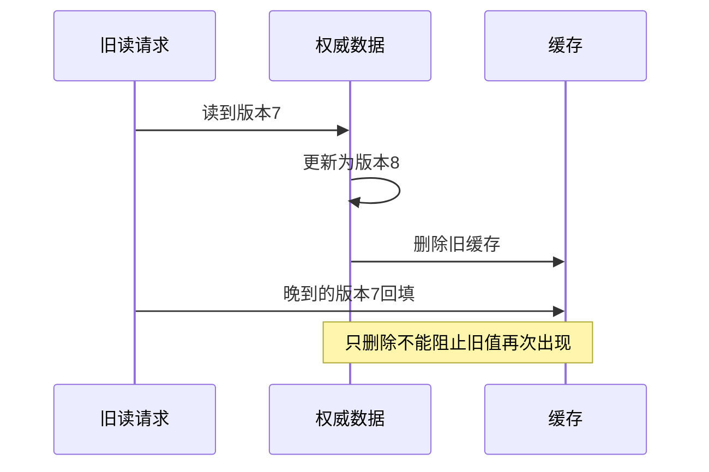

# 第6章　缓存、检索与数据生命周期

[上一章](05-数据库设计事务与并发正确性.md) · [本书目录](教材目录.md) · [下一章](07-消息任务与分布式一致性.md)

## 1. 目标、前置与问题

前置：第5章。能区分事实来源与派生数据，设计失效和重建。问题：数据库已撤销权限，缓存答案为什么仍可能泄露资料？

## 2. 概念与基础

先把制度原文保存在数据库，再把检索结果暂存为缓存。修改原文后，旧缓存可能仍返回旧答案，这说明缓存是从权威记录产生的派生数据。先演示未命中时查询数据库并回填，这叫Cache-aside；再给缓存设置保留时间TTL。到期只约束缓存保留多久，资料撤权仍需要另外设计及时失效。

命中率必须结合正确性和回源代价分析。穿透是大量不存在对象请求反复回源；击穿是热点失效后并发回源；雪崩是大量键或缓存服务同时失效。负缓存、请求合并、过期时间分散和限流各有适用条件，不能掩盖权限错误。

## 3. 机制与推导

缓存和索引都是权威数据的派生视图。它们能减少查询成本，但引入一个新问题：源数据改变后，派生结果什么时候才正确？必须先定义允许陈旧多久、哪些字段绝不能使用陈旧值，再选择策略。

写后删除缓存仍有竞态：请求 A 已读取旧版本7；请求 B 写入版本8并删除缓存；A 随后把7回填。缓存再次出现旧值。TTL 只能限制部分陈旧时间，不能证明立即撤权。

版本键可以避免把7当作8，但查询端还要知道当前有效版本。撤权、删除和批准判定需要在可信执行点校验。这里的即时要求应明确检查发生的时点；已经交付给用户的数据无法靠清缓存收回。

索引重建也要绑定解析配置、分块配置和 embedding 配置。不同维度当然不能混用；即使维度相同，不同模型的空间也不能因形状相同就视为兼容。新索引先验证，再切换，旧索引的保留不代表它可以绕过当前授权。



## 4. 案例逐步推演

DocPilot 更新付款制度。第一步保存新来源版本与生效区间；第二步构建新索引并验证条数、定位与题集；第三步切换查询配置。缓存键包含租户、查询条件、资料集合版本和会影响结果的策略版本。

删除某来源时，先在权威访问路径拒绝读取，再清理索引与缓存。故意让清理失败：只要当前授权检查仍在，用户就不应得到已禁用内容。随后核对后台清理记录，不把“查不到了”当所有副本均已删除。

验收分三类：检索能找到新来源；旧日期仍选到允许保留的历史版本；撤权用户无法从搜索、原文接口和缓存获得片段。它们分别验证知识更新、历史语义和安全，不能用向量数量相等代替。

### 4.1 用一个短程序看到旧值回填

```python
# track-example: A06
source = {"version": 7, "text": "旧条款"}
old_read = dict(source)
source = {"version": 8, "text": "新条款"}
cache = {}                      # 写入后删除缓存
cache["answer"] = old_read      # 较慢的旧请求现在才回填
assert cache["answer"]["version"] == 7
usable = cache["answer"] if cache["answer"]["version"] == source["version"] else None
assert usable is None           # 当前版本检查发现陈旧，不把它当新版
```

最后一行不是免费的一致性方案：它假设你已经从可信路径知道当前版本。如果每次都查数据库，节省了什么成本需要重新测量；如果当前版本也缓存，仍有陈旧窗口。先定义任务允许的窗口，再选方案。

回源保护同样重要。缓存不可用时全部请求同时查询数据库，可能把局部故障扩散。可考虑并发上限、同键合并和有限降级，但旧值能否返回取决于数据性质。普通描述与已撤销授权不是同一类数据，不能统一返回“最后成功值”。

## 5. 分层练习

先完成：手画旧读回填的交错顺序，为资料版本和当前授权分别设计检查点。运行 DocPilot 的日期与租户验收后，再在自己的缓存层模拟“源已更新、清理失败”。写明哪些响应允许陈旧。

## 6. 自测与参考推导

<details><summary>完成独立任务后查看诊断</summary>

若方案只写“TTL=60秒”，还未回答为什么权限可以陈旧60秒。若新旧索引切换后只比较数量，漏块、重复与错租户仍可能隐藏。需要回到权威数据与具体用户任务核验。

</details>

## 7. 项目交付与验收

更新同一份资料生命周期图，标出源、索引、缓存、删除与验证点。下一章用事件传播更新时，继续保留这份一致性要求。

## 8. 迁移与阅读

检索实现可选查阅[Python检索章](../python-book/20-RAG、Embedding、向量库与权限过滤.md)；本章按源与派生数据关系完成独立推导。具体缓存客户端和索引更新保证须按所选产品版本另行验证。

[上一章](05-数据库设计事务与并发正确性.md) · [本书目录](教材目录.md) · [下一章](07-消息任务与分布式一致性.md)
