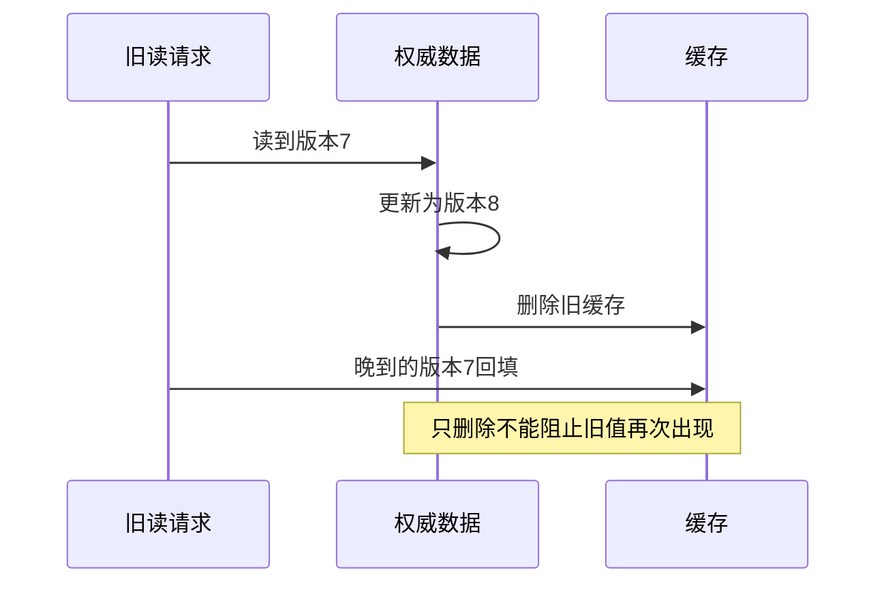

# 第6章　缓存、检索与数据生命周期

[上一章](05-数据库设计事务与并发正确性.md) · [本书目录](教材目录.md) · [下一章](07-消息任务与分布式一致性.md)

## 1. 目标、前置与问题

前置：第5章。能区分事实来源与派生数据，设计失效和重建。问题：数据库已撤销权限，缓存答案为什么仍可能泄露资料？

**本章主线：** 先识别谁是权威数据、谁是派生数据，再观察缓存命中和旧值回填，最后把版本、授权和索引重建放进同一张生命周期图。

## 2. 概念与基础

### 2.1 权威数据与派生数据

**权威数据**是系统约定最终以它为准的记录，例如制度原文及其生效区间。**派生数据**是为了更快读取而从权威数据计算出来的副本，例如检索结果、摘要和缓存答案。

两者出现分歧时，不能因为缓存读取更快就把缓存当权威。比如数据库已把付款上限从30%改为20%，缓存仍保存30%，此时30%只是旧派生物，不是新事实。

| 数据 | 角色 | 更新后怎样处理 |
| --- | --- | --- |
| 制度原文、版本、生效日期 | 权威数据 | 在可信写入路径保存并提交 |
| 搜索索引 | 派生数据 | 按版本重建、验证后切换 |
| 问答缓存 | 派生数据 | 失效、重建，并检查版本与授权 |
| 已交付给用户的页面 | 已交付结果 | 无法靠清缓存收回，只能阻止后续读取 |

### 2.2 Cache-aside：先查缓存，未命中再查数据库

Cache-aside 是一种“调用方负责读取和回填”的缓存用法。读请求先查缓存；命中就返回；未命中就查权威数据，再把结果写入缓存。

```python
source = {"version": 8, "text": "预付款上限为20%"}
cache = {}
key = "doc-7"

def read_answer():
    value = cache.get(key)
    hit = value is not None
    if not hit:
        value = dict(source)
        cache[key] = value
    return hit, value

first_hit, first_value = read_answer()
second_hit, second_value = read_answer()
print("第一次:", first_hit, first_value)
print("第二次:", second_hit, second_value)
```

输出：

```text
第一次: False {'version': 8, 'text': '预付款上限为20%'}
第二次: True {'version': 8, 'text': '预付款上限为20%'}
```

第一次查询走了“未命中→查数据库→回填”；第二次查询才直接命中。代码用 `None` 表示未命中，因此缓存值本身不能是 `None`，否则每次都会回源。

写请求通常更新数据库，再删除相关缓存，让下一次读取重新回填。这叫“写后删除”，不是把缓存和数据库放进同一个事务。第3节会说明它为什么仍可能返回旧值。

### 2.3 TTL、命中率与三种典型故障

TTL（Time To Live）是缓存项允许保留的时间。它解决“旧副本最多留多久”，不自动解决“撤权后立刻不能读”。例如普通介绍可以陈旧5分钟，已撤销的权限却应在当前请求中立即检查。

- **命中率**：命中次数÷读取总次数。命中率高说明回源少，但不能证明结果正确。
- **穿透**：大量不存在的键反复未命中，请求都落到数据库。可对确实不存在的对象短期使用负缓存，但要防止攻击者制造大量负缓存。
- **击穿**：一个热点键失效后，大量并发同时回源。可按同一个键合并回源请求，只让一个请求查数据库，其余等待结果。
- **雪崩**：大量键同时失效，或缓存服务整体不可用，回源压力突然放大。可分散过期时间、限制并发，并准备有界降级。

| 故障 | 典型现象 | 首选动作 | 不能替代的检查 |
| --- | --- | --- | --- |
| 穿透 | 不存在对象反复回源 | 负缓存、参数校验 | 权限与对象是否存在 |
| 击穿 | 单热点并发回源 | 同键请求合并、互斥回填 | 热点数据版本 |
| 雪崩 | 大量请求同时回源 | 过期时间加抖动、限流 | 故障范围与降级策略 |

“负缓存”也要带较短TTL。对象刚创建就被缓存为“不存在”，会让新数据延迟可见；因此它只适合确实不存在的对象，并要限制数量与有效期。

陈旧正向结果的处理是另一件事：对象已经撤权，却继续返回旧值，可能造成泄露。保护数据库和保护授权不能混为一谈。

### 2.4 缓存键必须能说明结果属于谁

一个只包含文档ID的键，可能把不同租户、不同生效日期或不同检索策略的结果混在一起。缓存键至少要能回答：

- 这份结果属于哪个租户和用户权限范围？
- 查询条件、文档版本和生效日期是什么？
- 分块、embedding和重排策略的版本是什么？
- key里能否放入敏感信息？若不能，应使用不可逆摘要并保留必要的隔离字段。

改变任何会影响答案的输入，都可能使旧缓存不再适用。先列清楚“答案由哪些输入决定”，再设计键，比上线后凭经验加字段可靠。

## 3. 机制与推导

### 3.1 为什么“写后删除”仍会回填旧值

假设请求A读取数据库时得到版本7，但响应较慢；请求B随后把数据库更新为版本8并删除缓存；A最后才把版本7写入缓存。删除动作已经发生，旧值却再次出现。



这是**交错执行**造成的竞态：每个步骤单独看都正确，组合顺序却产生旧结果。把TTL从60秒改成1秒，只能缩短部分陈旧窗口，不能证明撤权立即生效。

### 3.2 版本检查与授权检查不是一回事

版本检查回答“这份副本是否对应当前查询目标版本”；授权检查回答“当前用户此刻是否有权读取”。资料版本没变，权限也可能已撤销；用户有权限，也不代表可以读取错误版本。

查询最新制度时，目标版本就是当前最新版本；查询历史日期时，目标版本可能是版本7，即使最新版本已经是8。因此不能只用“是否等于最新版本”判断所有查询。

```python
cached = {"doc_id": 7, "version": 7, "text": "旧条款"}
current_version = 8
target_version = current_version
user_can_read = False

version_ok = cached["version"] == target_version
usable = cached if version_ok and user_can_read else None
print({"target_version": target_version, "version_ok": version_ok, "user_can_read": user_can_read, "usable": usable})
```

输出：

```text
{'target_version': 8, 'version_ok': False, 'user_can_read': False, 'usable': None}
```

这个判断要求 `current_version` 和 `user_can_read` 来自可信路径。如果把它们也放进同一份可能陈旧的缓存，只是把问题推迟一层。即时撤权应明确检查时点：搜索前、返回片段前，还是打开原文前。已经交付的数据无法靠清缓存收回。

### 3.3 索引重建也要绑定版本

搜索索引不是原始文档的简单复制，它依赖解析、分块和embedding配置。重排属于查询检索流程，不参与索引构建，但会影响最终返回结果。不同模型的向量即使维度相同，也未必处在同一空间，不能直接混用。

一次安全切换可按以下顺序进行：

1. 固定新来源版本与完整配置版本。
2. 构建新索引，不直接覆盖正在服务的旧索引。
3. 用题集验证召回、定位、日期语义和租户隔离。
4. 核对租户、权限、数量、重复块和关键来源，不能只比较向量总数。
5. 切换查询配置，并保留可回退路径。
6. 删除来源时先在权威访问路径拒绝，再清理索引和缓存，并记录清理失败。

切换索引不代表可以绕过授权。旧索引即使保留用于回退，也不能在权限撤销后继续对外提供片段。

## 4. 案例逐步推演

DocPilot更新付款制度。第一步保存新来源版本与生效区间；第二步构建新索引并验证条数、定位与题集；第三步切换查询配置。缓存键包含租户、查询条件、资料集合版本和会影响结果的策略版本。

删除某来源时，先在权威访问路径拒绝读取，再清理索引与缓存。故意让清理失败：只要当前授权检查仍在，用户就不应得到已禁用内容。随后核对后台清理记录，不把“查不到了”当所有副本均已删除。

验收分三类：检索能找到新来源；旧日期仍选到允许保留的历史版本；撤权用户无法从搜索、原文接口和缓存获得片段。它们分别验证知识更新、历史语义和安全，不能用向量数量相等代替。

### 4.1 用一个短程序看到旧值回填

```python
# track-example: A06
source = {"version": 7, "text": "旧条款"}
old_read = dict(source)
source = {"version": 8, "text": "新条款"}
cache = {}
cache["answer"] = old_read
assert cache["answer"]["version"] == 7
usable = cache["answer"] if cache["answer"]["version"] == source["version"] else None
assert usable is None
```

这段程序模拟A先读旧值、B更新源数据、A最后回填。第4行证明缓存里确实出现旧值，第6行说明读取端可以用目标版本发现它。本例查询最新版，所以目标版本等于当前最新版本8；历史查询应使用历史日期对应的目标版本。

最后一行不是免费的一致性方案：它假设你已经从可信路径知道当前版本。如果每次都查数据库，节省了什么成本需要重新测量；如果当前版本也缓存，仍有陈旧窗口。先定义任务允许的窗口，再选方案。

### 4.2 从命中到故障：依次改变一个条件

先用2.2的程序连续读取两次，第二次应命中；再把 `source` 改为版本9但忘记删除缓存，观察读取仍返回8；最后删除缓存并让读取回源，才得到9。

接着模拟热点：让10个请求同时发现同一个键未命中。如果没有同键合并，就会产生10次数据库读取；如果只允许一个请求回填，其他9个等待同一个结果。这里要验证的是回源次数，而不仅是接口是否最终返回。

缓存不可用时，普通介绍可以按约定返回有限降级；已撤权的资料不能统一返回“最后成功值”。是否允许陈旧，必须按数据性质和业务后果决定。

## 5. 分层练习

1. **基础**：手画3.1节的旧读回填交错顺序，分别标出版本检查和授权检查的位置。
2. **改造**：给缓存键加入租户、文档版本和策略版本，并写出一项“每个字段缺失会导致什么错误”。
3. **独立**：模拟“源已更新、删除缓存失败、旧读随后回填”，说明用户看到什么、系统记录什么、怎样恢复。

运行DocPilot的日期与租户验收后，再在自己的缓存层注入故障。不要只记录“接口返回200”，要记录返回的数据版本和授权判断结果。

## 6. 自测与参考推导

<details><summary>完成独立任务后查看诊断</summary>

- 若方案只写“TTL=60秒”，还未回答为什么权限可以陈旧60秒。
- 若把版本检查和授权检查合并成一个布尔值，就无法区分资料过期与权限撤销。
- 若新旧索引切换后只比较数量，漏块、重复与错租户仍可能隐藏。
- 若允许旧值降级，先说明哪些数据允许陈旧、陈旧多久、由谁承担后果。

</details>

**自问：** 为什么缓存命中率100%仍可能泄露资料？

**参考推导：** 缓存可能保存着已撤销授权的旧答案，而且所有请求都命中它。命中率只衡量是否访问缓存，不衡量结果是否仍有效。需要版本、授权和失效机制共同保证正确性。

## 7. 项目交付与验收

更新同一份资料生命周期图，标出源、索引、缓存、删除与验证点。下一章用事件传播更新时，继续保留这份一致性要求。

| 操作 | 预期结果 | 应保留的证据 |
| --- | --- | --- |
| 更新来源并重建 | 当前日期检索到新版本 | 来源版本、配置版本、题集结果 |
| 查询历史日期 | 命中允许保留的历史版本 | 日期条件、生效区间、返回版本 |
| 撤销用户权限 | 搜索、缓存、原文接口均拒绝 | 当前授权结果与各入口响应 |
| 删除缓存并重新读取 | 从权威数据取得新值 | 删除前后版本与回源记录 |
| 让清理失败 | 对外读取仍被授权检查阻断 | 清理错误、阻断结果、待重试项 |

## 8. 迁移与阅读

### 8.1 一页知识地图

**本章主问题：** 数据库已撤销权限，缓存里的答案为什么仍可能泄露资料？

**一条主线：**

```text
权威数据 → 派生视图 → 允许陈旧的窗口 → 失效与撤权的检查点
```

**三个关键词：** 派生数据、陈旧窗口、版本键。派生数据只有绑定版本才谈得上正确，TTL只约束时间，不替代撤权检查。

**最容易错：**

- 只写“TTL=60秒”，没回答权限为什么可以陈旧60秒。
- 以为写后删缓存就够了，晚到的旧读仍把版本7回填。
- 把版本检查当授权检查，忽略用户权限已经变化。
- 新旧索引只比数量，漏块、重复与错租户仍被隐藏。
- 把维度相同当成embedding空间兼容。

**与前后章：** 上一章的事务边界说明哪些写是原子的；下一章把资料更新改成事件传播，仍要保留这里的一致性要求。

**学完应能：**

- 画出旧读回填的交错顺序，标出版本检查与授权检查两个点。
- 列出缓存键里的租户、查询条件、资料版本与策略版本。
- 按新来源可检索、旧日期选历史版本、撤权不可得三类分别验收。

检索实现可选查阅[Python检索章](../python-book/20-RAG、Embedding、向量库与权限过滤.md)；本章按源与派生数据关系完成独立推导。具体缓存客户端和索引更新保证须按所选产品版本另行验证。

[上一章](05-数据库设计事务与并发正确性.md) · [本书目录](教材目录.md) · [下一章](07-消息任务与分布式一致性.md)
