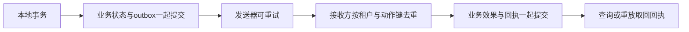

# 第7章　消息、任务与分布式一致性

[上一章](06-缓存检索与数据生命周期.md) · [本书目录](教材目录.md) · [下一章](08-性能分析容量与成本.md)

## 1. 目标、前置与问题

前置：第4–5章。能分析丢失、重复、乱序和跨系统部分成功。问题：本地已提交，事件却没发送，系统如何恢复？

## 2. 概念与基础

先保存“任务T1已完成”，再发通知。若数据库提交后进程停止，通知可能没发出；若发送成功但回执丢失，重试又可能重复。这两种失败分别说明需要可靠待发记录与消费去重。先沿提交、发送、确认三个时刻推演，再学习Outbox与投递语义，检查哪些效果仍需幂等或对账。

Outbox在一个数据库事务中保存业务状态和待发事件，再由发送器投递。消费者可以在本地事务内保存已处理事件标识和业务修改。对外部副作用仍需幂等或对账。死信保存多次失败的任务，不是故障自动消失。

## 3. 机制与推导

消息队列没有消灭失败窗口，而是把它们显式化。业务已提交但消息未发送，会漏通知；先发消息再提交，可能通知一个从未成立的业务事实。将业务状态与待发送事件写入同一个本地事务，可以避免这两者分离，这就是 outbox 的基本作用。

发送器仍可能发成功后崩溃，因未记确认而再次发送。消费者也可能落库成功后丢失确认。因此“至少一次”处理需要可重放，接收方按稳定动作键保存效果与回执。重复代码执行可以发生，业务效果是否重复取决于执行点保护。

跨系统补偿是新的业务动作，不能假定能撤回邮件或已经发生的交易。若远端既无幂等键也无状态查询，结果未知时就需要人工对账或改变业务流程，不能靠本地 checkpoint 宣称恰好一次。

事件表示已经发生的事实，命令请求执行可能被拒绝的动作。两者都要有身份、资源版本和兼容规则。乱序事件应防止旧版本覆盖新版本；重放也要判断旧动作是否仍适用。



分布式锁也不自动保证这一点：租期到期的旧执行者可能仍在运行。关键存储需能拒绝陈旧版本或 fencing token，不能只检查曾经拿到锁。

## 4. 案例逐步推演

按四个时刻推演提交报告：

| 中断位置 | 已经成立的事实 | 恢复动作 |
| --- | --- | --- |
| 本地事务前 | 无批准动作记录 | 重新开始并校验 |
| outbox提交后、发送前 | 动作待发送 | 发送同一动作键 |
| 远端提交后、响应丢失 | 远端可能已有效果 | 原键查询或幂等重试 |
| 回执已保存后 | 双方结果可对账 | 返回原回执 |

用[学习者验收](../../tests/learner/练习说明.md)实现一个本地模拟接收方。`fail_after_commit=True` 故意在效果提交后抛错，再次调用必须取回同一回执，效果行数仍为1。这里模拟远端的数据库，就是副作用的实际执行点。

然后对照已有 `uv run --frozen python -m practice.architecture_labs.idempotency_sqlite`。两份实现都验证局部机制；把它接到真实远端时，还需验证对方的键保留时间、查询语义和故障行为。

### 4.1 把接收方练习写成一条可检查流程

学习者接口 `submit` 的第一步不是查旧结果，而是确认当前可信批准摘要与载荷相符；随后在短事务内查询租户与动作键。若已经存在同摘要效果，返回原回执；若摘要不同，报冲突；若没有记录，同事务写入效果与回执。

`fail_after_commit=True` 位于事务成功之后。调用方收到异常，接收方却已有一条效果。再次执行用相同键查回原回执。这正是“客户端观察”和“服务端事实”分离的地方，不是测试框架假装失败。

将它接到发送器时，本地outbox保存待发送动作与稳定键；接收方保存效果；本地回执只是对账结果。三者不能用一个内存status代替。远端键的保留窗口、重放窗口和动作业务有效期也应协调。

队列增长时，先看最老任务年龄、生产率、处理率与重试；增加消费者之前核对下游限额和顺序约束。若旧版本事件晚到，按资源版本拒绝覆盖；若补偿不可逆，进入人工流程并保留事实。

## 5. 分层练习

先完成：实现 approval_starter 的两个函数，运行审批契约；再手画 outbox 发送器在“已发但未记”时如何恢复。挑战项是去掉接收方去重，解释哪一次中断会产生重复效果。

## 6. 自测与参考推导

<details><summary>完成独立任务后查看诊断</summary>

恢复后流程显示 completed 不足以通过，必须查询实际效果数量与回执。若每次重试生成新 action_id，去重机制形同虚设。若效果与去重记录不在同一原子边界，崩溃仍可能留下重复窗口。

</details>

## 7. 项目交付与验收

提交一份失回执时间线与自己的验收输出，附到同一架构记录。下一章测量正常与重试负载，不将重试流量遗漏。

## 8. 迁移与阅读

### 8.1 一页知识地图

**本章主问题：** 本地已经提交，事件却没发出去，系统靠什么恢复？

**一条主线：**

```text
业务状态与 outbox 同事务 → 可重试发送 → 按动作键去重 → 回执可查、可重放
```

**三个关键词：** outbox、至少一次、去重边界。outbox 消除“已提交未发送”，至少一次允许重复执行，去重边界决定效果是否只发生一次。

**最容易错：**

- 先发消息再提交业务，通知一个从未成立的事实。
- 每次重试生成新 action_id，去重形同虚设。
- 效果与去重记录不在同一原子边界，崩溃留下重复窗口。
- 把 completed 状态当成效果证据，忽略实际效果行数与回执。

**与前后章：** 上一章的资料更新与撤权要求在此变成事件，版本与身份不能丢；下一章测量容量时要把重试与积压算进负载。

**学完应能：**

- 填出四时刻中断表：事务前、提交后未发送、远端提交而回执丢失、回执已存。
- 用 fail_after_commit 验证再次调用取回同一回执、效果行数仍为 1。
- 判断哪种补偿必须转人工对账，并说明理由。

[Kafka设计文档](https://kafka.apache.org/41/design/design/)可用于核对日志和投递机制；[Outbox模式](https://microservices.io/patterns/data/transactional-outbox.html)用于延伸设计。

[上一章](06-缓存检索与数据生命周期.md) · [本书目录](教材目录.md) · [下一章](08-性能分析容量与成本.md)
