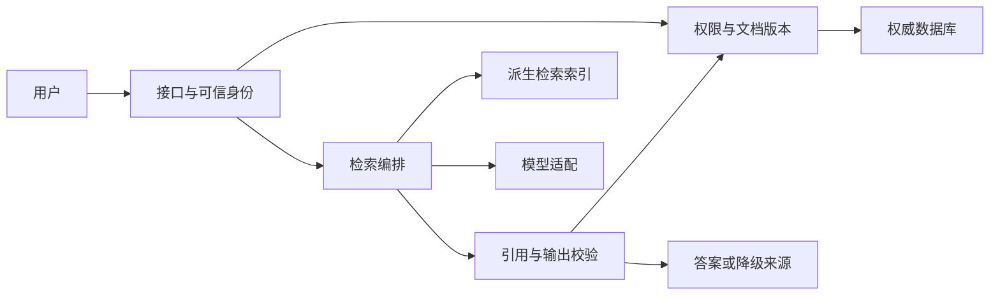

# 完整案例：DocPilot从约束到演进

[本书目录](教材目录.md) · [工作簿](附录A-工作簿与模板.md)

以下是虚构教学设计及参考推演，不是已实现架构或实测报告。先完成自己的版本，再比较差异。不同约束可以产生不同合理答案。

## 一、提出约束，而不是先选组件

假设两个开发者为三个采购团队提供制度查询，资料经授权，用户需要可追溯来源。初期不执行采购写操作；文档由指定负责人更新；预算有限；模型可能不可用。

未知项包括文档规模、访问频率、部署限制和错误后果。下一步询问资料负责人、采集授权样例并测量检索基线。团队数不直接推出吞吐量，不能据此填写并发承诺。

| 场景 | 预期行为 | 验证 |
| --- | --- | --- |
| 正常查询 | 只基于当前可访问来源，引用能回查 | 固定问题与来源人工复核 |
| 模型超时 | 返回授权检索来源及降级提示 | 注入依赖超时，核对响应与日志 |
| 撤销访问 | 撤权生效后不能继续获得内容 | 缓存命中、索引滞后及旧链接测试 |
| 导入失败 | 保留状态与错误，旧版本行为明确 | 解析/索引中断后恢复 |

## 二、画同层级图，再跟踪请求

下面是逻辑组件图，可先运行在同一API进程，不能据图声称已拆成多个服务。



一次查询：入口确定主体；按当前权限和文档版本形成过滤；检索来源；模型生成候选答案；校验引用能定位且当前主体仍可访问；返回结果及状态。若权限可在查询期间变化，要明确最终检查与生效语义。模型输出不能修改身份和可见范围。

## 三、一份可被替代的ADR

```text
ADR-001：初期采用模块化单体
状态：教学设计；尚待实测
背景：两人维护，单一产品流程，未知实际瓶颈
A：单体模块化，资源共享，部署与调试较简单
B：独立服务，隔离更强，需要网络、部署与跨服务治理
决定：先A；保持documents/retrieval/model_adapter边界
代价：导入可能影响查询；进程扩缩影响多个模块
验证：同数据下对照查询负载与混合导入负载
复查：实测目标受资源争抢影响，或有独立隔离约束
回退/演进：先隔离后台执行，再评估独立部署
```

若客户要求文档处理与模型出口有严格独立网络边界，初始选择可能改变。这说明约束优先，示例不是通用标准答案。

## 四、数据、版本与状态

权威存储记录文档ID、租户、来源版本、可见范围、导入状态与更新时间；索引保留稳定来源标识，允许重建。一个文档版本可经历received→parsing→indexing→ready，失败保留阶段，重试记录attempt。旧版本何时停止可见由产品和业务规则确认。

更新流程先写新版本、解析与构建派生数据，验证后切换当前版本。重试使用稳定标识避免重复片段。撤权先执行可信读取限制，再清理索引和缓存；不能等待TTL自然到期才满足立即撤权。

若加入报告写操作，另建动作账本与批准：批准绑定报告版本；本地事务保存动作和outbox；远端使用同一动作键；未知结果对账。该流程不能靠数据库事务自动覆盖外部系统。

## 五、容量与可靠性推演

教学假设20请求/秒，平均端到端1.5秒，稳态约30在途；该估计只用于预算起点。要进一步测量排队、P95、错误率、资源与外部限额；模型速率限制还可能按token而非请求计算。

假设有效查询月目标成功99.5%，分母为授权且输入有效的查询。10万请求对应500次失败预算；另记录延迟目标及安全护栏。降级是否算成功必须预先定义，不能为了指标好看把所有降级都算完整成功。授权失败是否排除也应记录，避免遗漏系统错误拒绝的正常用户。

## 六、演练与发布

按顺序演练依赖超时、权限撤销、导入中断、服务重启和备份恢复。每项记录前置、输入、观察、状态、恢复、限制，不仅检查HTTP返回码。

新增索引配置时并行构建新版本，比较检索、来源和权限；使用受控切换与回退。数据库先增加兼容字段、回填校验，再切新读路径；旧实例退出后才收缩。回滚代码不会撤销已写出的外部报告。

## 七、参考结论怎样表达

可以说：在明确假设下选了单体，识别出资源隔离和权限的关键风险，提出对照与恢复实验。只有实际运行后，才能补充对应环境、数据和结果。尚未完成的负载、安全和供应商集成保持待验证。

答辩追问：若团队增多但流量没变，为何拆服务？若检索效果差，为何先增加Agent？若权限撤销后旧缓存仍命中，哪里应拦截？答案应回到约束、失败点和证据。
