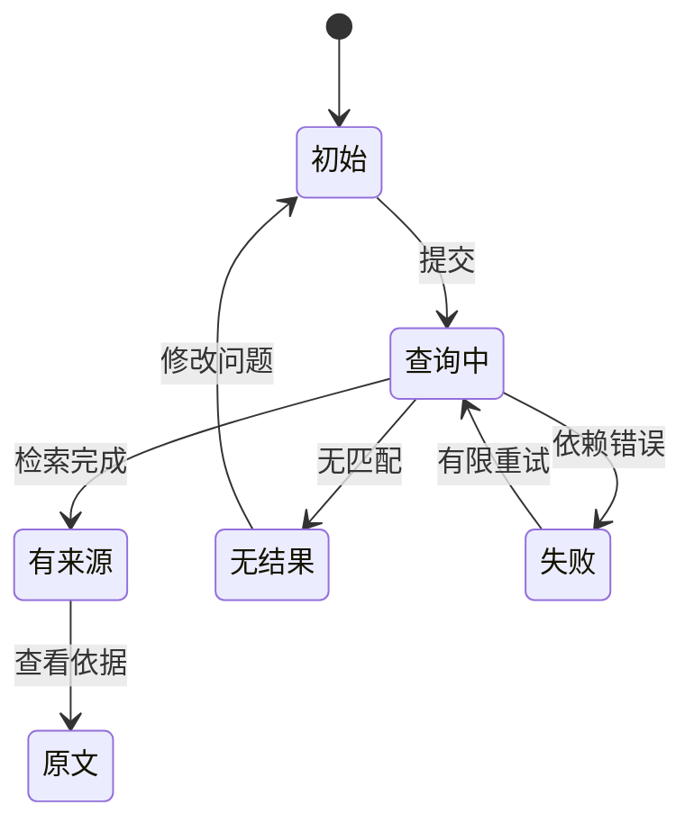

# 第5章　交互设计、可用性与无障碍

[上一章](04-需求优先级产品规格与路线图.md) · [本书目录](教材目录.md) · [下一章](06-全栈开发与最小产品交付.md)

## 1. 目标、前置与问题

前置：第4章。能画完整任务流程并进行可用性测试。问题：回答内容正确，用户为什么仍不知道下一步做什么？

## 2. 概念与基础

信息架构决定内容组织，交互设计决定用户动作与系统反馈。用户需要知道当前状态、可做动作及结果。空状态、加载、失败、无权限和恢复与成功页面同样重要。

无障碍关注不同能力和设备的访问：语义化结构、键盘操作、焦点、表单标签、对比度及辅助技术。颜色不能成为唯一状态标识。无障碍需在设计和实现中验证，不只在交付前加检查表。

## 3. 机制与推导

交互设计先决定用户怎样理解状态，再决定颜色与组件。用户需要知道当前做了什么、系统正在做什么、结果是否可用、失败后还能怎样继续。只画成功页，会把最需要帮助的情境留到开发时猜。

先画任务流和信息层级：问题与日期在输入区；回答与证据分层；版本和定位贴近来源；缺口与下一步明确展示。不要让用户记住上一页的关键限制。高后果动作要展示实际对象和内容版本。



原型测试给目标，不给点击步骤。观察是否完成、在哪里停顿、误解了什么、是否求助。少量用户可以揭示具体问题，但不能据此计算总体成功率。窄屏、键盘、标签与焦点关系也要在关键路径中检查。

## 4. 案例逐步推演

先画文字线框：顶部是“业务日期”和问题表单；中部是结果状态；下面每个来源显示标题、版本、生效区间、命中片段和“打开原文”；底部是“这次是否找到依据”的反馈。

| 状态 | 文案和可用动作 |
| --- | --- |
| 加载 | 显示查询中，保留输入，避免重复提交 |
| 无结果 | 说明当前范围未找到，允许改日期或问题 |
| 生成失败 | 保留来源，说明摘要暂不可用 |
| 会话失效 | 提示重新登录，说明输入如何保留 |
| 来源不再可访问 | 清楚反馈，不继续展示缓存正文 |

给测试者任务：“请找到6月30日适用的付款限制，并指出原文。”不告诉他选日期按钮。若他只读摘要就报告完成，检查来源层级和日期文案；如果点不开原文，先修任务阻断，再讨论美观。

### 4.1 从文字线框到可观察行为

```text
业务日期 [2026-07-01]   问题 [预付款上限是多少？]
[查询]
状态：找到2条可访问来源；摘要需人工核对

付款制度  版本2  2026-07-01起适用
命中原文：预付款比例不得超过合同金额的20%。
[查看原文]  [这次找到依据了]  [仍有问题]
```

来源信息要靠近结论，而非藏在难找的脚注。无证据时不显示一份看起来确定的答案；加载时保留输入和取消或等待反馈；状态变化用清楚文字表达，不只用红绿颜色。

测试脚本只给情境：“你正在核对6月30日的材料，找到适用条款并指出依据。”记录是否主动修改日期、是否打开来源、是否看见版本、是否误把当前日期当业务日期。把观察写成行为，而非“用户不够认真”。

键盘检查按真实Tab顺序走：输入、日期、提交、来源、返回；焦点应可见，表单有标签，错误能与字段关联。窄屏要保留关键内容，不能用横向滚动掩盖主要动作。

## 5. 分层练习

先完成：画三张低保真状态图：有结果、无结果、依赖失败。让一人独立做一道新任务，记录实际点击、停顿和求助。只选一个主要阻断修改，再用同等任务复测。

## 6. 自测与参考推导

<details><summary>完成独立任务后查看诊断</summary>

若测试时不断提示点击，测到的是你的讲解能力。若用户说好看却不能找对版本，任务仍未完成。如果错误页只写“出错了”，缺少可行动反馈。

</details>

## 7. 项目交付与验收

保存 `product/flow.md` 的流程、状态和一次观察记录。下一章按同一状态表开发纵向切片。

## 8. 迁移与阅读

[W3C无障碍基础](https://www.w3.org/WAI/fundamentals/accessibility-intro/)和[MDN无障碍实践](https://developer.mozilla.org/en-US/docs/Learn_web_development/Core/Accessibility)用于深入实现。

[上一章](04-需求优先级产品规格与路线图.md) · [本书目录](教材目录.md) · [下一章](06-全栈开发与最小产品交付.md)
