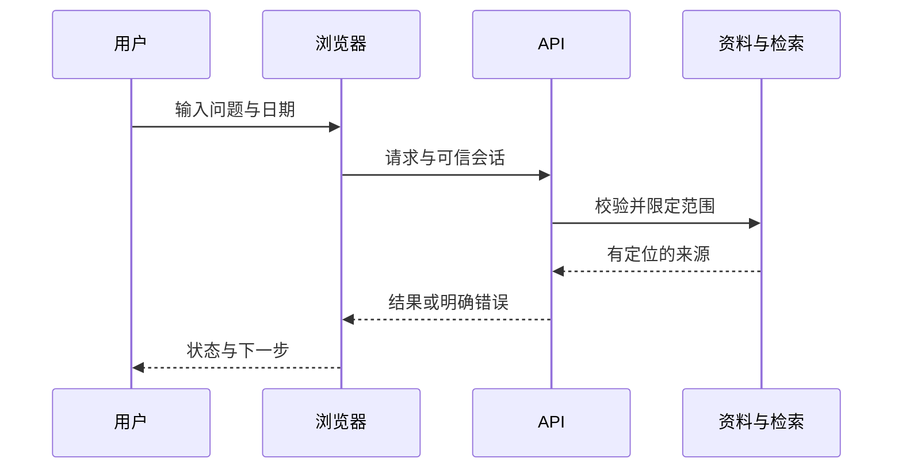

# 第6章　全栈开发与最小产品交付

[上一章](05-交互设计可用性与无障碍.md) · [本书目录](教材目录.md) · [下一章](07-指标埋点漏斗与留存.md)

## 1. 目标、前置与问题

前置：第4–5章和基本后端能力。能把产品规格转成可使用的纵向切片。问题：API全部通过测试，为什么用户仍无法完成任务？

## 2. 概念与基础

先做一条可点击的查询路径：HTML提供输入框和按钮，CSS安排布局与可读性，JavaScript读取问题并向服务端请求结果。再分别显示等待、回答、无依据和失败。完成这条路径后，才考虑组件拆分与框架；先能解释浏览器如何发请求、服务端如何授权，以及结果怎样回到界面。

用户态至少区分未登录、加载、成功、空结果和失败。服务端是权限与业务规则的最终执行点。浏览器不能保存服务端密钥；采用Cookie认证需考虑CSRF，令牌方案同样需要安全存储与失效设计，不能套用一个万能方案。

## 3. 机制与推导

全栈的最短路径是把一项任务从浏览器接到可信数据，再把结果和失败交回用户。HTML 提供语义与表单，CSS 安排布局和窄屏，JavaScript 处理事件、状态和请求，服务端负责校验、授权、规则与持久化。框架建立在这些机制上。

从纵向切片开始：先让输入问题、授权搜索、展示来源与打开原文一起工作。若先完成所有页面再写所有接口，直到最后才会发现字段、错误和身份契约不一致。切片越早联通，越早暴露真正断点。

浏览器校验改善反馈，服务端仍必须校验。请求后要检查 HTTP 状态；旧请求晚到不能覆盖新问题结果。重复点击、断网、刷新、取消和会话过期都需要明确行为。AI 可以生成代码，但你应能沿这条链解释并修改它。

团队内不要求每人精通每层；独立首版至少要能实现、排错与发布这一条完整路径。保持后端深度，再逐步补界面与运行能力，比同时学习多个前端框架更容易形成交付。

## 4. 案例逐步推演

先运行[现有全栈切片](附录E-全栈产品交付实操.md)，它用于观察浏览器与接口的关系。接着按任务逐层修改：

| 层 | 本次修改 | 如何确认 |
| --- | --- | --- |
| 页面 | 增加业务日期与来源版本 | 窄屏和键盘可操作 |
| 请求 | 发送 question 与 as_of | 网络面板查看请求与错误 |
| 服务 | 身份由服务端取得 | 请求体不能指定其他租户 |
| 核心 | 日期过滤与证据定位 | 自己模块通过 DocPilot 契约 |
| 运行 | 新进程启动同一版本 | 关键路径可复现 |

把生成留到这条搜索路径通过之后。真实登录、数据库和模型分别接入并验收，不把教学固定身份当生产认证。每接一层，重新运行原有正常与失败样本。

### 4.1 沿运行切片逐层建立全栈模型

可先运行第23章的[累计核心与HTTP切片](../python-book/23-项目实战一：DocPilot从零到检索系统.md#45-将同一个核心接到http而不是重写业务)。它让你的核心进入真实HTTP边界；现有全栈附录用于学习浏览器表单与状态。二者分别验收核心、协议和用户路径，不将教学令牌视为真实登录。

浏览器事件处理先读取字段、显示加载、发出请求，再判断HTTP状态并解析响应。渲染证据时把不可信文本作为文本内容，不直接拼成可执行HTML。连续查询给请求编号或取消旧等待，只有最新请求更新当前结果。

后端收到请求先确定可信身份，再校验输入和范围，调用同一search或answer；Timeout与无证据返回不同状态。把数据库接入时，保留核心契约并增加持久化集成，不把所有逻辑塞进路由。

这条路径形成学习顺序：原生HTML表单与CSS布局→JavaScript状态与fetch→一个框架的组件化→服务端接口→数据库与迁移→部署与观察。每层用当前任务练，不同时开启多套框架教程。

## 5. 分层练习

先完成：完成同一个搜索切片，保存一次成功、一次无结果和一次服务失败。让第二次查询先返回、第一次后返回，检查界面不会被旧响应覆盖。再从新会话完成同一任务。

## 6. 自测与参考推导

完成独立任务后查看诊断

若前端只在 catch 中处理错误，检查4xx/5xx是否被误当成功。如果必须手动修改多个文件才能启动，配置没有集中。如果浏览器可改租户，接口尚未建立可信身份边界。

## 7. 项目交付与验收

交付可运行切片与最短启动说明，更新 `product/spec.md` 的已实现范围。下一章只对这条真实路径定义事件与成功。

## 8. 迁移与阅读

[MDN核心学习](https://developer.mozilla.org/en-US/docs/Learn_web_development/Core)用于补齐前端基础；服务端实现可选查阅[HTTP入口](../python-book/15-FastAPI、接口模型与服务生命周期.md)与[部署](../python-book/17-部署、可观测性与可靠性.md)。

[上一章](05-交互设计可用性与无障碍.md) · [本书目录](教材目录.md) · [下一章](07-指标埋点漏斗与留存.md)
