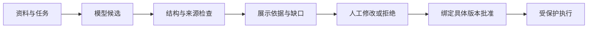

# 第9章　AI产品体验、评估与人工协作

[上一章](08-实验设计与产品迭代.md) · [本书目录](教材目录.md) · [下一章](10-定价单位经济与现金流.md)

## 1. 目标、前置与问题

前置：第5、7–8章及基本模型知识。能把模型能力与风险转成产品边界。问题：模型能生成完整报告，为什么还要人工确认？

## 2. 概念与基础

AI输出具有不确定性，格式、事实、引用和业务可用性是不同维度。用户需要知道来源、适用范围与下一步，避免把流畅语言误当确定结论。

根据后果选择自动化程度：辅助草稿、人工批准后执行、低风险限定自动执行。评价“节省时间”时要计入复核、纠错和返工，不只计生成速度。提示词、模型和资料版本都可能改变体验。

## 3. 机制与推导

AI 体验不是在输出下面加一句“可能出错”。用户需要知道系统依据什么、缺什么、哪里需要复核、怎样改正，以及哪些动作还没有发生。模型输出的流畅程度不能代替业务完成。

首先区分来源真实、引用存在、引用支持结论和结论适用于当前任务。程序可以检查部分结构与逐字位置，但“原文上限20%，回答80%”仍需要规则或语义审核。任意模型自报百分比也不等于经过校准的可靠性。

人工复核需要足够上下文：对应字段、原文、适用日期、修改入口与后续动作。若只是给一个批准按钮，用户可能机械点击。观察是否真正发现错误，而不只统计批准率。

耗时要从开始到完成计算，包含等待、核对和返工。模型生成从十秒变成五秒，如果多出五分钟人工修正，用户结果可能更差。

## 4. 案例逐步推演

构造三条验收题：正常证据写20%；没有付款条款；原文写20%但回答80%。第一条应展示正确依据，第二条不能编出通过结论，第三条即使引用存在也必须判错。

在 DocPilot 引用契约之外，手工给每题标注“是否支持结论、适用对象与日期、应否拒答”。请两人分别评分并讨论分歧，再决定哪些可以自动判。

若升级为 ProcureAgent，修改报告后产生新摘要，旧批准失效。界面显示本次将提交的内容与版本，执行后展示真实回执；“模型说已提交”不算提交成功。

### 4.1 将AI评分拆成能复核的维度

| 题目 | 自动可检查部分 | 仍需规则或人工检查 |
| --- | --- | --- |
| 原文20%，答20% | 引用ID与quote存在 | 条件、对象与日期是否适用 |
| 原文20%，答80% | 引用可能仍通过 | 数值结论错误 |
| 没有付款条款 | 空引用与复核状态 | 是否不当编造结论 |
| 他人来源 | 范围与拒绝 | 页面与日志是否泄露 |
| 工具超时 | 状态与错误分类 | 用户能否继续或转人工 |

每道题保留预期、实际和评分理由。自由问答先让两人独立评一小批，讨论分歧，再决定自动裁判能承担哪些任务。不要把开发题的标签提前送进模型。

界面让用户知道缺什么、看哪段、改哪里；提交前展示最终载荷，修改使旧批准失效。人工复核既是产品体验，也是业务边界，不能用一段免责声明代替。

## 5. 分层练习

先完成：写五道风险分层题，覆盖正常、缺证据、冲突、权限与依赖失败。观察一位测试者能否发现预置错误，记录总完成时间和修改量；若无真实用户，明确为模拟复核。

## 6. 自测与参考推导

完成独立任务后查看诊断

如果自动检查只验证 quote 在原文，就不要把通过率叫事实正确率。如果复核者无法看到原文，批准没有充分信息。如果缺资料被展示成绿色通过，状态含义需要重写。

## 7. 项目交付与验收

提交一份AI任务验收表，链接代码检查与人工评分，并记录各自覆盖范围。下一章把模型和人工支持共同计入成本。

## 8. 迁移与阅读

实现契约回看[原教材AI评测章](../python-book/22-AI评测、提示注入、追踪与成本.md)；本章负责将机制转成用户体验和采用条件。

[上一章](08-实验设计与产品迭代.md) · [本书目录](教材目录.md) · [下一章](10-定价单位经济与现金流.md)
