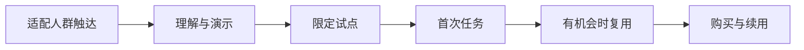

# 第11章　获客、销售与客户成功

[上一章](10-定价单位经济与现金流.md) · [本书目录](教材目录.md) · [下一章](12-运营交付协作与经营边界.md)

## 1. 目标、前置与问题

前置：第3、7、10章。能设计从触达到持续使用的路径。问题：产品发布后没有用户，该改功能还是找渠道？

## 2. 概念与基础

获客包括找到人、建立理解、试用、采用和付费。企业销售还涉及业务负责人、预算、安全审核和采购。渠道可有内容、社区、合作、产品内传播和直接销售，适用性取决于客户习惯及交付成本。

客户成功帮助用户获得预期结果，涉及入门、数据接入、使用支持、反馈与续用。客户购买不等于完成采用；免费试用人数也不等于有效需求。

## 3. 机制与推导

上线可访问、用户理解价值、用户持续采用是三个环节。没有用户时先定位漏斗：人群是否适配、信息是否清楚、试用门槛是否太高、任务是否完成、是否有再次使用的场景。不能把所有问题都交给更多推广。

首轮渠道应贴近已经观察的客户行为。B2B 可能需要使用者、资料负责人、预算与安全共同参与；个人工具可能从内容和社区进入。先小范围测试一个人群与一条信息，记录拒绝，再考虑扩大。

落地页说明面向谁、解决哪个任务、真实结果示例、边界与下一步。没有测过的收益不写成承诺。销售了解购买条件，客户成功帮助采用并反馈系统障碍，二者都需要进入交付成本。

## 4. 案例逐步推演

准备一套可以审阅的发布材料，而不是先群发：一句定位、一张含版本与原文的结果图、两分钟任务演示、支持范围、试点邀请与反馈入口。

虚构渠道记录：联系20个适配团队，8个回应，5个演示，3个完成限定任务，1个进入付费试点。先逐个记录流失原因：没回应可能是渠道，演示不试可能是定位或接入，完成不买可能是预算、价值或采购。

一份试点邀请可以写：“想用已授权样例验证新人能否按业务日期找到适用原文；限定两周，结束后共同核对完成、错误和接入成本。”试点前约定资料负责人、任务、窗口、支持与退出。材料是练习稿，不代表已联系真实对象。

用户愿意但买方拒绝时，分别问预算、风险和收益证据；不要统一降价或把未验证能力承诺出去。

### 4.1 一份没有虚构效果的发布稿

标题：“按业务日期找到可核对的制度原文。”适用对象：“已有资料维护人、需要反复处理制度咨询的小团队。”展示：“输入日期与问题，查看对应版本和命中原文。”边界：“本轮使用授权样例，结果需核对，不代替业务批准。”下一步：“申请限定试点，约定资料范围与观察任务。”

演示先给一个陌生任务，随后展示用户如何查日期、开来源与发现缺口。没有实际测量，不写“效率提升80%”；没有客户评价，不编造证言。

渠道实验只改一个主要变量。例如同一类团队、同一试点范围，比较两种问题表达；记录回应、适配、演示、任务完成与拒绝。首轮样本少时以解释和后续验证为主，不把点击差直接当确定因果。

试点结束要形成决定：继续、缩小、调整购买者或停止。推广材料和产品规格随后按最终范围同步，不留下已经放弃功能的承诺。

## 5. 分层练习

先完成：选一个人群与一个渠道，写发布包和试点计划。模拟或在获得授权后做小批量验证，记录触达、适配、任务完成、复用与拒绝原因；根据一条证据修改信息或入门路径。

## 6. 自测与参考推导

完成独立任务后查看诊断

若只报告浏览量，无法判断是否触达适配用户。如果任务完成率很低，增加流量会放大支持成本。如果试点无限延长却无判断标准，既没有学到采用，也没有验证购买。

## 7. 项目交付与验收

保存 `product/launch.md`：发布包、渠道假设与一份试点记录。下一章明确上线后谁负责维护、故障和退出。

## 8. 迁移与阅读

把本章结果回写第3章定位和第10章成本。增长是可验证的交付过程，不用营销热度替代产品价值。

[上一章](10-定价单位经济与现金流.md) · [本书目录](教材目录.md) · [下一章](12-运营交付协作与经营边界.md)
