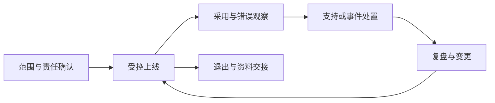

# 第12章　运营交付、协作与经营边界

[上一章](11-获客销售与客户成功.md) · [本书目录](教材目录.md) · [下一章](13-创业路径资源配置与决策.md)

## 1. 目标、前置与问题

前置：第6、9–11章。能安排客户交付、支持与数据责任。问题：只有一个开发者，也需要运维和责任约定吗？

## 2. 概念与基础

运营包括资料更新、账号、计费、支持、故障和反馈；交付明确范围、验收、责任与变更。团队需要知道谁决定优先级、谁处理故障和谁能访问客户数据，即使人员很少。

经营可能涉及合同、知识产权、开源许可、隐私、税务和劳动关系。义务随地区、客户、数据及业务变化；本章教识别需确认的问题，不提供通用法律结论。

## 3. 机制与推导

产品上线后会持续产生工作：资料更新、权限变化、问题反馈、账单、依赖升级和故障。一个开发者可以承担多个角色，但不能让职责消失。对外承诺必须与实际保障匹配。

交付先约定范围和验收，变更再确认成本与时间。客户提出每个特殊需求都接下，可能把产品变成难以复制的实施服务；这并非必然错误，但需要如实计入工作量和定价。

数据责任要具体到来源、用途、访问、保留、导出和删除。客户上传不自动代表有权用于其他目的。涉及真实合同、隐私、许可和税务的义务依地区与事实判断，本书提供核对问题，不给通用结论。

## 4. 案例逐步推演

客户要求导入真实合同。第一步不是上传，而是确认资料负责人、授权用途、处理位置与访问范围；未明确前用虚构数据走流程。再约定谁维护制度、谁复核结果、何时响应问题。

| 事件 | 立即动作 | 需要保存的结果 |
| --- | --- | --- |
| 模型不可用 | 降级到来源，提示限制 | 时间、影响与恢复 |
| 怀疑越权 | 限制影响并通知约定负责人 | 必要审计与处置记录 |
| 资料过期 | 标识或停用，联系维护者 | 更新责任与版本 |
| 试点退出 | 停止访问并按约定交接 | 导出、删除与保留核对 |

一次交接应让第二个人按说明启动测试环境、找到版本、运行关键任务和定位日志。说明必须包含已知限制，不能只写“联系原开发者”。

### 4.1 只有一个人也要有责任分工

| 责任 | 学习期可由谁承担 | 至少检查什么 |
| --- | --- | --- |
| 资料维护 | 你模拟维护者 | 来源、版本、有效区间与更新记录 |
| 发布与恢复 | 你作为开发者 | 版本、迁移、关键任务与备份演练 |
| 用户支持 | 你作为试点联系人 | 反馈入口、范围和已约定响应方式 |
| 业务复核 | 参与任务的适当人员 | 结论依据、缺口和动作载荷 |

一人可以承担多项，但复核职责不因此由模型自动接管。进入真实客户环境时重新约定角色与权限，不把课堂模拟的身份当真实授权。

退出样本包括停止新访问、交接可导出资料、按约定处理索引与缓存、核对备份保留、结清未完成支持与账务。不能只删除登录账号就宣称全部数据已经清除。

每次发布后用新会话走关键任务，并回看采用、错误和工单。持续运行是产品的一部分，不是开发完之后偶尔救火。

## 5. 分层练习

先完成：写一个人的责任表与故障手册，允许一人多角色但标清检查动作。模拟依赖停用或客户退出，沿用户、数据、计费与支持逐项处理，保留需要进一步确认的事实。

## 6. 自测与参考推导

完成独立任务后查看诊断

如果承诺全天响应但没有值守能力，产品承诺与资源冲突。若退出只有删除账号，资料与派生索引可能仍在。若所有客户都需定制，应该重新评估业务形态，而不是把实施时间隐藏。

## 7. 项目交付与验收

保存 `product/operations.md` 的运行、交付与退出说明。下一章用真实工作量重新安排个人资源和下一轮投入。

## 8. 迁移与阅读

[SBA计划入口](https://www.sba.gov/counseling/plan-your-business/)可参考经营结构；不将其美国制度视为本地规则。技术恢复可选读架构教材第9章。

[上一章](11-获客销售与客户成功.md) · [本书目录](教材目录.md) · [下一章](13-创业路径资源配置与决策.md)
