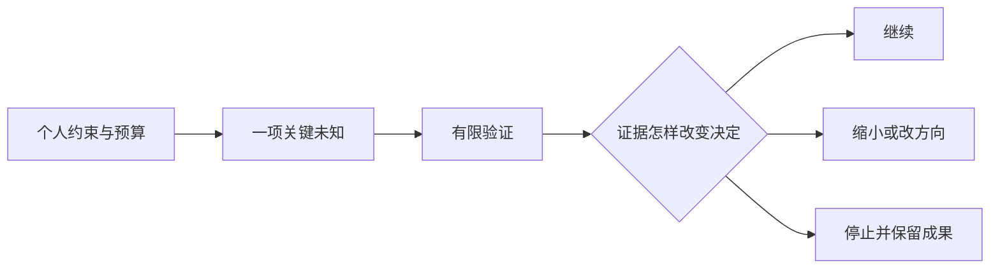

# 第13章　创业路径、资源配置与决策

[上一章](12-运营交付协作与经营边界.md) · [本书目录](教材目录.md) · [下一章](14-综合产品实战与创业验证.md)

## 1. 目标、前置与问题

前置：第3、10–12章。能比较兼职验证、自筹经营和融资等路径，设定学习与经营决策点。问题：有一个好想法，就该全职投入吗？

## 2. 概念与基础

创业路径取决于客户、资金、销售周期、生活约束和个人风险承受。兼职可降低早期资源压力，但受时间及雇佣约定限制；自筹需尽早获得现金；融资会引入增长、治理和资金计划要求。不存在对所有项目最好的路径。

创始人匹配度包括领域、技术、触达、交付与持续兴趣。合伙需要明确职责、决策、投入、知识产权和退出安排，具体约定由适用规则和专业意见落实。

## 3. 机制与推导

创业判断需要把产品证据与个人约束放在同一张表。喜欢技术、已有代码和获得赞美，都不足以说明值得全职投入。至少还要知道谁会持续采用、谁购买、如何交付、需要多少支持，以及自己能承担什么损失。

兼职、自筹和融资是不同资源安排，各有时间、现金、治理与增长要求，不存在默认最佳路线。合伙也不是补一个职位名，需要明确投入、决策、知识产权与退出，具体约定按真实情况落实。

把投入分成有限阶段。每阶段写预算、最危险未知、要获得的证据，以及继续、缩小、改方向或停止的条件。过去投入无法收回，不应成为继续投入的唯一理由。

停止商业尝试不等于技术学习无效；反过来，工程作品完成也不等于商业已经成立。两类目标应分别验收。

## 4. 案例逐步推演

教学资源设定：每周8小时，四周共32小时。分配为访谈与整理10小时、原型8小时、接入可行性6小时、分析4小时、缓冲4小时。此轮不同时承诺完整开发、部署和销售。

继续条件示例：至少找到可观察的反复任务，资料接入可行，目标团队愿意投入试点时间。它们是本轮设定的验证门槛，不是通用创业成功公式。

坏消息：客户必须私有部署且需要持续资料清理。先计算接入和维护是否超出可用资源，再比较缩小客户、提供实施服务、寻找互补伙伴或停止。不能把再买一套工具当作自动解决。

写一页决定：“当前证据支持再投入32小时验证某项采用，不支持辞职或扩团队；若资料仍无法接入则停止此场景。”让资源承诺与证据范围相匹配。

### 4.1 看一份有条件的继续决定

当前事实：完成一个可运行切片，尚无真实持续采用；虚构训练显示版本确认与维护责任可能比自动生成重要。个人约束：每周8小时，仅安排一个有限验证周期。最危险未知：资料接入与负责人配合。

下一轮：先验证资料范围与维护责任，邀请适配对象完成限定任务；不同时承诺完整私有部署、计费和全天支持。继续条件是获得可执行试点与独立任务观察；若仍无法取得合适资料，调整场景或停止。

分别列三个结果。只有称赞：继续发现，暂不扩大开发；有任务采用但支持过重：核算服务与产品边界；有持续采用与真实购买：再评估交付能力和投入。每种结果都不自动意味着应辞职、融资或扩团队。

这份决定的价值在于约束下一步，而不是预测最终成功。下一轮预算应根据新证据重算，不能因已写很多代码就无限延长。

## 5. 分层练习

先完成：列自己的时间与现金上限，安排一个有限验证周期。预先写三条会让你缩小或停止的观察；模拟其中一条发生，更新决定，不用沉没成本解释继续。

完成后换一个约束或一组输入，解释原决定哪里需要改变。基础任务通过后再做深化；本章不要求把所有扩展同时实现。

## 6. 自测与参考推导

合上正文，复述问题怎样出现、机制为什么有效、哪些条件下仍会失败。再对照下面的诊断检查自己的成果。

完成独立任务后查看诊断

若计划只有开发排期，遗漏了研究、接入与支持。若任何结果都被解释为值得继续，门槛没有作用。若将虚构付费样本当真实验证，不能据此作个人重大决定。

## 7. 项目交付与验收

保存 `product/decision.md` 的阶段预算与一次继续或停止判断。最后一章把它与产品作品分开答辩。

验收时由你或同伴用新条件检查，记录输入、实际结果与解释。设计练习以推理和反例判断，代码任务用实际行为检查；涉及用户与商业的结论只使用相应真实证据。

## 8. 迁移与阅读

本章用于安排验证过程；具体雇佣、融资、税务与股权事项需基于实际地区和合同另行确认。

[上一章](12-运营交付协作与经营边界.md) · [本书目录](教材目录.md) · [下一章](14-综合产品实战与创业验证.md)
