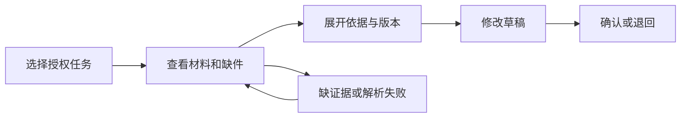

# 完整案例：从采购问题到产品与商业验证

[本书目录](教材目录.md) · [工作簿](附录A-工作簿与模板.md)

以下访谈、样本、数字及决定全部为虚构教学材料，不能用于证明真实市场需求。先做自己的练习，再对照这条推理链。

## 一、从想法改写成可验证问题

初始想法是“做一个采购审查Agent”。角色有采购专员、审批者和资料负责人。先问最近一份报告如何完成，不直接演示模型功能。

| 模拟记录 | 观察与解释 | 下一步 |
| --- | --- | --- |
| 专员R01：常在等证件 | 补件可能是主要阻塞；尚未证明 | 观察经授权的补件过程 |
| 审批者R02：难判断引用是否有效 | 需要版本和来源可追溯 | 看最近一次退回原因 |
| 新人R03：不知道缺什么 | 清单可能比报告生成更有价值 | 测试固定规则清单 |
| 熟手R04：现有表格已够用 | 存在无需新工具的人群 | 比较使用频率与协作规模 |

形成暂定问题：新人在准备审查材料时难识别缺件并找到当前依据。先定位有维护制度负责人、愿意提供授权材料的团队。熟手单人流程可能暂不适配。

## 二、用假设安排投入

| 假设 | 最低成本验证 | 会改变方向的结果 |
| --- | --- | --- |
| 缺件经常造成返工 | 最近任务访谈及授权记录 | 主要耗时其实是外部等待 |
| 固定清单能帮助新人 | 人工清单与原型任务 | 清单不适用于实际流程 |
| 数据可被合法使用 | 与数据负责人确认范围 | 无法获得允许的材料 |
| 团队愿意采用 | 有期限的小范围试点 | 无人投入使用时间 |
| 有人购买且可交付 | 购买者访谈与成本测算 | 成本远超可接受价格 |

任一验证都记录样本、偏差和下一步。试点承诺比礼貌性赞美更强，但仍不等于持续付费。

## 三、一页产品规格的参考版

```text
用户：初次准备材料的采购专员
任务：识别缺件，定位依据，生成可修改的检查草稿
范围：授权虚构材料、固定清单、来源定位、人工确认
不做：真实下单、自动合规结论、无限文档类型
成功：用户完成检查任务；缺件与引用经评审可复查
护栏：越权为零容忍测试项；无证据不能显示通过
异常：缺材料、冲突来源、解析失败、模型超时分别反馈
版本：问题与规则有版本，批准绑定最终载荷
```

指标目标需实测基线后设定。不要直接写“效率提高50%”；没有基线、任务和样本口径，这不是可验收目标。

## 四、界面与第一条可用路径



第一切片先固定规则与来源，不必有模型。用户看到缺件清单和依据，能够返回补材料。随后加入模型草稿，对比复核时间和错误。前端展示状态、失败和恢复，服务端持续授权；隐藏按钮不能保护写接口。

可用性测试给出目标“找出该任务缺少的资料及依据”，观察卡点，不教用户点击。记录任务完成、错误、复核与解释，改一轮再测。

## 五、如何解释指标与实验

假设邀请20账户，8个完成首次价值任务，其中5个次周再次完成。按当前口径激活率40%，激活队列次周留存62.5%。小样本仅作探索；账户不等于企业，低频采购也未必适合周留存。

想比较“清单”与“清单加AI草稿”，先固定题集评估缺件和引用，再试点观察。任务完成为主要指标，关键错误、总耗时和成本为护栏。企业内用户相互影响时，用户级随机可能污染；样本不足可先探索，但不能声称已经证明因果提升。

若完成率提高而人工复核总耗时增加，应调查草稿错误和自动化偏见，可能保留清单并暂缓生成。决策来自任务价值，不是模型功能数量。

## 六、商业与经营推演

假设购买者接受每月2000元的试点价格，可变成本模型400、基础设施200、人工支持500，贡献为900元。该口径没有扣研发和销售，且付款可能延期。若每客户获客3600且贡献稳定、客户持续付费，贡献回本粗估四个月；实际仍受流失和账期影响。

将支持成本翻倍，贡献降为400；这可能表明资料接入和培训需要产品化，或者应另收实施费，不能只说模型变便宜后就会盈利。定价须与购买者、替代和交付证据继续验证。

试点还需明确范围、数据、期限、责任、成功标准、支持与退出。真实合同和当地要求另行确认；不要把教学设计当客户承诺。

## 七、最终决策备忘录的参考结构

```text
已知：授权范围、实际观察、运行结果（仅填真实已验证）
未知：持续使用、购买者预算、销售周期、真实支持成本
主要反例：熟手表格已够用，某些流程主要是等待
下一轮：缩小人群与任务，验证清单价值和购买者收益
投入上限：时间/现金与复查日，按个人条件设定
停止条件：无法授权数据、没有任务改善或交付不可持续
```

如果只有模拟资料，结论应写“已练习方法，真实需求和商业待验证”。这份完整推演展示决策链，不能替代自己的用户和市场证据。

## 八、连续成果包：访谈→规格→观察→修订

**较弱访谈。** “你们需要AI采购助手吗？”“需要，应该能省时间。”这段记录只有礼貌性赞同，没有最近一次任务、替代做法和后果，不能支持任何规格。

**改写问题。** 请对方还原最近一次审查：材料从哪里来、花了多久、哪一步返工、最后谁批准。记录到“等待缺失证书平均两天，专员用表格追人；报告格式不是主要耗时”。这把问题从“自动生成报告”改成“识别缺件并追踪补齐”。

**规格初稿。** 聊天框输入项目名，模型生成审查报告，附来源。原型观察发现：使用者先找“缺哪些材料”，不先读报告；找不到来源打开入口，就不信任结论。

**修订规格。** 首页先列缺件和状态，报告与来源从每一项进入；生成只作为整理，不替代规则核对。验收任务改成“新人独立找出两份缺件并说明依据”，不是“报告文字看起来完整”。

**试点决定。** 先约一个能提供授权资料的团队，观察一次真实任务；成功标准是独立完成、能打开来源、知道下一步找谁；若仍是等待资料，先修协作流程而不是加功能。弱答案的问题在于把“愿意试用”当成需求证据；修订后每一步都对应一个可观察任务和反例。
