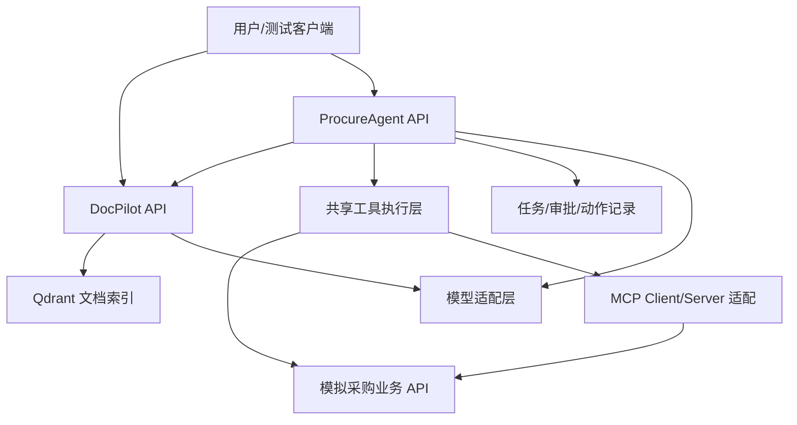

# DocPilot 与 ProcureAgent：实践规格

[执行日程](../learning-plan/enterprise-ai-16-weeks.md) · [数据说明](../../practice/enterprise_ai/README.md) · [评测方法](evaluation.md)

这里规定你要逐步实现的能力，不表示这些服务已经存在。先在同一仓库内按模块组织，出现独立部署或权限边界需要时再拆服务。Tool Lab 是两个项目复用的基础模块。



图表示学习阶段的职责关系，组件可同进程实现，不要求一开始全部独立部署。

## 一、Tool Lab：W01–03 的出口

建议目录（完成对应任务时再创建）：

```text
src/python_agent_lab/tool_lab/
    models.py        # ToolSpec、ToolResult、调用上下文
    registry.py      # 注册与查找
    executor.py      # 校验、执行、超时和错误转换
    tools/           # 只读订单与虚构业务查询
tests/tool_lab/
```

### 注册与执行契约

- register(name, handler, input_model)：显式注册；同名报错，名称为空报错。
- 装饰器注册复用 register，返回原函数或行为等价的包装，保留签名/说明。
- execute(name, arguments, context)：先检查工具允许范围，再用参数模型校验，之后执行。
- context 来自服务端，包含 request_id/身份/租户/超时预算，不通过模型参数覆写。
- 结果区分 ok、unknown_tool、invalid_arguments、forbidden、timeout、execution_error；错误不冒充正常空结果。
- 异步工具直接 await；同步阻塞工具有明确线程边界。取消线程等待不等于线程中的副作用已经停止。
- 本阶段只读；每次调用记录开始、结束、错误和耗时，日志不保存密钥。

### 最少行为检查

1. 合法参数返回实际计算结果，输入不变。
2. 非法参数和未知工具使业务函数调用次数为零。
3. 重复注册报错；两个请求不共享可变参数。
4. 查询超时可区分，连接和任务能清理。
5. 并发峰值不超过设定值；父任务取消后不留下异步子任务。
6. 业务异常保留可检查分类，不能被通用 except 转成“成功”。

## 二、DocPilot：文档、抽取与知识检索

### 业务范围

用户上传虚构合同/制度，查询可访问的材料。系统给出字段抽取或基于证据的说明。文档中的风险提示是学习样例，业务结论需结合规则和人工复核。

### 最小接口

| 接口 | 本阶段要求 |
| --- | --- |
| GET /health | 进程可用；另用 readiness 检查必需依赖，二者含义分开 |
| POST /api/chat | 输入消息、返回文本和请求标识；通过模型适配层调用 |
| POST /api/chat/stream | 明确事件类型及结束/失败；客户端断开能清理 |
| POST /api/documents | 校验上传，返回 document_id/任务状态；不将用户文件名直接拼进存储路径 |
| GET /api/documents/{id} | 返回解析/入库状态；检查访问权限 |
| POST /api/extractions | 指定可访问 document_id 与抽取字段集合 |
| POST /api/search | 返回有来源的候选片段，支持受控历史日期与类型过滤 |
| POST /api/questions | 检索、生成并返回 answer、citations、needs_review |

所有输入都有模型和大小/长度边界。identity/tenant 来源于可信认证上下文，不能相信请求体自报身份。早期单用户可用服务端注入的固定测试身份，但要保留边界并写越权测试。

### 抽取结果契约

每个字段返回 value（可 null）、evidence、needs_review。金额保留原文，再按明确规则确定性转为金额分和币种。证据形状为：

```json
{
  "source_id": "policy-a-current",
  "version": "2",
  "page": null,
  "section": "付款要求",
  "quote": "预付款比例不得超过合同金额的20%。"
}
```

JSON/Markdown 样例没有真实页码，应填 null 并引用节号；实际 PDF 只有成功追溯页码后才填数字。证据文字必须能在指定来源中找到，引用存在还不够，还要核对它是否支持该字段。

### 检索管道

```text
解析 → 规范化来源/版本/权限 → 分块 → 向量化 → 索引
查询 → 确定用户可见范围/业务日期 → 过滤检索 → 可选融合/重排 → 证据回答
```

每个片段保存 source_id、版本、chunk_id、租户、授权范围、生效区间与来源位置。更换 embedding 的维度/模型时创建可区分的新索引配置，不混入旧向量；重复入库要有稳定标识和更新策略。

Dense、稀疏和重排的候选都必须经过相同权限与版本约束；工具输出与提示词也不能泄露不可见材料。空召回、来源冲突、来源过期分别处理。

### 分阶段交付

- W04：聊天适配、错误与假模型测试；起始固定样本。
- W05：文本型 PDF 解析和字段证据；不支持的文档明确报告。
- W06：带版本与权限的基线 RAG；关键词/向量结果可导出。
- W07：固定集上的融合/重排比较；选默认策略。
- W12：问题 Router；不确定时要求澄清，数值查询交给确定性工具。

## 三、ProcureAgent：虚构采购审查

### 输入与输出

输入：project_id、业务日期、审查类型和受控任务选项。身份由服务端提供。项目和供应商从模拟业务数据获取。

输出 ReviewResult：task_id、status、findings、missing_information、evidence、tool_trace、needs_human_review。Finding 至少包含 code、category、severity、explanation、evidence_ids、rule_version、source_component。

status 可以是 completed、partial、needs_review；任务执行状态另行记录。completed 只表示指定流程完成，不等于采购合规；是否存在异常看 findings。资料缺失时不能输出“通过”。

### 四个只读工具

| 工具 | 受控参数 | 返回与边界 |
| --- | --- | --- |
| search_policy | query、as_of、top_k | 可访问、有效来源及定位；top_k 限制上限；无结果明确标识 |
| get_project | project_id | 同租户项目；不存在/无权限不返回隐私字段 |
| query_supplier | supplier_id | 同租户供应商与资格资料；过期、缺失分开 |
| check_rules | project_id、policy_source_ids | 服务端重新取可信数据，校验政策租户/有效期，执行确定性金额与资格规则 |

模型不能在 check_rules 中通过传入虚构 budget、role 或付款阈值改变判定。采购样例规则都是虚构的，真实系统需要业务方确认规则和证据。

### 任务状态和恢复

```text
queued → running → waiting_approval → running → completed
             ↘ failed                 ↘ failed
waiting_approval → rejected
queued/running/waiting_approval → cancelled（按实际取消点记录）
```

失败重试记录新的 attempt；只在允许重试的错误上进行，保留历史。外部动作正在执行时，取消任务不能保证撤销业务效果，状态需对账而不能假定回滚。

区分四类数据：业务任务/状态转换、图 checkpoint、审批与动作记录、审计事件。Checkpoint 标识映射到当前用户有权访问的业务 task，不允许拿任意外部 thread_id 恢复他人任务。

### 一个受保护的模拟写操作

只在 W10 加入 submit_review：把确认后的审查报告提交到模拟业务服务。不做真实下单、供应商封禁或真实资金操作。

- 审批绑定 task_id、action_type、payload_hash/版本、审批人、有效期。
- 原载荷或身份范围变化时，旧审批无效。
- 执行点再次检查权限和审批，使用 action_id/幂等键。
- 重放、重复 resume 和重试通过持久化动作账本确认结果；对外服务也需要幂等处理。
- 外部写入已完成但本地未记成功时，先查询/对账；不能简单重试造成双写。
- 拒绝和取消都保留事件；模型输出“用户已同意”不能代替审批记录。

### 单 Agent 与多 Agent

基线 A 为固定工具工作流，B 为单 Agent。之后分别实验 C 串行专家、D 并行专家、E 有限核验返工。资格/预算/合同专家共享结果 Schema，但仅获得各自需要的上下文与工具。

合并器保留所有独立风险与资料缺口；按稳定 finding_id 去重；同一问题依据不一致时保留冲突。一个专家失败只可产出 partial/needs_review，不应凭另外两个专家的“通过”推断整体完成。

补充调查只针对具体缺口；次数、总时限、模型用量都有上限。相同评测集未发现收益时，将复杂版本保留为实验，默认业务路径采用更容易解释和维护的方案。

## 四、组件怎样演进

建议先按模块划分 document、retrieval、review、tools、model_adapter、tasks、evaluation。业务规则只维护一份，本地工具、MCP 和 API 都调用它。

W16 最小部署可先是一个 API 进程、PostgreSQL、Qdrant，加所选模型服务配置；MCP 有独立运行要求时再加入，追踪平台另用可选配置。Langfuse 自托管应使用并核对其官方部署栈和资源要求，不能假设只是多加一个轻量容器。

交付说明写清当前是模块还是独立服务、依赖启动顺序、数据目录、密钥注入、健康检查、备份方式、已测试负载和明确限制。原型完成后再安排真实权限设计、安全评审、容量和长期运维验证。
