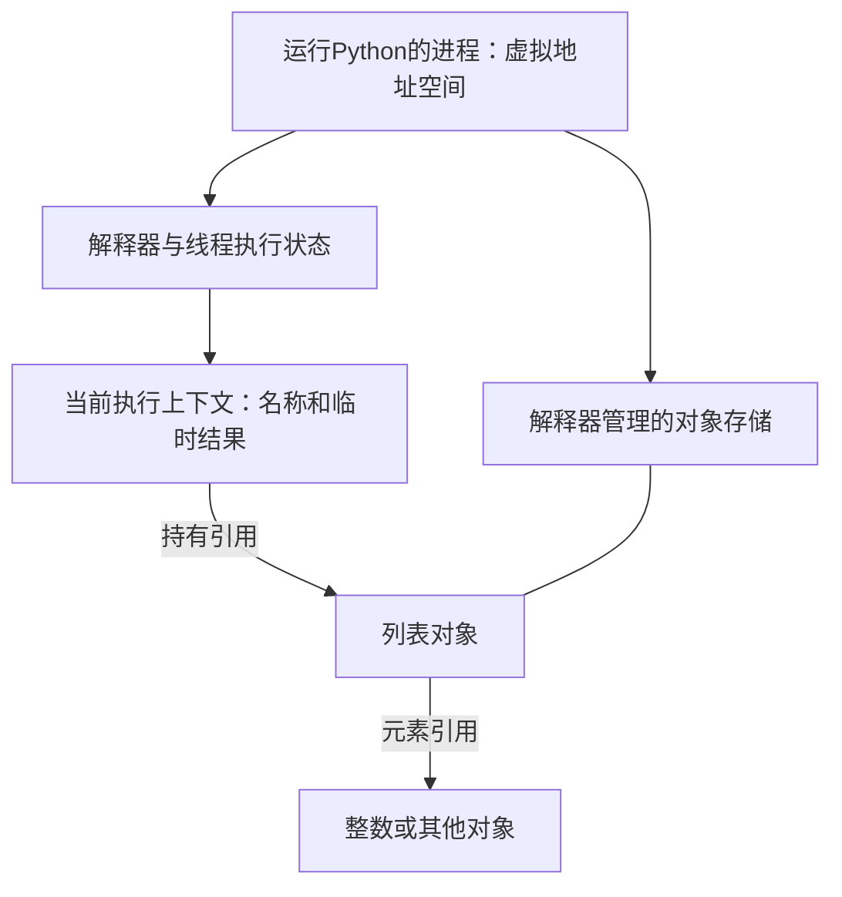

# 第01章　认识执行过程、对象与控制流

[导读](00-导读与学习方法.md) · [全书目录](教材目录.md) · [下一章](02-数字、金额、文本与编码.md)

## 1. 学习目标与前置知识

能从进程、执行上下文与对象存储解释名称绑定和副作用，再预测分支与循环。前置：已有基本编程经验；不要求先理解C指针、函数帧或垃圾回收。

**承接与本章主线：** 从程序运行的位置开始，建立对象存储、名称和执行状态的关系；本章输出是能逐行解释的引用图与控制流。第2章在这张图上区分数值和文本，第3章扩展到容器。

**本章从这里开始：** 一笔订单需要满200元才能享受活动。你能否在运行前说出程序走哪条路径？这一章从这个可验证的问题开始，建立后面阅读所有Python代码的方法。

## 2. 基础知识讲解

### 2.1 从一条语句开始认识程序

程序是交给解释器执行的指令。先新建一个扩展名为 `.py` 的文本文件，写入 `print("Hello Python")`，再从终端用项目解释器运行它。`print` 是内置函数：圆括号里提供输入，它将文本写到标准输出。交互环境适合验证一两行表达式，脚本适合保存一个可重复运行的过程。

```python
print("订单分析")
count = 2
print(count)
```

运行时先输出标题，再把整数2绑定到count，最后输出它。`count`是名称，2是对象；等号是赋值，不是比较。名称必须先绑定后使用，命名区分大小写，不能使用if、for等关键字。推荐以小写单词和下划线表达含义，例如order_count。

### 2.2 程序运行后：进程、内存、堆与栈

先建立整体位置关系。磁盘上的.py文件是源码；运行Python时，解释器在操作系统进程中执行代码。进程有自己的虚拟地址空间，用来容纳程序代码、运行时数据、线程栈及其他映射；虚拟地址不等同物理内存位置。操作系统负责地址空间和物理资源，解释器在其中管理Python对象。

**堆**是动态存储的概念：存放可能跨越一次函数调用而继续存在的数据。常规CPython通过内存管理器维护对象存储，通常称为Python私有堆，整数、列表、函数等Python对象由它管理。私有堆不是另一块独立硬件，也不意味着每个对象都单独向操作系统申请内存；解释器可以复用和缓存内存块。

**栈**强调后进先出的组织方式：最后进入的活动先结束。先把它理解为“记录当前做到哪一步、接下来回哪里”的结构，再区分下表几种含义。

这里的“线程”可先理解为进程中的一条执行路径；“执行帧”是解释器为一次代码执行维护的状态记录。多个调用的记录按调用关系关联，形成Python调用栈。引用则是程序能继续访问某对象的关联，不要求初学者用C指针操作它。

| 名称 | 管理什么 | 与Python的关系 |
| --- | --- | --- |
| 原生线程栈/C栈 | 当前线程的底层函数执行状态 | 解释器自身是程序，也会使用它 |
| Python调用栈 | 尚未结束的Python调用及其执行帧 | 解释是谁调用谁、异常从哪里传播 |
| 帧内求值栈 | 执行表达式时的临时操作数和结果 | 帮助理解先求值再绑定，不是业务容器 |
| Python对象存储 | 整数、列表等对象及引用关系 | 对象可被多个执行帧和容器共同引用 |

帧内求值栈可用计算过程理解：概念上先取得加法的两个操作数，再取得结果供名称绑定；它保存临时计算状态，不是保存所有业务数据的列表。这里描述执行含义，不承诺某个表达式必有固定字节码序列。

这些是不同层次，不能画成“所有Python变量在C栈，所有其他数据在堆”的一一对应关系。调用栈是执行关系，帧实际存在哪里由解释器实现决定。CPython 3.12并不要求每个Python调用都新增一个一一对应的C调用层；本书第4章再解释这一点。



图表示职责和引用，不是连续内存布局，也没有表示地址高低。此时先记住：**执行上下文负责当前怎样执行，对象存储负责数据存在，引用把二者连接起来。**名称怎样存放和查找随上下文变化，初学先用关系图推理。

### 2.3 表达式、语句与基本对象

`1 + 2`、`count > 0`是表达式，求值后得到结果；赋值和if是组织程序的语句。整数写成2，小数可以写成2.5，文本用引号包住，布尔值写True/False，没有值的业务状态常用None。`type(value)`查看类型，`bool(value)`获得真假解释。

对象类型决定能执行什么操作：两个整数可以相加，两个字符串可以拼接，但字符串与整数不能直接相加。需要展示数值时可以调用str，或者使用下一章介绍的格式化字符串。`input()`返回文本，即使用户键入的是数字；转换与非法输入稍后单独处理。

#### 基本表达式要形成一套完整认识

整数、浮点数、文本、布尔值和None承担不同含义。type查看类型，int/float/str进行约定转换，bool解释真假；转换失败并不意味着得到默认值。`=`绑定名称，`==`比较值，`is`比较身份，判断None通常用is None。

乘除通常先于加减，比较、not、and、or还有各自优先级；先加括号写清含义，再依规则简化。`0 < n < 10`是链式比较；`n == 0 or 1`不是“n等于0或1”，因为右边1本身为真。条件表达式`x if condition else y`产生一个值，适合简单选择，多步业务使用if块。

```python
# study-example: S01D
n = 5
assert (n == 0 or 1) == 1
assert (n == 0 or n == 1) is False
assert 0 < n < 10
assert (10 if n is None else n) == 5
```

注释以#开始，三引号创建可跨行字符串，规定位置的字符串可成为文档字符串，不等于通用多行注释。pass是空操作占位；脚本中的名称拼写、缩进和代码块边界共同影响执行。input总返回文本，数字转换在取得文本之后显式进行，不在离线示例里等待交互。

### 2.4 名称怎样连接到对象：赋值、修改与重新绑定

“标签”用于理解引用关系，不表示对象内部存着变量名。对象可以没有可见名称，也可以被多个名称、容器或函数状态引用。一个名称在当前作用域绑定到一个对象；重新绑定名称，不会自动改动其他名称。

对象有身份、类型和状态。身份在对象存活期间保持不变；类型规定可执行的操作；状态是否允许变化取决于类型。`type(x)`观察类型，`id(x)`取得身份标识，`is`比较身份。id只需在对象生命周期内唯一；对象结束后标识可能被复用，不能用历史id追踪一个已经不存在的业务对象。

#### 普通名称赋值：先求右侧，再建立左侧绑定

`second = first`可以按三步读：在当前名称解析规则下找到first绑定的对象；取得该对象；让second也绑定它。赋值没有要求调用复制协议，也不是让second永久依赖名称first。以后first重新绑定，second仍指向原对象。

```text
second = first 执行后：
first  ─┐
        ├──→ 对象A
second ─┘

first = 其他对象 执行后：
first  ────→ 对象B
second ────→ 对象A
```

这里讨论的是左侧为普通名称的赋值。`items[0] = value`修改容器槽位，`obj.attr = value`涉及属性写入，不能一概说所有等号都只改变局部名称；它们在第3、6章继续推导。

#### 整数加法：结果绑定变化，旧整数没有被改写

```python
# study-example: S01E
first = 1000
second = first
assert first is second
first = first + 1
assert first == 1001
assert second == 1000
assert first is not second
```

先读取旧first所指的1000，再执行加法取得表示1001的结果对象，最后让first绑定结果。1000自身没有变成1001，所以second仍看到1000。“结果对象”不等于每次都保证一次全新内存分配：实现可以复用适合的不可变对象。此例身份不同由两个不同整数值及不可变性保证，不依赖小整数缓存范围。

不可变限制对象的状态，并不限制名称重绑定。`first = "订单"`可以让同一名称以后指向文本；它没有把那个整数对象改造成字符串。名称没有固定的整数存储格这一假设，不能照搬到Python对象模型。

#### 列表方法：沿引用找到同一对象，再修改它

这里只预览列表，完整语法与复制在第3章学习。列表能改变元素序列，而整数不能改变自身数值。

```python
# study-example: S01F
first = [10]
second = first
before = id(first)
returned = first.append(20)
assert first is second and id(first) == before
assert second == [10, 20]
assert returned is None
first = [99]
assert first == [99] and second == [10, 20]
```

append先找到first所指的列表，再让该列表多引用整数20；没有重新绑定first或second，所以两者都观察到变化。append返回None，表示它不是通过返回新列表交付结果。写`first = first.append(20)`会先完成修改，再把first绑定到None；其他别名仍能看到已经改动的列表。

这不意味着“可变类型上的操作都原地发生”。例如内置列表的`+`产生新列表，append修改原列表；应看具体操作契约，而不是只看类型名称。`+=`还包含原地协议与写回，第3、5章继续讨论。

### 2.5 值与身份：先区分两种问题

```python
# study-example: S01G
left = [1, 2]
right = [1, 2]
alias = left
assert left == right
assert left is not right
assert alias is left
value = None
assert value is None
```

两次列表表达式创建独立外层列表，所以身份不同；内置列表的相等比较按对应元素判断，因而值相等。is不检查内容，也不能由自定义__eq__改写。None是语言提供的单例，使用is None表达身份判断。

本章先掌握内置整数、文本和列表的比较。自定义比较如何协商、怎样回退，等第6章学会类后再解释；现在不需要预先掌握特殊方法。比较结果用于条件时，还要经过真假判断。

小整数复用、字符串驻留或编译期常量合并都不能作为业务比较依据：同值不推出同身份，不同运行环境观察到的复用也可能不同。用`==`表达数值或文本相等，用`is`表达确实需要的身份关系，不背缓存范围猜结果。

### 2.6 按条件选择路径

```python
amount_cents = 19900
if amount_cents >= 20000:
    message = "达到门槛"
elif amount_cents > 0:
    message = "未达到门槛"
else:
    message = "需要检查金额"
print(message)
```

条件后的冒号引出代码块，缩进表示哪些语句属于分支，统一使用4个空格。if/elif从上到下判断，选中一个分支后跳过后面的分支；上例输出“未达到门槛”。比较相等使用`==`，`=`用于赋值。先写互斥、清楚的条件，再考虑压缩成条件表达式。

#### 案例推进：第一轮：让规则产生可见结果

先只使用整数、名称、比较与分支。金额采用整数分，200元就是20000分。规则先检查非法金额，再检查活动门槛，最后处理合法的小额订单。

```python
# study-example: S01A
amount_cents = 19900
if amount_cents < 0:
    message = "金额非法"
elif amount_cents >= 20000:
    message = "达到活动门槛"
else:
    message = "未达到活动门槛"
assert message == "未达到活动门槛"
```

从上往下读：赋值先完成，第一次比较得到False，第二次比较也得到False，于是执行else。选中分支后不会再执行其他分支。这里message最终绑定文本对象；程序没有把文本“放进整数变量”，而是让名称绑定到另一种对象。

把amount_cents改为20000，第二次比较为True；改为-1，第一次比较为True。分别验证等于门槛和刚低于门槛，比只试一个普通值更能确认边界。代码顺序本身也是规则的一部分：如果先处理所有非负金额，再写门槛判断，后者可能永远没有机会执行。

### 2.7 用循环处理重复工作

for从可迭代对象中依次取得元素，range可以提供整数序列；while每轮重新检查条件。`range(3)`产生0、1、2，不含终点3。

```python
total = 0
for number in range(3):
    total += number
print(total)  # 3
```

break退出当前循环，continue结束当前这一轮的剩余语句。循环else只在没有执行break时运行，适合表达“全部检查后仍未找到”。while必须设计推进状态或退出条件，避免无意的无限循环。

#### 案例推进：第二轮：看见循环中的每次状态变化

先不处理订单集合，只累计0到3，观察重复过程。range(4)提供0、1、2、3，终点4不包含在内。total在循环之前建立，每一轮读取旧值、相加，再重新绑定。

```python
# study-example: S01B
total = 0
for number in range(4):
    total = total + number
assert total == 6
assert number == 3
```

| 时刻 | number | 加法前total | 加法后total |
| --- | --- | --- | --- |
| 第1轮 | 0 | 0 | 0 |
| 第2轮 | 1 | 0 | 1 |
| 第3轮 | 2 | 1 | 3 |
| 第4轮 | 3 | 3 | 6 |

Python普通for块不创建独立的局部作用域，因此本例循环后仍可读取number。但若range为空，一轮也不执行，不能据此假定number一定获得过值。理解循环应同时考虑零次、一次和多次。

#### 案例推进：第三轮：搜索与穷尽是两种不同结果

for/else中的else表示循环没有因break退出。它适合搜索失败的反馈，而不是“最后一轮的if不成立”。

```python
# study-example: S01C
text = "订单A"
for character in text:
    if character == "A":
        found = True
        break
else:
    found = False
assert found is True
```

将text改为“订单B”或空字符串，循环穷尽后运行else，得到False。continue只跳过本轮剩余部分，不会像break一样跳过循环else。while也有类似退出语义，但必须保证状态推进，避免条件一直为真。

- 正常完成：循环遍历完成所有元素后，执行else子句。
- 被 break 终止：如果循环被 break 中断，则不执行 else 子句。
- 异常终止：如果循环中发生异常，else 也不执行。

### 2.8 从运行结果回到执行过程

用纸记录每行之前和之后的变量，比仅看最终输出更容易理解程序。使用`assert 条件`可以表达示例中应成立的关系；不成立会抛AssertionError。它是学习和测试手段，不能代替生产输入校验。看到错误时先读异常类型和最后的触发行，再沿调用路径查原因。

#### 案例推进：怎样从本章继续

本章还不要求你设计函数或异常体系。先能读懂赋值、表达式、缩进、分支和循环，并把每行执行前后的状态写出来。第二章会解释金额为什么用整数、输入文本怎样变成数据；第三章才开始把多笔记录放进容器。

## 3. 原理讲解与推导

### 3.1 名称绑定解释了赋值的含义

第2部分已经按“进程→存储与执行→名称/对象→具体操作”建立模型。现在把它用于三项检查：这一步修改哪一个对象？有没有名称或容器槽位重新绑定？哪些其他引用还能看到变化？先用这些问题解释S01E/F，再按需要读下面的实现层。

#### 进阶阅读：CPython怎样表达对象和元素引用

本段用于连接概念与实现，初读不要求记C字段。在常规CPython中，对象结构包含类型与引用管理等信息，不同类型的数据部分不同。全局名称常通过模块命名空间查找，函数局部名称可通过执行帧中的优化槽位访问；不能推断每个名称都存在独立字典，或都对应一个原生栈变量。

#### 再向下看一层：对象和元素引用放在哪里

下面是常规CPython的概念图，不是可直接照抄的C结构定义，也不承诺字段偏移：

```text
名称绑定/执行帧中的引用
          │
          ▼
   列表对象：类型信息、引用管理信息、长度、元素存储信息
          │
          ├── 元素引用 ──→ 整数对象：自己的类型信息与整数数据
          └── 元素引用 ──→ 另一个对象
```

列表保存元素引用，不把所有元素的完整对象逐个嵌进列表本体。因此一个列表能引用不同类型，也能在多个位置引用同一对象。扩容可能更换内部元素存储区域，但外层列表仍是原对象，不能由内部缓冲区移动推出list的身份改变。

整数对象由其类型相关表示保存数值；执行加法读取这些数值并取得结果对象，不是通过first这个名称原地覆盖旧整数数据。名称重绑定和对象内部修改发生在不同层，后续容器复制、函数共享状态与并发问题都要先分清这两层。

引用管理同样不能机械理解成“每执行一次赋值，打印的引用计数就恰好加一”：解释器还可能保存临时引用，并存在特殊对象和实现优化。学习实验验证身份与可见状态，不固定对象大小、地址或引用计数。

#### 为什么不从内存地址猜程序结果

Python语义规定可观察行为；CPython结构解释某个版本如何实现；缓存、分配器和调试工具观察又是另一层。对象复用、内部缓冲区移动与引用计数变化不能替代语义推理。学完函数后在第4章接上帧和返回，学完容器后在第3章追踪嵌套引用。

### 3.2 条件判断先解释真假，再选择是否继续计算

None、False、数值零以及空文本/容器通常是假。and/or使用短路求值：当前结果已足以决定选择时，不计算右侧，而且返回操作数本身。因此`0 or 10`得到10；如果0是合法配置，这种默认值写法就错误。此时应显式检查`value is None`。

### 3.3 代码先成为可执行结构，再产生运行结果

在常规CPython中，源码会经过解析和编译成为代码对象，再执行。语法错误会阻止相应代码块正常进入执行；名称错误和不支持的操作可能到运行某行时才出现。动态编译观察E01放在第7章模块知识之后，初读先理解语法阶段与运行阶段的区别。第三章先学习容器复制，第5章再结合异常观察tuple增量赋值的复杂路径。

### 3.4 名称消失、对象回收与资源关闭

名称、对象和外部资源有三种不同生命周期。`del name`删除一个绑定；若其他名称、容器或闭包仍引用对象，对象仍可存在。即使对象已经不能再访问，语言也不普遍承诺在某个精确时刻立刻回收它。

常规CPython主要使用引用计数并配合循环垃圾回收处理一部分循环引用。a引用b、b又引用a时，仅看引用计数归零不足以发现它们已不可达；循环回收机制参与处理。具体细节属于实现及版本，不能用它推出所有Python实现都立即析构。

文件、网络连接和锁还拥有外部状态。释放一个Python名称不等于及时释放所有外部资源，也不能用“等垃圾回收”代替正常关闭。第五章的with与finally正是为了把退出责任写进程序控制流。现在先记住区分：取消名称绑定、对象不可达、资源已关闭。

#### 四种“释放”不是同一个时刻

1. del或离开作用域使某个绑定消失，不保证其他引用也消失。
2. 没有可达引用后，对象成为可回收对象；环需要相应回收机制处理。
3. 对象占用的内存块可交回解释器分配器，以便以后复用。
4. 进程向操作系统归还物理页是另一个层次，不保证立即发生。

所以“del之后任务管理器内存没有下降”不能单独证明泄漏；反过来，仍被缓存或列表引用的数据也不会因调用gc.collect而自动变得无用。第8、10章用测量和引用关系区分持续保留、临时分配与分配器缓存。

## 4. 示例与逐步走查

```python
# book-example: B01
value = 0
assert type(value) is int
assert value is not None
assert bool(value) is False
assert bool("False") is True
```

### 4.1 沿输入到结果逐步解释

value先绑定整数0，type取得其类型，身份检查确认它不是None，bool将它解释为假。改成非空文本"False"后，其内容虽然是单词False，文本对象仍为真。这说明值的内容、类型与真假解释是三个不同问题。

### 4.2 用同一张图复述本章

先画进程和对象存储，再画执行上下文中的first/second，依次执行整数加法、列表append和名称重绑定。每步只问谁持有引用、谁改变状态。最后把分支和循环看成决定下一条执行语句的规则，而不是另一套内存模型。

## 5. 动手练习

### 基础训练：控制执行路径

建立一个脚本，分别给amount_cents赋0、1、19999、20000和负数；用if/elif/else输出“零金额”“未达门槛”“达到门槛”或“非法金额”，明确每项只能命中一类。先手算，再运行核对。

用for将range(5)中的值累计，写出每一轮total变化；再用while完成同一计算，指出推进状态的语句。最后用for/else在文本中寻找目标字符，分别验证找到、没有找到和空文本。

验收：能解释终点是否包含、break对else的影响，以及`0 or 10`为何得到10。E01已移至第7章，是解释器分层的扩展实验；引用复制题L01移至第3章，函数题L02移至第4章。

### 进阶训练：给对象图标出修改与重绑定

不看示例重写三种情况：整数加法后别名保留旧值；列表append后别名看到改动；名称重新赋值后别名保持原对象。每一步画名称到对象的箭头，再比较值和身份。最后解释把append返回值赋回名称会怎样；不要求输出任何固定id。

## 6. 验收与自测

**行为验收：** 独立脚本能覆盖金额门槛、空循环与搜索结果；逐行解释读取与绑定的变化。不得依赖小整数缓存或固定id数值。

**原理验收：** 合上资料解释本章一个机制，预测一个反例，说明规则属于语言语义、库约定还是实现观察。

**提交证据：** 实现位置、运行命令、正常案例、至少一个错误/边界案例、一次失败原因和修复记录。自动检查只证明其覆盖行为；未实现任务不因示例通过而算完成。

### 6.1 先预测，再查看参考推导

如果range(4)改成range(0)，total和number分别怎样？能否只根据最后一行输出推断程序过程？

<details>
<summary>完成预测后查看解释</summary>

total仍为0；若在独立脚本中此前没有number绑定，读取它会失败。循环并不保证至少执行一次。相同最终结果也可能来自不同执行路径，应检查中间状态与边界输入。

</details>

## 7. 面试问答与迁移

赋值与比较分别做什么？为什么0或空文本可能触发默认值？for/else何时执行，空循环后变量是否一定存在？复制与函数参数问题在第3–4章继续。

回答顺序：定义与边界 → 机制 → 小例子 → 项目影响 → 验证方式。不确定的实现细节明确说明版本和查证办法。

## 8. 本章小结与参考

内存与执行模型参考：[CPython内存管理](https://docs.python.org/3.12/c-api/memory.html)、[执行帧与名称](https://docs.python.org/3.12/reference/executionmodel.html)。它们解释不同层次；源码级布局留到第4章进阶段。

本章建立“语句执行→名称绑定→对象操作→控制流”的阅读方法。下一章区分数字、文本和字节；同一种操作是否合法，将由对象类型与业务单位共同决定。

官方参考：[本章资料](https://docs.python.org/zh-cn/3.12/tutorial/)。动态框架资料以2026-11-04核对的入口为准，具体SDK版本在实际实践时重新核对并记录锁文件。

原理对照：[名称赋值规则](https://docs.python.org/3.12/reference/simple_stmts.html#assignment-statements)、[比较规则](https://docs.python.org/3.12/reference/expressions.html#value-comparisons)、[CPython对象与引用管理](https://docs.python.org/3.12/c-api/intro.html#objects-types-and-reference-counts)。补充核对：2026-11-09；实际实验按项目解释器运行。

原理对照：[对象、值、类型与生命周期](https://docs.python.org/3.12/reference/datamodel.html#objects-values-and-types)。重点区分语言允许的行为和CPython实现说明。

[全书目录](教材目录.md) · [下一章](02-数字、金额、文本与编码.md)
