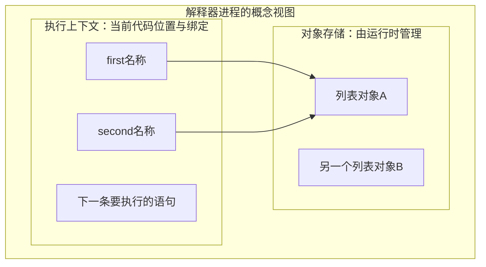

# 第01章　认识执行过程、对象与控制流

[导读](00-导读与学习方法.md) · [全书目录](教材目录.md) · [下一章](02-数字、金额、文本与编码.md)

## 1. 学习目标与前置知识

能运行脚本，辨认基本值与转换，解释名称绑定、值比较和身份判断，再预测分支与循环。之后用进程、执行上下文与对象存储回看这些操作。前置：已有基本编程经验；不要求先理解C指针、函数帧或垃圾回收。

**承接与本章主线：** 从一个能输出结果的程序开始，依次认识基本值、名称、引用与执行路径；原理部分再解释存储和调用。本章输出是能逐行解释的引用图与控制流。第2章深化数值和文本，第3章扩展到容器。

**本章从这里开始：** 一笔订单需要满200元才能享受活动。你能否在运行前说出程序走哪条路径？这一章从这个可验证的问题开始，建立后面阅读所有Python代码的方法。

## 2. 基础知识讲解

### 2.1 从一条语句开始认识程序

程序是交给解释器执行的指令。先新建一个扩展名为 `.py` 的文本文件，写入 `print("Hello Python")`，再从终端用项目解释器运行它。`print` 是内置函数：圆括号里提供输入，它将文本写到标准输出。交互环境适合验证一两行表达式，脚本适合保存一个可重复运行的过程。

```python
print("订单分析")
count = 2
print(count)
```

运行时先输出标题，再把整数2绑定到count，最后输出它。`count`是名称，2是对象；等号是赋值，不是比较。名称必须先绑定后使用，命名区分大小写，不能使用if、for等关键字。推荐以小写单词和下划线表达含义，例如order_count。

#### 先认清脚本中常见的符号

名称可以包含字母、数字和下划线，但不能以数字开头；本书优先用能表达业务含义的英文小写名称。`order_count`与`Order_count`不同，`if`、`for`等关键字不能拿来作普通名称。空行用于分隔步骤，`#`后的内容是注释。

```python
# study-example: S01M
# 括号内可以换行，仍然是同一个加法表达式。
subtotal = (
    100 + 200
)
message = """订单报告
金额待核对"""
print(subtotal)  # 300
print(message)   # 输出两行文本
print("订单", "A", sep=":", end="!\n")  # 订单:A!
```

括号中的换行用于排版；三引号创建的是一个多行字符串。它仍是数据，不能一概当作块注释。print默认在多个输出值之间加空格，末尾换行；sep和end分别指定分隔与结尾。这里只按名称给内置函数提供设置，第4章再学习函数参数的完整规则。

遇到`if 条件:`这样的行，冒号后的缩进表示它管理的代码块。本书使用四个空格，块结束后回到原缩进；完整例子在第2.6节。换行与缩进先分别看：前者组织文本行，后者决定代码属于哪个块。

#### 交互输入与脚本输出怎样区分

在交互解释器中，下面的`>>>`是提示符，输入时不复制它；提示“数量：”后键入3并回车。它是需要人工输入的实验，教材自动检查不等待键盘。

```text
>>> raw = input("数量：")
数量：3
>>> print(type(raw))
<class 'str'>
```

`input`得到文本，`print`负责显示结果。在.py脚本中写语句时也不写`>>>`。下一步会用int把这份文本转换为可计算的数量，再讨论转换失败。

### 2.2 程序运行后：进程、内存、堆与栈

磁盘文件保存代码，运行中的进程提供执行环境。解释器要同时保留数据和进度：数据使下一步还能取得订单金额，进度使它知道该计算还是该输出。

接下来先用具体操作区分名称与对象。第3.5节再回答：为什么对象可以被多个名称共享，为什么函数结束后结果还能保留，以及堆与调用栈分别管理什么。先有这几个疑问，再给机制命名，就不必靠背诵内存区域理解赋值。

### 2.3 表达式、语句与基本对象

先回看前面计算小计的例子，可以写成 `subtotal = 100 + 200`。等号右边的加法会得到一个结果，像这样能求出结果的代码叫**表达式**；整行赋值把结果绑定给名称，属于**语句**。后面先认识结果是什么，再学习怎样判断和组合条件。

#### 先认识值，再给类型命名

同一份订单需要保存数量、重量、编号、付款状态和未填写的备注。依次写出这些值：

```python
# study-example: S01I
quantity = 2
weight = 2.5
order_code = "002"
paid = False
remark = None
print(type(quantity))   # <class 'int'>
print(type(weight))     # <class 'float'>
print(type(order_code)) # <class 'str'>
print(type(paid))       # <class 'bool'>
print(type(remark))     # <class 'NoneType'>
```

`type(x)`回答“x所指的对象属于什么类型”。输出中的`<class 'int'>`先读成“类型是int”，class的定义语法第6章再学。先观察输出，再把名称与用途对应起来：int保存整数，float保存浮点数，str保存文本，bool的True/False表达真假，None是一个常用于表示缺失的特殊值。例如编号“002”保留前导零，不能因为看起来像数字就改成数量2。

**这些值都是对象，None也是对象。**Python没有要求把整数、布尔值当作另一套不属于对象的基本值来处理。对象有自己的类型；`quantity`这样的名称负责引用对象。列表、函数、模块也是对象，后续逐个学习。类型本身也有对象表示，例如这里的int；第6章再解释类与类型的关系。`if`、`for`等语法关键字则不属于数据对象。[官方对象模型](https://docs.python.org/3.12/reference/datamodel.html#objects-values-and-types)

#### 再观察：文本“2”为什么不能直接参与数量计算

外部输入常是文本。先预测下面的输出，特别注意转换前后的raw有没有变化：

```python
# study-example: S01J
raw = "2"
quantity = int(raw)
print(raw + raw)          # 22，拼接文本
print(quantity + quantity) # 4，整数相加
print(type(raw))          # <class 'str'>
label = str(quantity)
print(type(label))        # <class 'str'>
print(float("2.5"))       # 2.5
```

`int(raw)`按整数文本规则取得整数对象，赋值让quantity引用结果；raw仍引用原文本。`str`取得文本表示，`float`可以从适当的文本取得浮点数。转换各有允许的输入，例如`int("两件")`会失败，`int("2.5")`也不能直接当整数文本转换。现在先能指出失败发生在转换处，第5章再学习怎样捕获和反馈异常。`input()`取得的也是文本，键入数字后仍要显式转换。

#### 最后区分：没有填写、数值为零与真假

假设优惠额未填写时用None，明确没有优惠时用0。这是两种业务状态；bool只给出对象用于条件时的真假解释。

```python
# study-example: S01K
discount = None
print(bool(discount)) # False
discount = 0
print(bool(discount)) # False
print(bool("0"))      # True
print(bool("False"))  # True
```

前两项都解释为假，但含义不同；后两项是非空文本，因此解释为真。`bool("False")`没有解析英文单词的含义。需要判断“没填写”时，后面的第2.5节会使用`is None`；需要选择执行路径时，第2.6节再介绍if。

到这里先完成一件事：给定一个值，说明它的类型、允许的操作，以及是否需要转换。乘除、比较、多个条件的组合将在具体使用处逐步出现。代码中以`#`开始的内容是注释；示例里的`assert 条件`表示该条件应成立，不成立时报告错误，供学习和测试核对。

### 2.4 名称怎样连接到对象：赋值、修改与重新绑定

“标签”用于理解引用关系，不表示对象内部存着变量名。对象可以没有可见名称，也可以被多个名称、容器或函数状态引用。一个名称在当前作用域绑定到一个对象；重新绑定名称，不会自动改动其他名称。

观察一个对象时分三次问：它是哪一种对象，用type查看；它表示什么值、是否允许修改，按类型的规则判断；它和另一个名称引用的是否为同一个对象，用is判断。`id(x)`取得对象存活期间的身份标识，本章只比较标识是否相同，不记具体数字。身份相同的对象仍可以有变化的内容，例如列表追加元素后还是原列表。

接下来的例子用`==`核对值是否相等，用`is`核对是否为同一对象。先沿箭头预测，再看第2.5节的完整选择规则。对象结束后id可能被复用，因此历史id不能作为持久业务编号。

#### 普通名称赋值：先求右侧，再建立左侧绑定

`second = first`可以按三步读：在当前名称解析规则下找到first绑定的对象；取得该对象；让second也绑定它。赋值没有要求调用复制协议，也不是让second永久依赖名称first。以后first重新绑定，second仍指向原对象。

```text
second = first 执行后：
first  ─┐
        ├──→ 对象A
second ─┘

first = 其他对象 执行后：
first  ────→ 对象B
second ────→ 对象A
```

这里讨论的是左侧为普通名称的赋值。`items[0] = value`修改容器槽位，`obj.attr = value`涉及属性写入，不能一概说所有等号都只改变局部名称；它们在第3、6章继续推导。

#### 整数加法：结果绑定变化，旧整数没有被改写

```python
# study-example: S01E
first = 1000
second = first
assert first is second
first = first + 1
assert first == 1001
assert second == 1000
assert first is not second
```

先读取旧first所指的1000，再执行加法取得表示1001的结果对象，最后让first绑定结果。1000自身没有变成1001，所以second仍看到1000。“结果对象”不等于每次都保证一次全新内存分配：实现可以复用适合的不可变对象。此例身份不同由两个不同整数值及不可变性保证，不依赖小整数缓存范围。

不可变限制对象的状态，并不限制名称重绑定。`first = "订单"`可以让同一名称以后指向文本；它没有把那个整数对象改造成字符串。名称没有固定的整数存储格这一假设，不能照搬到Python对象模型。

#### 列表方法：沿引用找到同一对象，再修改它

这里只预览列表，完整语法与复制在第3章学习。列表能改变元素序列，而整数不能改变自身数值。

```python
# study-example: S01F
first = [10]
second = first
before = id(first)
returned = first.append(20)
assert first is second and id(first) == before
assert second == [10, 20]
assert returned is None
first = [99]
assert first == [99] and second == [10, 20]
```

append先找到first所指的列表，再让该列表多引用整数20；没有重新绑定first或second，所以两者都观察到变化。append返回None，表示它不是通过返回新列表交付结果。写`first = first.append(20)`会先完成修改，再把first绑定到None；其他别名仍能看到已经改动的列表。

这不意味着“可变类型上的操作都原地发生”。例如内置列表的`+`产生新列表，append修改原列表；应看具体操作契约，而不是只看类型名称。`+=`还包含原地协议与写回，第5章3.3继续讨论。

### 2.5 值与身份：先区分两种问题

先问自己的目的：比较订单金额或编号是否相等，关注的是值；检查两个名称是否共享同一份可修改数据，关注的是身份。**选择依据是问题，不是给每种类型指定一种比较运算符。**同一对列表可以同时进行这两种比较，得到不同答案。

```python
# study-example: S01G
left = [1, 2]
right = [1, 2]
alias = left
assert left == right
assert left is not right
assert alias is left
value = None
assert value is None
```

两次列表表达式创建独立外层列表，所以身份不同；内置列表的相等比较按对应元素判断，因而值相等。is不检查内容，也不能由自定义__eq__改写。None是语言提供的单例，使用is None表达身份判断。

本章先掌握内置整数、文本和列表的比较。自定义比较如何协商、怎样回退，等第6章学会类后再解释；现在不需要预先掌握特殊方法。比较结果用于条件时，还要经过真假判断。

小整数复用、字符串驻留或编译期常量合并都不能作为业务比较依据：同值不推出同身份，不同运行环境观察到的复用也可能不同。用`==`表达数值或文本相等，用`is`表达确实需要的身份关系，不背缓存范围猜结果。

#### 将比较放回订单任务

| 你真正想问什么 | 写法 | 怎样解释 |
| --- | --- | --- |
| 数量是不是2 | `quantity == 2` | 比较数值 |
| 状态文本是不是paid | `status == "paid"` | 比较文本内容 |
| 两份列表内容是否相等 | `left == right` | 按列表的相等规则比较元素 |
| 两个字典是否保存相等的键值映射 | `left == right` | 按字典规则比较；不靠插入顺序判断相等 |
| 两个集合是否包含相等的成员 | `left == right` | 按集合成员比较，不比较排列顺序 |
| 两个名称是否共享一个列表 | `left is right` | 比较对象身份 |
| 优惠额是否没有填写 | `discount is None` | 判断是否为None这个单例对象 |

None、0和空文本要用实际输入分开观察：

```python
# study-example: S01L
discount = 0
assert discount is not None
assert discount == 0
assert bool(discount) is False
missing = None
assert missing is None
assert missing != 0
assert "" is not None
assert 1 == 1.0
assert True == 1
assert type(True) is not int
```

零优惠存在且有效，不能用“解释为假”代替“没有填写”。数值比较也不总要求类型完全相同：1与1.0相等，True也与1相等。严格输入校验需要另外检查类型，第2章会用金额入口继续练。这里`type(True) is not int`比较的是类型对象的身份，没有把True与整数做身份猜测。

自定义类的`==`按它实现的相等规则执行，未定义内容比较时，两个独立实例通常不相等；第6章学会类后再亲手验证。实际浮点近似比较、NaN等特殊值在第2章展开，不能将本节简化成“所有值都能用同一算法比较”。

### 2.6 按条件选择路径

```python
amount_cents = 19900
if amount_cents >= 20000:
    message = "达到门槛"
elif amount_cents > 0:
    message = "未达到门槛"
else:
    message = "需要检查金额"
print(message)
```

条件后的冒号引出代码块，缩进表示哪些语句属于分支，统一使用4个空格。if/elif从上到下判断，选中一个分支后跳过后面的分支；上例输出“未达到门槛”。比较相等使用`==`，`=`用于赋值。先写互斥、清楚的条件，再考虑压缩成条件表达式。

#### 案例推进：第一轮：让规则产生可见结果

先只使用整数、名称、比较与分支。金额采用整数分，200元就是20000分。规则先检查非法金额，再检查活动门槛，最后处理合法的小额订单。

```python
# study-example: S01A
amount_cents = 19900
if amount_cents < 0:
    message = "金额非法"
elif amount_cents >= 20000:
    message = "达到活动门槛"
else:
    message = "未达到活动门槛"
assert message == "未达到活动门槛"
```

从上往下读：赋值先完成，第一次比较得到False，第二次比较也得到False，于是执行else。选中分支后不会再执行其他分支。这里message最终绑定文本对象；程序没有把文本“放进整数变量”，而是让名称绑定到另一种对象。

把amount_cents改为20000，第二次比较为True；改为-1，第一次比较为True。分别验证等于门槛和刚低于门槛，比只试一个普通值更能确认边界。代码顺序本身也是规则的一部分：如果先处理所有非负金额，再写门槛判断，后者可能永远没有机会执行。

#### 从一个条件走到多个条件

先写`n == 0`，它只问n是否等于0。需要“等于0或者等于1”时，分别写两次比较，再用or连接：`n == 0 or n == 1`。or会先看左侧的真假；左侧为真就返回左侧，否则求右侧并返回它。因此`n == 0 or 1`的右侧只是整数1，无法表达第二次比较。

```python
# study-example: S01D
n = 5
assert (n == 0 or 1) == 1
assert (n == 0 or n == 1) is False
assert 0 < n < 10
assert (10 if n is None else n) == 5
```

先看前两项：n为5时第一项得到1，第二项才得到False。第三项的链式比较表示n同时大于0、小于10。最后一项是条件表达式：条件为真取10，否则取n；它会产生一个可参与赋值的结果。需要多步处理时，继续使用上面的if代码块。

表达式有优先级，例如乘法先于加法；初写多个条件时先用括号明确分组。not用于取反，and要求前项解释为真才继续求后项。后面的短路推导再检查“没执行到的部分是否有副作用”。

### 2.7 用循环处理重复工作

for从可迭代对象中依次取得元素，range可以提供整数序列；while每轮重新检查条件。`range(3)`产生0、1、2，不含终点3。

```python
total = 0
for number in range(3):
    total += number
print(total)  # 3
```

break退出当前循环，continue结束当前这一轮的剩余语句。循环else只在没有执行break时运行，适合表达“全部检查后仍未找到”。while必须设计推进状态或退出条件，避免无意的无限循环。

#### 先展开range的起点、终点和步长

range可以只给终点，也可以给起点与终点，或再给步长。先把下面三个范围转换成列表，观察实际出现的数；list在这里把范围内的数收集起来显示，第3章正式学习列表。

```python
# study-example: S01N
assert list(range(4)) == [0, 1, 2, 3]
assert list(range(2, 7, 2)) == [2, 4, 6]
assert list(range(3, 0, -1)) == [3, 2, 1]
assert list(range(3, 0)) == []
remaining = 3
while remaining > 0:
    remaining = remaining - 1
assert remaining == 0
```

默认从0开始、步长为1，终点不包含。向下走需要负步长；方向不匹配就得到空范围，步长不能为0。最后的while每轮减少remaining，条件终会不成立；若删去减少步骤，正数输入将无法正常结束。练习时先预测range(5, 0, -2)的三个数，再运行核对。

#### 案例推进：第二轮：看见循环中的每次状态变化

先不处理订单集合，只累计0到3，观察重复过程。range(4)提供0、1、2、3，终点4不包含在内。total在循环之前建立，每一轮读取旧值、相加，再重新绑定。

```python
# study-example: S01B
total = 0
for number in range(4):
    total = total + number
assert total == 6
assert number == 3
```

| 时刻 | number | 加法前total | 加法后total |
| --- | --- | --- | --- |
| 第1轮 | 0 | 0 | 0 |
| 第2轮 | 1 | 0 | 1 |
| 第3轮 | 2 | 1 | 3 |
| 第4轮 | 3 | 3 | 6 |

Python普通for块不创建独立的局部作用域，因此本例循环后仍可读取number。但若range为空，一轮也不执行，不能据此假定number一定获得过值。理解循环应同时考虑零次、一次和多次。

#### 案例推进：第三轮：搜索与穷尽是两种不同结果

for/else中的else表示循环没有因break退出。它适合搜索失败的反馈，而不是“最后一轮的if不成立”。

```python
# study-example: S01C
text = "订单A"
for character in text:
    if character == "A":
        found = True
        break
else:
    found = False
assert found is True
```

将text改为“订单B”或空字符串，循环穷尽后运行else，得到False。continue只跳过本轮剩余部分，不会像break一样跳过循环else。while也有类似退出语义，但必须保证状态推进，避免条件一直为真。

- 正常完成：循环遍历完成所有元素后，执行else子句。
- 被 break 终止：如果循环被 break 中断，则不执行 else 子句。
- 异常终止：如果循环中发生异常，else 也不执行。

### 2.8 从运行结果回到执行过程

用纸记录每行之前和之后的变量，比仅看最终输出更容易理解程序。使用`assert 条件`可以表达示例中应成立的关系；不成立会抛AssertionError。它是学习和测试手段，不能代替生产输入校验。看到错误时先读异常类型和最后的触发行，再沿调用路径查原因。

#### 案例推进：怎样从本章继续

本章还不要求你设计函数或异常体系。先能读懂赋值、表达式、缩进、分支和循环，并把每行执行前后的状态写出来。第二章会解释金额为什么用整数、输入文本怎样变成数据；第三章才开始把多笔记录放进容器。

## 3. 原理讲解与推导

### 3.1 名称绑定解释了赋值的含义

S01F里，first和second起初都找到同一个列表。若second保存的是“以后再去读取first”这条指令，first重新赋值后，second就应该一起变化；实际它没有。这说明赋值当时取得的是对象，而不是让两个名称永久联动。

再看append：名称没有改变，列表内部却多了元素，另一个名称也能看到。两种现象合起来，才得到“名称关联对象；修改对象与改变关联是不同操作”的模型。它可以同时解释别名、参数共享和浅复制，不需要给每个例子另背一个输出。

当你能画出这两次变化，再读3.5的存储与调用推演。对象结构、缓冲区和CPython帧槽位细节移到第4章4.3，在实际函数调用之后深入；它们不作为理解这两次赋值的前置。

### 3.2 条件判断先解释真假，再选择是否继续计算

None、False、数值零以及空文本/容器通常是假。and/or使用短路求值：当前结果已足以决定选择时，不计算右侧，而且返回操作数本身。因此`0 or 10`得到10；如果0是合法配置，这种默认值写法就错误。此时应显式检查`value is None`。

### 3.3 代码先成为可执行结构，再产生运行结果

在常规CPython中，源码会经过解析和编译成为代码对象，再执行。语法错误会阻止相应代码块正常进入执行；名称错误和不支持的操作可能到运行某行时才出现。动态编译观察E01放在第7章模块知识之后，初读先理解语法阶段与运行阶段的区别。第三章先学习容器复制，第5章再结合异常观察tuple增量赋值的复杂路径。

### 3.4 名称消失、对象回收与资源关闭

名称、对象和外部资源有三种不同生命周期。`del name`删除一个绑定；若其他名称、容器或闭包仍引用对象，对象仍可存在。即使对象已经不能再访问，语言也不普遍承诺在某个精确时刻立刻回收它。

常规CPython主要使用引用计数并配合循环垃圾回收处理一部分循环引用。a引用b、b又引用a时，仅看引用计数归零不足以发现它们已不可达；循环回收机制参与处理。具体细节属于实现及版本，不能用它推出所有Python实现都立即析构。

文件、网络连接和锁还拥有外部状态。释放一个Python名称不等于及时释放所有外部资源，也不能用“等垃圾回收”代替正常关闭。第五章的with与finally正是为了把退出责任写进程序控制流。现在先记住区分：取消名称绑定、对象不可达、资源已关闭。

#### 四种“释放”不是同一个时刻

1. del或离开作用域使某个绑定消失，不保证其他引用也消失。
2. 没有可达引用后，对象成为可回收对象；环需要相应回收机制处理。
3. 对象占用的内存块可交回解释器分配器，以便以后复用。
4. 进程向操作系统归还物理页是另一个层次，不保证立即发生。

所以“del之后任务管理器内存没有下降”不能单独证明泄漏；反过来，仍被缓存或列表引用的数据也不会因调用gc.collect而自动变得无用。第8、10章用测量和引用关系区分持续保留、临时分配与分配器缓存。

### 3.5 从基础操作回看进程、堆与栈

先不要给“变量放在哪块内存”背答案。一个程序实际要保留两类信息：用到了什么数据，以及当前执行到哪里。下面从已经学会的语句说明为什么需要这两类信息。

#### 把对象存储与执行状态画在同一个进程里



这幅图表达责任与引用，不是操作系统真实分区，也不表示每个名称都住在原生栈。赋值 `first = []` 会把first的连接移到新列表B，second仍连接A；`second.append(2)` 沿其连接修改A。没有任何名称或其他保留者再需要A时，运行时才可能回收相关存储。

调用栈则回答“谁在执行、谁在等待返回”。第4章实际调用时会增加一份局部执行状态，它仍可以引用同一对象存储里的列表。因而“一个函数结束”和“它用过的所有对象消失”不能画成同一个动作。

#### 数据与进度为什么是两件事

```python
# study-example: S01H
price_cents = 100
quantity = 2
total_cents = price_cents * quantity
print(total_cents)
```

文件保存的是这段源代码。运行时，解释器在操作系统管理的进程中工作；进程可先理解为正在运行的程序实例。

第三行结束后，程序必须保留整数100、2和计算所得200，才能供后续使用。同时，它必须知道下一步执行print，而不是重新从第一行开始。这就是“数据”和“执行进度”的区别。名称把代码使用的标识与对象关联起来，便于继续取得需要的数据。

```text
本次执行需要知道：下一步输出total_cents
名称关联：total_cents ──→ 整数对象200
```

这只是关系图，不是内存地址图。换成两个名称引用同一列表时，一次修改能被两边看到，因为名称背后仍是同一个数据对象，而不是两个自动同步的副本。

#### 对象为什么不能简单跟着一个名称消失

回看S01F：first和second共同引用列表；first后来绑定新列表，second仍能访问原列表。如果存储只能随first这个名称被替换就立即销毁，second就会失去仍在使用的数据。因此对象的存活必须考虑所有保留关系，不能只看一个名称的变化。

常规CPython把Python对象使用的动态存储交给内存管理器，官方称为Python私有堆。**堆在这里描述对象存储的管理，不规定对象必须活多久。**短暂结果和长期共享列表都可以由这套机制管理；哪些内存可复用，要结合对象是否仍被使用判断。

从操作系统申请内存、解释器分配一个对象、对象不可达、向操作系统归还内存，也不是同一个动作。因此不能从“删除了名称”直接推出“任务管理器占用立刻下降”。这层区别在第8章测量时才需要进一步验证，本章不要求记分配器布局。

#### 先看一次等待与返回，再给它命名

假设主程序请“生成报告”计算一份报告，生成报告又请“计算金额”提供总额。这时计算金额正在执行，另外两层需要等它返回，并记住之后怎样继续。

```text
进入：主程序 → 生成报告 → 计算金额
返回：计算金额 → 生成报告继续 → 主程序继续
```

为一次执行保留的代码位置、局部绑定和临时状态，称为执行帧；这些尚未结束的调用按关系组织，形成Python调用栈。“栈”的直观含义是后进入的调用先结束：要先拿到金额，才能完成报告，再回到主程序。

现在看返回值：计算金额结束后，报告仍需使用整数200。如果把调用结束等同于销毁所有用过的数据，就无法返回结果。因此要把调用状态与对象存活分开：调用可以结束，结果被下一层接住后仍可访问。

```text
计算期间：计算金额的局部名称 ──→ 结果对象200
返回之后：生成报告接收结果的名称 ──→ 结果对象200
```

第4章2.2会给出完整函数代码和逐行变化。本章只需能解释：谁正在执行、谁仍在等待、谁还引用数据。堆与调用栈不是两组互不相干的术语，它们分别帮助回答数据管理与执行关系的问题。

#### 哪些底层细节现在可以不学

CPython自身的原生线程栈、解释器帧内的求值栈、操作系统虚拟地址，是进一步解释实现时使用的不同层次。它们不等同于这里画出的逻辑调用关系。第4章先有实际调用再分层介绍；本章无需用固定地址、引用计数或C结构字段证明赋值结果。

[CPython内存管理](https://docs.python.org/3.12/c-api/memory.html)说明对象存储管理，[Python执行模型](https://docs.python.org/3.12/reference/executionmodel.html)说明执行帧。二者一起支持前面的推理，并不要求把每个Python名称画成原生栈上的一个固定小格。

最后把quantity改为3：计算得到的总额变为300，执行仍按相同顺序进行。再回到S01F，让一个名称重新绑定：改变的是引用关系，不是其他名称指向的旧对象。能解释这两项变化，再进入数字表示和容器复制。

## 4. 示例与逐步走查

```python
# book-example: B01
value = 0
assert type(value) is int
assert value is not None
assert bool(value) is False
assert bool("False") is True
```

### 4.1 沿输入到结果逐步解释

value先绑定整数0，type取得其类型，身份检查确认它不是None，bool将它解释为假。改成非空文本"False"后，其内容虽然是单词False，文本对象仍为真。这说明值的内容、类型与真假解释是三个不同问题。

### 4.2 用同一张图复述本章

先画进程和对象存储，再画执行上下文中的first/second，依次执行整数加法、列表append和名称重绑定。每步只问谁持有引用、谁改变状态。最后把分支和循环看成决定下一条执行语句的规则，而不是另一套内存模型。

## 5. 动手练习

### 本章累计任务：预测数据与执行

写出两名称共享列表、其中一个重新绑定、另一个追加元素的执行表。逐行标出名称连接与列表内容，另画一条if/for实际走过的路径。

**未通过时怎样定位：** 如果认为重新绑定会把另一个名称一并改掉，回到2.4画两条独立连接；如果把调用栈当对象列表，回到3.5区分执行进度与数据。

**带到下一步：** 把结果带到第2章：名称模型保持不变，进一步解释对象怎样表示数字和文本。

下方专题练习用于补当前卡点；先完成这一项累计任务，不另将所有索引作为必须并行完成的进度。

### 基础训练：控制执行路径

建立一个脚本，分别给amount_cents赋0、1、19999、20000和负数；用if/elif/else输出“零金额”“未达门槛”“达到门槛”或“非法金额”，明确每项只能命中一类。先手算，再运行核对。

用for将range(5)中的值累计，写出每一轮total变化；再用while完成同一计算，指出推进状态的语句。最后用for/else在文本中寻找目标字符，分别验证找到、没有找到和空文本。

验收：能解释终点是否包含、break对else的影响，以及`0 or 10`为何得到10。E01已移至第7章，是解释器分层的扩展实验；引用复制题L01移至第3章，函数题L02移至第4章。

### 进阶训练：给对象图标出修改与重绑定

不看示例重写三种情况：整数加法后别名保留旧值；列表append后别名看到改动；名称重新赋值后别名保持原对象。每一步画名称到对象的箭头，再比较值和身份。最后解释把append返回值赋回名称会怎样；不要求输出任何固定id。

## 6. 验收与自测

**行为验收：** 独立脚本能覆盖金额门槛、空循环与搜索结果；逐行解释读取与绑定的变化。不得依赖小整数缓存或固定id数值。

**原理验收：** 合上资料解释本章一个机制，预测一个反例，说明规则属于语言语义、库约定还是实现观察。

### 6.1 先预测，再查看参考推导

如果range(4)改成range(0)，total和number分别怎样？能否只根据最后一行输出推断程序过程？

<details>
<summary>完成预测后查看解释</summary>

total仍为0；若在独立脚本中此前没有number绑定，读取它会失败。循环并不保证至少执行一次。相同最终结果也可能来自不同执行路径，应检查中间状态与边界输入。

</details>

## 7. 面试问答与迁移

赋值与比较分别做什么？为什么0或空文本可能触发默认值？for/else何时执行，空循环后变量是否一定存在？复制与函数参数问题在第3–4章继续。

## 8. 本章小结与参考

### 8.1 主要知识点总结

- 名称绑定到对象；重新绑定名称与修改对象内容是两种操作。
- 值比较使用==，身份比较使用is；None、零和空文本要按业务含义区分。
- if选择路径，for遍历来源，while依靠条件和状态推进；循环else取决于是否发生break。
- 对象存储与执行帧承担不同职责；对象的生命周期需要沿引用关系分析。

### 8.2 日常工作注意事项

- 检查“是否填写”时，若0是有效金额，写value is None；使用if not value会把0也当成缺失。
- 比较编号与状态文本时使用==，不依赖小整数缓存或字符串复用来使用is。测试数据换一组后仍应成立。
- 多个名称共享列表时，修改会被共同观察到。修改输入前确认调用契约；需要独立结果时建立符合需求的新结构。

### 8.3 参考与后续学习

内存与执行模型参考：[CPython内存管理](https://docs.python.org/3.12/c-api/memory.html)、[执行帧与名称](https://docs.python.org/3.12/reference/executionmodel.html)。它们解释不同层次；源码级布局留到第4章进阶段。

本章建立“语句执行→名称绑定→对象操作→控制流”的阅读方法。下一章区分数字、文本和字节；同一种操作是否合法，将由对象类型与业务单位共同决定。

官方参考：[本章资料](https://docs.python.org/zh-cn/3.12/tutorial/)。动态框架资料以2026-11-04核对的入口为准，具体SDK版本在实际实践时重新核对并记录锁文件。

原理对照：[名称赋值规则](https://docs.python.org/3.12/reference/simple_stmts.html#assignment-statements)、[比较规则](https://docs.python.org/3.12/reference/expressions.html#value-comparisons)、[CPython对象与引用管理](https://docs.python.org/3.12/c-api/intro.html#objects-types-and-reference-counts)。补充核对：2026-11-09；实际实验按项目解释器运行。

原理对照：[对象、值、类型与生命周期](https://docs.python.org/3.12/reference/datamodel.html#objects-values-and-types)。重点区分语言允许的行为和CPython实现说明。

[全书目录](教材目录.md) · [下一章](02-数字、金额、文本与编码.md)
