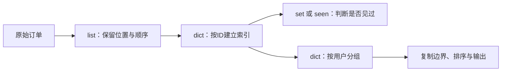
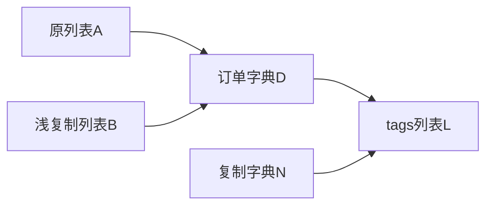

# 第03章　一批记录：容器、查找与聚合

[上一章](02-数字、金额、文本与编码.md) · [全书目录](教材目录.md) · [下一章](04-函数、作用域、闭包与装饰器.md)

## 1. 学习目标与前置知识

能为一组订单选择容器、保留顺序、按键查找、识别重复与冲突、分组聚合，并说明复制后哪些层仍然共享。前置：第1–2章。

**承接与本章主线：** 第1章建立“名称→对象”，第2章区分值与单位；本章把这条箭头扩展成“名称→容器→元素对象”，用同一批订单依次解决顺序、查找、唯一性、分组和复制问题。产出是一段可运行的数据脚本，第4章再把其中的规则封装成函数。

**本章从这里开始：** 现在有一批订单，业务要回答四个问题：按原顺序展示、按ID找到某一笔、判断哪些ID重复、按用户汇总已支付金额。只用一个列表或只用一个集合都只能回答其中一部分；本章从“每个结构保留了什么信息”出发，一步步搭出一条数据管道。

四个问题对应四种信息，不要求一次记住所有容器：

**首遍路线：** 2.1 list → 2.2 dict → 2.3 set → 2.4 tuple → 2.5 推导式与分组 → 2.6 复制边界 → 2.7 排序汇总 → 2.8 选型速查。第一遍先把“这个结构保留了什么信息”说清；2.6 的浅复制和 `id` 观察可以慢一点，它是本章最容易被“看起来一样”骗过去的地方。



## 2. 基础知识讲解

先记住一个判断顺序：**这个操作需要保留位置、字段、唯一性，还是聚合结果？** 结构选错时，后面每一步都在补救丢失的信息；结构选对时，筛选、分组和复制只是同一张图上的不同操作。

### 2.1 先保存一批记录：list 保留位置

只有金额时，`[1990, 1000, 10]` 能求和，却不能回答“哪一笔属于Alice”“重复的是哪一笔”。要回答这些问题，记录必须同时保留ID、用户、金额和状态。最直接的做法是把每笔订单写成字典，再把字典放进列表。外层list回答“第几笔、按什么顺序”，内层dict回答“字段叫什么、值是什么”。`orders[0]`取得第一笔，`orders[-1]`取得最后一笔，`orders[1:3]`取得从位置1开始、不含3的两笔。下标越界会抛`IndexError`，负下标从末尾计数；这些规则都作用在“位置”上。

```python
# study-example: S03A
orders = [
    {"id": "A", "user": "Alice", "amount_cents": 1990, "status": "paid"},
    {"id": "B", "user": "Bob", "amount_cents": 1000, "status": "pending"},
    {"id": "C", "user": "Alice", "amount_cents": 10, "status": "paid"},
]
paid_ids = []
paid_total = 0
for order in orders:
    if order["status"] == "paid":
        paid_ids.append(order["id"])
        paid_total += order["amount_cents"]
assert paid_ids == ["A", "C"]
assert paid_total == 2000
assert orders[1]["user"] == "Bob"
```

`for order in orders`每轮让`order`绑定当前字典；读取`order["status"]`没有复制它。`paid_ids`是新列表，只追加需要的ID；如果写成`order["status"] = "checked"`，就会改动原记录，这和“读取后产生新结果”是两种副作用。

#### 案例推进：列表方法改变的是同一批位置

列表的常见操作只有几类，先按“加一个还是加一批”区分：

```python
# study-example: S03M
items = ["A", "B"]
items.append("C")
items.extend(["D", "E"])
assert items == ["A", "B", "C", "D", "E"]
items[0] = "A2"
last = items.pop()
assert last == "E" and items == ["A2", "B", "C", "D"]
assert "B" in items
assert "E" not in items
```

`append`追加一个对象；`extend`把来源中的元素逐个追加；`insert`在指定位置前插入；`pop`按位置取出并删除；`remove`按值删除第一个相等元素。它们改变的是列表内容，不是把`items`重新绑定到另一个列表。删除前要先决定“目标不存在时怎么办”：`remove`会抛`ValueError`，`discard`式的静默跳过并不适用于列表。

遍历同一个列表时删除元素，会让后续元素前移，循环可能跳过下一项。需要筛选时，构造新列表通常更清楚：

```python
# study-example: S03Q
items = ["A", "B", "A"]
assert items.count("A") == 2
assert items.index("B") == 1
items.insert(1, "C")
assert items == ["A", "C", "B", "A"]
items.remove("A")
assert items == ["C", "B", "A"]
del items[1]
assert items == ["C", "A"]
assert items.reverse() is None
assert items == ["A", "C"]
assert items.clear() is None
assert items == []
```

`count`和`index`只读，`insert`、`remove`、`del`、`reverse`、`clear`修改原列表；修改方法通常返回`None`，不能把`items = items.reverse()`当作“得到反转后的新列表”。

**到这里，list 能回答“第几笔”，却不能高效回答“ID为A的记录在哪里”。** 每次按ID查找都要从头扫描；下一节把ID变成键。

### 2.2 按ID找到记录：dict 是索引，不是集合

如果查询总是“按ID找一笔”，可以把记录放进以ID为键的字典（这里先假设ID唯一；重复/冲突处理见下例）：

```python
orders = [{"id": "A", "user": "Alice"}, {"id": "B", "user": "Bob"}]
by_id = {order["id"]: order for order in orders}
assert by_id["A"]["user"] == "Alice"
assert by_id.get("D") is None
```

`by_id["D"]`要求键存在，缺失时抛`KeyError`；`get`允许指定默认值。**字段不存在与字段值为`None`是两种状态**，`get("D")`得到`None`并不证明“D存在且值为空”。需要区分时，用`"D" in by_id`先判断键，或给`get`一个不会与业务值冲突的哨兵。

字典的键必须可哈希，值没有这个要求；同一个键再次赋值会更新值，但保留该键原来的插入位置。删除后重新插入，才会排到末尾。遍历字典得到键，`items()`得到键值对；这些视图反映当前字典，不是修改时自动冻结的快照。

#### 案例推进：ID 索引和冲突

直接执行`by_id[order["id"]] = order`会把重复ID悄悄覆盖，冲突信息就丢了。要保留“完全重复”和“同ID不同内容”的区别，必须在写入前比较：

```python
# study-example: S03R
orders = [
    {"id": "A", "user": "Alice", "amount_cents": 1990, "status": "paid"},
    {"id": "B", "user": "Bob", "amount_cents": 1000, "status": "pending"},
    {"id": "A", "user": "Alice", "amount_cents": 1990, "status": "paid"},
    {"id": "A", "user": "Alice", "amount_cents": 1991, "status": "paid"},
    {"id": "C", "user": "Alice", "amount_cents": 10, "status": "paid"},
]
before = [dict(order) for order in orders]
by_id = {}
duplicates = []
conflicts = []
for order in orders:
    key = order["id"]
    if key not in by_id:
        by_id[key] = order
    elif by_id[key] == order:
        duplicates.append(key)
    else:
        conflicts.append(key)
assert list(by_id) == ["A", "B", "C"]
assert duplicates == ["A"] and conflicts == ["A"]
assert by_id["A"]["amount_cents"] == 1990
assert orders == before
```

第一笔A建立条目，第三笔A与首条完全相同，记入`duplicates`；第四笔A金额是1991，记入`conflicts`，原条目不被覆盖；最后C建立新条目。`list(by_id)`保持首次插入顺序，因此“保留首见顺序”可以和“按ID查找”同时成立。

如果想把首条覆盖，需要把 `else` 分支的 `conflicts.append(key)` 改成 `by_id[key] = order`；这时 `by_id["A"]` 才会被1991覆盖。

如果删除整个 `elif` 分支、只保留 `if/else`，可以用下面这个独立实验复现实际结果：

```python
# study-example: S03S
first = {"id": "A", "user": "Alice", "amount_cents": 1990, "status": "paid"}
duplicate = {"id": "A", "user": "Alice", "amount_cents": 1990, "status": "paid"}
conflict = {"id": "A", "user": "Alice", "amount_cents": 1991, "status": "paid"}
by_id = {}
duplicates = []
conflicts = []
for order in (first, duplicate, conflict):
    key = order["id"]
    if key not in by_id:
        by_id[key] = order
    else:
        conflicts.append(key)
assert duplicates == []
assert conflicts == ["A", "A"]
assert by_id["A"]["amount_cents"] == 1990
```

此时重复A和冲突A都会进入 `conflicts`，实际结果是 `duplicates == []`、`conflicts == ["A", "A"]`，首条A仍然是1990；`duplicates == ["A"]` 的断言失败。这个实验说明“漏记重复”与“覆盖首条”是两种不同错误，不能混为一谈。

**dict 能保存首条内容，也能用 `key in by_id` 回答“某个ID是否出现过”；但“是否出现过”和“出现过什么”是两个问题。** set 的价值不在替代 dict，而在于对一批ID做并、交、差等集合关系，并在只关心成员时避免保存整条记录。下一节用 set 处理“全部订单ID/已支付订单ID”这类关系。

### 2.3 只回答“见过没有”：set 与可哈希

按ID能找到记录后，还有一个更小的问题：这个ID到底出现过没有？如果只关心真假，不需要保存整条记录，set更合适。set保存唯一成员，适合记录“哪些ID已经出现”：

```python
# study-example: S03C
all_ids = {"A", "B", "C"}
paid_ids = {"A", "C"}
assert all_ids - paid_ids == {"B"}
assert paid_ids <= all_ids
assert all_ids | {"D"} == {"A", "B", "C", "D"}
assert all_ids & paid_ids == {"A", "C"}
```

`|`求并集，`&`求交集，`-`求差集，`<=`检查子集。set不保留重复次数，也不承诺输入顺序；`{"B","A"}`和`{"A","B"}`是同一个集合。因此“去重后仍要按首见顺序输出”不能只靠set，通常用dict的键顺序。

空集合写成`set()`，`{}`是空字典。set成员必须可哈希：列表、字典通常不能直接放进去；tuple是否可哈希取决于内部元素，外层套一个tuple并不会自动解决。作为键或成员使用期间，影响哈希和相等的状态必须保持稳定，否则同一个对象可能“找不到自己”。

```python
# study-example: S03O
seen = {"A", "B"}
seen.add("C")
seen.discard("B")
seen.discard("missing")
assert seen == {"A", "C"}
assert type({}) is dict
assert type(set()) is set
single = ("A",)
assert len(single) == 1
assert type(("A")) is str
assert frozenset(seen) == frozenset({"C", "A"})
```

`discard`在成员不存在时不报错，`remove`要求存在；`frozenset`提供不可修改的集合形式。`("A")`只是加了括号的字符串，`("A",)`才是单元素tuple。

**set 适合集合关系和成员判断，不保存重复次数、顺序或首条内容；它不是 dict 的替代品，而是另一类需求。** 当一条记录或复合分组键的字段位置固定、不需要增删时，用 tuple 表达；下一节从“按什么分组/返回什么组合”出发引入它。

### 2.4 固定结构：tuple 与解包

当一条记录的位置固定、不需要增删时，用tuple表达比list更准确。tuple保存有序元素，但创建后不能替换某个位置的引用。它适合“字段位置固定、不需要增删”的记录，或函数返回多个值。单元素tuple必须有逗号：

```python
# study-example: S03T
record = ("A", 1990)
order_id, cents = record
assert order_id == "A" and cents == 1990
one = ("A",)
assert len(one) == 1
first, *middle, last = [1, 2, 3, 4]
assert first == 1 and middle == [2, 3] and last == 4
# record[0] = "B" 会抛 TypeError；left, right = (1, 2, 3) 会抛 ValueError。
# 本章只观察这些边界，不在这里捕获；第5章再统一处理异常。
```

解包把固定结构赋给多个名称，`*middle`收集中间剩余元素并生成列表；元素数量不符合时抛`ValueError`。tuple不可替换位置，但内部如果引用可变对象，对象本身仍可能被修改；“tuple不可变”不等于“内部一切不可变”。

**tuple 适合固定组合，不适合需要增删的批次。** 对一批记录做筛选、转换或分组时，下一步需要一种不写长循环的表达方式。

### 2.5 从循环到推导式：筛选、转换与分组

前面用循环完成筛选和分组；当循环只做“取元素、判断、追加”时，可以改用推导式。先写清楚循环，再决定是否压缩：

```python
rows = [{"id": "A", "status": "paid"}, {"id": "B", "status": "pending"}]
paid_ids = []
for row in rows:
    if row["status"] == "paid":
        paid_ids.append(row["id"])
```

同一件事可以写成列表推导式：“结果表达式、遍历来源、筛选条件”：

```python
# study-example: S03D
rows = [{"id": "B", "amount_cents": 10}, {"id": "A", "amount_cents": 10},
        {"id": "C", "amount_cents": 5}]
ids = [row["id"] for row in rows if row["amount_cents"] >= 10]
assert ids == ["B", "A"]
```

推导式适合“取元素、筛选、转换”一步完成。需要多步更新、错误定位或冲突处理时，普通循环更容易讲清；字典/集合推导式只改变输出结构，不会替你决定业务规则。

#### 案例推进：分组就是“首次建桶、之后追加”

按用户分组时，dict的值可以是列表：

```python
# study-example: S03B
orders = [{"id": "A", "user": "Alice"}, {"id": "B", "user": "Bob"},
          {"id": "C", "user": "Alice"}]
groups = {}
for order in orders:
    user = order["user"]
    if user not in groups:
        groups[user] = []
    groups[user].append(order["id"])
assert groups == {"Alice": ["A", "C"], "Bob": ["B"]}
assert list(groups) == ["Alice", "Bob"]
```

第一轮建立Alice的桶，第二轮建立Bob的桶，第三轮复用Alice的桶。若每轮都写`groups[user] = []`，旧分组会被覆盖；`setdefault`可以把“不存在就建空列表”合成一步，但首次学习先保留`if`，看清两个阶段。

**推导式和分组能产生新结构，但如果新结构仍引用原记录，调用方修改结果就可能改坏输入。** 下一节专门处理复制边界。

### 2.6 复制、别名与所有权：不修改输入 ≠ 返回独立

先看一个常见误解：函数没有修改输入，返回的新列表却装着原字典，调用方修改结果仍会影响原数据。

```python
# study-example: S03E
original = [{"id": "A", "tags": ["new"]}]
outer_copy = original.copy()
record_copy = [dict(original[0])]
assert outer_copy is not original
assert outer_copy[0] is original[0]
assert record_copy[0] is not original[0]
assert record_copy[0]["tags"] is original[0]["tags"]
```

关系可以画成“名称→外层列表→订单字典→tags列表”。`original.copy()`只新建外层，元素仍是原字典；`dict(original[0])`再复制一层字典，但`tags`列表仍共享。复制到哪一层，由“谁会修改哪一层”决定。



切片`original[:]`、`list(original)`、`original.copy()`都只复制外层；`copy.deepcopy`递归复制嵌套对象，并用备忘处理重复引用和环，但资源对象、外部连接和自定义复制仍有边界，不能把深复制当资源隔离或事务机制。

#### 案例推进：复制到哪一层

```python
# study-example: S03Z
from copy import deepcopy
original = [[1], [2]]
shallow = original.copy()
assert shallow is not original
assert shallow[0] is original[0]
shallow[0].append(9)
assert original == [[1, 9], [2]]
shallow[1] = [8]
assert original[1] == [2] and shallow[1] == [8]
deep = deepcopy(original)
deep[0].append(7)
assert original == [[1, 9], [2]]
```

给浅副本的外层槽位重新赋值，只改变新容器；通过浅副本修改内部列表，两边都能看到。`deepcopy`之后内部不再共享，但这不代表它可以替代权限、事务或资源管理。

列表重复也有同样的问题：

```python
# study-example: S03F
# 这个不是创建了 3 个独立的空列表，而是把同一个空列表对象的引用复制了 3 份
shared = [[]] * 3
shared[0].append("A")
assert shared == [["A"], ["A"], ["A"]]
separate = [[], [], []]
separate[0].append("A")
assert separate == [["A"], [], []]
assert shared[0] is shared[1]
assert separate[0] is not separate[1]
```

`[[]] * 3`重复的是同一个内部列表的引用，不会把空列表求值三次；需要独立桶时，用`[[] for _ in range(3)]`，每一轮新建一个列表。

切片赋值和字典视图又是另外两种“看到变化”的方式：

```python
# study-example: S03G
ids = ["v1", "appendix", "receipt"]
primary, *extras = ids
observer = ids
ids[:1] = ["v2"]
assert primary == "v1" and extras == ["appendix", "receipt"]
assert observer == ["v2", "appendix", "receipt"]

versions = {"policy": "v1"}
keys = versions.keys()
snapshot = list(keys)
versions["invoice"] = "v2"
assert list(keys) == ["policy", "invoice"] and snapshot == ["policy"]
```

`ids[:1] = ["v2"]`修改原列表，`observer`能看到；`primary`和`extras`在切片赋值前已经绑定到旧值。字典的`keys()`是动态视图，`list(keys)`才是当时的快照。要保留“决策当时的证据”，只复制键还不够，还要保留来源版本。

**复制解决“结果是否共享”，不解决“业务上哪些信息该保留”。** 下一步把结果稳定地排序、配对和汇总。

### 2.7 排序、配对与汇总：让输出稳定

结果结构稳定后，最后常做的是排序、配对与汇总。`sorted`返回新列表，`list.sort`原地修改并返回`None`：

```python
# study-example: S03P
ids = ["A", "B"]
amounts = [100, 200]
assert list(enumerate(ids, start=1)) == [(1, "A"), (2, "B")]
assert list(zip(ids, amounts, strict=True)) == [("A", 100), ("B", 200)]
assert list(zip(ids, [100])) == [("A", 100)]
assert sum(amounts) == 300
assert min(amounts) == 100 and max(amounts) == 200
assert sorted(amounts, reverse=True) == [200, 100]
assert amounts == [100, 200]
in_place = amounts.copy()
returned = in_place.sort(reverse=True)
assert in_place == [200, 100] and returned is None
assert any([False, True]) is True
assert all([True, False]) is False
assert any([]) is False and all([]) is True
```

`enumerate`在保留元素的同时附上序号，`start`改变起点；`zip`按位置配对，默认到较短来源结束，`strict=True`要求长度一致，长度不同会失败。`sum`、`min`、`max`做汇总，后两者要求非空；`any`只需一项为真，`all`要求全部为真，空输入分别返回`False`和`True`。

排序是稳定的：相同排序依据的元素保持原相对顺序。按金额排序订单需要“从记录中取金额”的函数；第四章学会函数后再用`key`，本章先只对数字排序并理解“返回新列表”和“并列保持顺序”。

**到这里，五种结构各自回答了不同问题。** 下一步不是再背方法，而是用一张表决定“当前问题该用哪种结构”。

### 2.8 选型与操作速查：把方法放回容器

| 结构 | 保留顺序 | 允许重复 | 按值/键查找 | 可修改 | 适合 |
| --- | --- | --- | --- | --- | --- |
| list | 是 | 是 | 按下标；按值需扫描 | 是 | 批次、顺序、稳定输出 |
| tuple | 是 | 是 | 按下标 | 否（位置） | 固定记录、返回多值 |
| dict | 是（插入序） | 键唯一 | 按键，平均O(1) | 值可改 | 记录索引、分组、去重 |
| set | 否 | 否 | 成员判断，平均O(1) | 是 | 是否见过、集合运算 |
| frozenset | 否 | 否 | 成员判断 | 否 | 可哈希的集合 |

常见操作按容器归类，查表即可，不必一次背完：

```python
# study-example: S03N
order = {"id": "A", "cents": 100}
order["cents"] = 200
assert order["cents"] == 200
assert order.get("note") is None
assert order.get("note", "未填写") == "未填写"
removed = order.pop("cents")
assert removed == 200 and "cents" not in order
```

`in`判断键，`get`指定缺失默认值，`pop`同时读取和删除；`update`合并时后来的同名值覆盖先前值，适合明确覆盖的配置，不适合尚未检查冲突的订单去重。

按下标取元素在常规CPython中通常是O(1)；按值搜索（`"Z" in items`）才逐项比较，是O(n)。dict/set按键或成员查找平均是常数时间，但“平均”不是“保证”，哈希碰撞和恶意输入会影响最坏情况。选择结构时先问：需要顺序吗？需要保留重复次数吗？查询是按下标、按ID还是按成员？数据量会让线性扫描变得不可接受吗？

## 3. 原理讲解与推导

### 3.1 容器保存的仍是对象引用

前面反复出现“复制到哪一层”，现在把引用关系单独说清。第1章的名称→对象，在容器里变成名称→容器→元素对象。容器的槽位保存引用，不保存一份独立副本；因此“外层是新容器”与“内部对象独立”是两个问题。函数契约要说明：是否只读、是否复制外层、是否复制内部、返回值能否被调用方修改。复制到哪一层由修改位置决定，不改变对象图本身；深复制也不能替代资源关闭与权限检查。

### 3.2 哈希缩小候选，相等确认键

为什么dict/set查找快，而list要逐项扫描？答案在哈希与相等。哈希表利用哈希值组织候选位置，仍需相等判断确认键。相等对象应有相同哈希值，哈希碰撞却不代表相等。作为键使用期间，影响哈希和相等的状态必须保持稳定；自定义类的`__eq__`与`__hash__`在第6章展开。

### 3.3 结构由要保留的信息决定

回到本章的订单问题：结构不是风格选择，而是由要保留的信息决定。只记录ID可以判断是否见过，却无法比较内容；记录“ID→首条订单”，便能判断完全重复还是字段冲突，同时利用插入顺序输出。需要分组时，dict的值从“一条记录”变成“一组记录”；需要稳定输出时，再对结果排序。

## 4. 示例与逐步走查

下面把同一批订单走完整条管道：按ID去重并发现冲突、保留首见顺序、按用户分组、汇总已支付金额。

```python
# book-example: B03
orders = [
    {"id": "A", "user": "Alice", "amount_cents": 1990, "status": "paid"},
    {"id": "B", "user": "Bob", "amount_cents": 1000, "status": "pending"},
    {"id": "C", "user": "Alice", "amount_cents": 10, "status": "paid"},
    {"id": "A", "user": "Alice", "amount_cents": 1990, "status": "paid"},
    {"id": "A", "user": "Alice", "amount_cents": 1991, "status": "paid"},
    {"id": "D", "user": "Alice", "amount_cents": 500, "status": "pending"},
]
before = [dict(order) for order in orders]
by_id = {}
duplicates = []
conflicts = []
for order in orders:
    key = order["id"]
    if key not in by_id:
        by_id[key] = order
    elif by_id[key] == order:
        duplicates.append(key)
    else:
        conflicts.append(key)
by_user = {}
for order in by_id.values():
    by_user.setdefault(order["user"], []).append(order["id"])
paid_total = sum(order["amount_cents"] for order in by_id.values()
                 if order["status"] == "paid")
assert list(by_id) == ["A", "B", "C", "D"]
assert duplicates == ["A"] and conflicts == ["A"]
assert by_user == {"Alice": ["A", "C", "D"], "Bob": ["B"]}
assert paid_total == 2000
assert orders == before
```

### 4.1 沿输入到结果逐步解释

第一步按ID建索引：第一笔A建立条目；第四笔A与首条完全相同，记入`duplicates`；第五笔A金额1991，记入`conflicts`，原条目不被覆盖；D建立新条目。

如果删掉整个 `elif` 分支、只保留 `if/else`，重复A和冲突A都会进入 `conflicts`：实际是 `duplicates == []`、`conflicts == ["A", "A"]`，首条A仍是1990，`by_id["A"]` 和 `paid_total` 不会变；变的是 `duplicates` 断言。

要观察覆盖，应把 `else` 改成 `by_id[key] = order`；这时 `by_id["A"]` 和 `paid_total` 才会变，断言才会失败。

第二步分组：遍历`by_id.values()`，Alice第一次出现时建立列表，C和D再追加；Bob建立自己的列表。`setdefault`把“首次建桶、之后追加”合成一行，但语义仍是两步。

第三步汇总：只对`status == "paid"`的记录求和，A和C合计2000；B和D是pending，不计入。删掉状态判断会得到3500，说明“有记录”不等于“已支付”。三种输出分别依赖冲突比较、分组键和状态过滤，任何一步删掉，后面的断言都会失败。

## 5. 动手练习

### 本章累计任务：保持顺序并发现冲突

处理订单：A/Alice/29/paid、B/Bob/1999/pending、A/Alice/29/paid、C/Alice/500/pending。按ID去重后应保留A、B、C三笔，首见顺序不变；按用户分组应为Alice→[A, C]、Bob→[B]；已支付合计29分。把第二条A的金额改成30分，应记入冲突而不是覆盖，输入不得被修改。再用空列表验证空报告，并说明分组若保存整条记录、返回结果是否会与原字典共享。

**未通过时怎样定位：** 先确认“同ID怎样比较”，再检查是否在写入前比较；如果分组被覆盖，回到“首次建桶、之后追加”；如果复制后内部仍共享，回到引用图。空列表应形成合法空结果，不靠第一条记录初始化。

**带到下一步：** 第4章把这段真实规则封装成可复用函数，不换一批无关数据。

下方专题练习用于补当前卡点；先完成这一项累计任务，不另将所有索引作为必须并行完成的进度。

### L05：规范化与输入不变（P06）

对订单记录去掉 id/user 两端空白，保留大小写，金额与状态不改。返回新列表与新订单字典。本章先记录空id/user或未知字段为非法，不发布正常结果；第4–5章再封装函数并用ValueError表达拒绝。

验收：`{"id":" A ","user":" Alice ","amount_cents":1,"status":"paid"}` 变为 A/Alice，原数据仍保留空白；本章手工准备独立预期数据或比较原字段；第5章E02再使用deepcopy快照检查。

### L06：保持顺序的冲突去重（P08）

复用本章订单样例：完全重复保留第一条；同ID不同内容先记录冲突ID；第5章增加包含ID的ValueError。保持首见顺序，并让分组和汇总只使用去重后的记录。

验收：ID 为 B/A/B 且 B 两条内容相同，输出 B/A；若第二条 B 金额改变，明确报错。额外测试空输入、输入不变，以及“只有ID集合无法判断字段冲突”。

### L01：引用与复制（P02）

用 `a = [{"tags": ["paid"]}]` 本章构造别名与浅复制；深复制在第5章E02继续完成。修改外层列表，再修改 tags，记录三个版本受到的影响。预测结果后运行，并画出名称与对象的引用关系。

验收：能解释为什么“外层不是同一个列表”不足以证明内部状态独立；不用 id 数值规律推断语义。

### 累计交付：数据脚本

当前任务：给定订单列表，完成筛选、按ID去重与冲突记录、按用户分组和已支付汇总，不修改输入。

继续之前：保存脚本、手算结果、一个重复ID和一个冲突ID；第4章把合法路径封装，第5章把非法状态变成明确异常。

## 6. 验收与自测

**行为验收：** 同ID完全重复只留一条，字段冲突单独记录；空输入有定义；分组与已支付汇总正确；原列表和内部字典不被修改；排序返回新列表且并列保持原顺序。删除冲突判断、状态过滤或分组初始化后，B03 的对应断言必须失败。

**原理验收：** 合上资料解释本章一个机制，预测一个反例，说明规则属于语言语义、库约定还是实现观察。

### 6.1 先预测，再查看参考推导

一个函数声称“不修改输入”，却返回了原订单字典组成的新列表。这个接口是否已经保证调用方修改结果不会影响原输入？

<details>
<summary>完成预测后查看解释</summary>

没有。函数执行时不修改输入，与返回值不共享内部可变对象是两个契约。新列表仍可能引用原字典；若要求后者，应复制相应记录或返回不可变表示，并用修改结果的案例验证。分组时如果每个组都引用原记录，修改分组结果同样会改到原数据。

</details>

## 7. 面试问答与迁移

list、dict、set分别保留什么信息？为什么字典键要求可哈希？浅复制和深复制的边界在哪？遍历列表时删除元素为什么会漏项？稳定排序对业务有什么意义？

**参考回答：**

1. list 保留位置与重复，dict 保留键值映射和插入序，set 表达唯一成员且不保证业务顺序。选型先问要保留什么信息：只用set去重会丢失重复记录的内容冲突。常见实现中list按下标访问为O(1)、按值查找为O(n)；dict/set的哈希查找通常平均O(1)，不能说所有输入下都如此。
2. 哈希先缩小候选位置，相等比较再区分候选，所以相等对象必须有相同哈希，哈希相同却不保证相等。键在使用期间哈希值必须稳定；改变参与相等或哈希的状态会破坏查找约定。tuple是否可哈希还取决于里面的成员。
3. 浅复制只新建外层容器，内层引用继续共享；deepcopy按复制协议递归处理并记录已访问对象，不等于把所有东西变成互不关联的副本。文件、连接、外部效果应明确所有权，不能靠深复制实现隔离。
4. 列表迭代继续向后取元素，删除当前项会让下一项前移，从而可能跳过；构造保留项列表通常更清楚。稳定排序只保证相同排序键的项保留输入相对顺序；输入来自无序来源时，还需规定完整的并列键才能跨次复现。

**换条件自测：** 第1章的真假默认值与字典缺键默认值不同。先预测以下结果；再把 `0` 改成 `None`，说明为什么get仍不替换它。

```python
# study-example: S03U
settings = {"limit": 0}
assert settings.get("limit", 10) == 0
assert (settings.get("limit") or 10) == 10
assert settings.get("missing", 10) == 10
```

## 8. 本章小结与参考

### 8.1 主要知识点总结

- list保留位置与顺序，dict用键建立查找和分组，set只表达唯一成员，tuple固定位置结构。
- 去重前先比较内容：完全重复保留首条，同ID不同内容记录冲突，不能直接覆盖。
- 浅复制只新建外层，嵌套对象仍可能共享；复制范围由修改位置决定，返回结果是否独立是接口契约。
- 排序、配对与汇总要明确返回新列表还是原地修改、长度要求、空输入以及并列规则。

### 8.2 日常工作注意事项

- 遍历列表时直接删除元素可能漏处理；优先构造筛选结果，或明确遍历快照与修改目标。
- 不要将`items = items.sort()`当作取得新列表；`sort`修改原列表并返回`None`，`sorted`才返回新列表。
- 用字典去重前先检查同ID内容是否冲突；用集合去重会丢失重复次数，也不能满足保留首见顺序的需求。
- `[[]] * n`只重复引用；需要独立桶时用推导式逐轮新建。

### 8.3 参考与后续学习

机制补充核对（2026-11-09）：[复制协议与备忘](https://docs.python.org/3.12/library/copy.html)。实验按本项目3.12解释器验证，其他构建或解释器需重新确认。

本章把单个值组织为记录和记录集合，并明确查找、唯一性、分组与复制。下一章把重复的数据处理封装为函数，继续追踪参数绑定和副作用。

官方参考：[本章资料](https://docs.python.org/zh-cn/3.12/tutorial/)。动态框架资料以2026-11-04核对的入口为准，具体SDK版本在实际实践时重新核对并记录锁文件。

[上一章](02-数字、金额、文本与编码.md) · [下一章](04-函数、作用域、闭包与装饰器.md)
