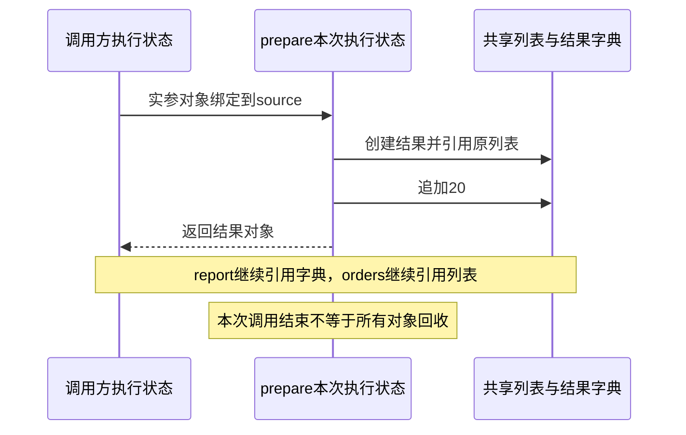

# 第04章　函数、作用域、闭包与装饰器

[上一章](03-容器、推导式与数据转换.md) · [全书目录](教材目录.md) · [下一章](05-迭代、生成器、异常与资源管理.md)

## 1. 学习目标与前置知识

能设计签名、解释名称解析并编写行为透明的包装。前置：第1–3章。

**承接与本章主线：** 在已有对象与容器上建立调用帧、参数和返回模型，再推导作用域、闭包及包装；下一章让调用可以暂停并处理异常退出。

**本章从这里开始：** 同一段订单规则将被CLI、接口与工具重复使用。函数让它变成稳定的输入输出；闭包和装饰器则让行为可以配置与扩展。本章先写普通函数，再一步步得到这些机制。

## 2. 基础知识讲解

### 2.1 定义函数是建立一个可调用对象

订单汇总在两个入口重复出现时，复制代码会让一次规则修改需要改两处。函数先解决“同一规则只维护一份”：调用方提供对象，函数执行规则并返回结果。随后还会遇到配置、共享状态与包装问题；参数、作用域、闭包和装饰器分别解决这些具体变化，不必一开始同时掌握所有函数语法。

函数将一项工作封装成输入与结果。`def`后写名称和参数，缩进体描述调用时执行的语句。return返回结果并结束本次调用；没有return或只写return得到None。print把信息写到输出，不等同返回可组合的数据。

```python
def add_cents(left, right):
    total = left + right
    return total
amount = add_cents(100, 25)
assert amount == 125
```

left/right是本次调用的局部名称，绑定到调用方提供的对象。局部名称重新赋值与修改可变参数不同；是否允许修改输入是接口的一部分。

#### 案例推进：先得到一个能组合的返回值

```python
# study-example: S04A
def paid_total(orders):
    total = 0
    for order in orders:
        if order["status"] == "paid":
            total += order["amount_cents"]
    return total

rows = [{"status":"paid","amount_cents":1990}, {"status":"pending","amount_cents":500}]
assert paid_total(rows) == 1990
assert paid_total([]) == 0
```

执行def时建立函数，执行paid_total(rows)时才进入函数体。orders是本次调用的局部名称；return将结果交回调用处。如果把return改成print，终端虽然显示数字，调用者得到的却是None，无法可靠接入后续计算。

给函数写文档时，说明输入是否已校验、是否允许重复、是否修改输入、输出单位与失败行为。函数名不能替代这些条件；名字同为total，却可能一个统计原始行、另一个统计去重订单。

### 2.2 一次函数调用怎样建立帧、共享对象并返回

第1章区分了对象存储与执行上下文。现在把执行上下文具体化为**执行帧**：一次调用需要记住正在执行的代码、下一步位置、局部绑定、可访问的全局环境及临时计算状态。调用栈把尚未结束的调用关联起来，便于回到调用处或传播异常。

```python
# study-example: S04W
def prepare(source):
    local_total = 1000
    result = {"items": source, "total": local_total + 1}
    source.append(20)
    return result
orders = [10]
report = prepare(orders)
assert report["items"] is orders
assert report["total"] == 1001
assert orders == [10, 20]
```

| 时刻 | 执行状态 | 对象与引用 |
| --- | --- | --- |
| 执行def | 建立函数对象并绑定prepare | 函数保存代码及定义环境，不执行函数体 |
| 求实参 | 取得orders引用的列表 | 尚未要求复制列表 |
| 进入调用 | 本次帧中source绑定该列表 | 调用方与本次形参共享对象 |
| 执行函数体 | local_total、result属于本次局部绑定 | 新字典引用列表及计算结果 |
| return | 把结果对象交回调用处 | report接住字典，对象继续可达 |
| 调用结束 | 结束本次执行，释放不再需要的帧引用 | 返回的字典和列表不随局部名称一起消失 |

```text
prepare执行期间（逻辑调用关系，不是内存地址图）：
调用方：orders ───────────────────→ 列表A
   │                                  ↑
   └─ 本次prepare帧：source ────────────┘
                     result ──→ 字典B ──items──→ 列表A

返回后：调用方report ──→ 字典B ──items──→ 列表A
        调用方orders ───────────────────→ 列表A
```

所以“函数退出，局部变量释放”更准确地说是本次局部绑定和执行状态结束；对象是否继续存在要追踪剩余引用。返回值、容器、闭包和异常现场都可能保留对象。正常返回也不保证调试器或其他持有者未保存帧。

参数共享与重新绑定再看下面的独立实验：

调用时先计算实参，再把对象绑定到本次形参。它不是把调用者的名称本身交给函数；形参重绑定不会重新绑定调用者名称，原地修改共享对象则可被调用者看到。常说“传对象引用”应理解为这种共享对象与独立名称的关系。

```python
# study-example: S04Z
def change(items):
    original_object = items
    items.append(2)
    items = [99]
    return original_object, items
outside = [1]
shared, local = change(outside)
assert outside is shared and outside == [1, 2]
assert local == [99] and local is not outside
```

函数每次调用有自己的局部状态；CPython使用执行帧等结构管理执行，但局部名称不必逐次按普通dict查询。LEGB是名称解析模型，不能直接当底层内存布局。默认值在def执行时求值并由函数保存；闭包访问相关外层绑定，非每次调用复制外层对象。

函数体若对一个名称赋值，通常会被判为局部名称；即使赋值语句位于之后，前面的读取也不会自动退回同名全局，可能产生UnboundLocalError。global/nonlocal声明改变绑定目标，不能靠调用者的同名变量改变词法作用域。

#### 先后关系与存活关系分开画



图中执行状态的结束顺序体现调用栈；对象是否存活由仍被谁保留决定。之后学习闭包、生成器和协程时继续问这两个问题，不另背一套互不相关的存储口诀。

#### 进阶：Python调用栈和原生C栈为什么不一一对应

常规CPython 3.12中，内部解释器帧记录局部引用和求值状态；常见调用可使用线程管理的帧存储，生成器/协程又有需跨暂停保存的状态。供Python调试观察的frame对象可按需要建立，不能说所有Python调用都必定分配一个完整可见的frame对象。

Python调用栈描述调用关系，不是承诺每层调用对应一层原生C递归。版本优化改变布局，却不改变本例的参数共享与返回语义。源码层资料见[3.12帧布局](https://raw.githubusercontent.com/python/cpython/3.12/Objects/frame_layout.md)、[帧API](https://docs.python.org/3.12/c-api/frame.html)和[调用优化说明](https://docs.python.org/3.12/whatsnew/3.11.html#inlined-python-function-calls)。初学不需要记内部字段或手工访问帧来编程。

### 2.3 参数怎样匹配

普通参数可以按位置或名称传入，默认参数用于省略值。`/`之前仅限位置传入，`*`之后仅限关键字传入。`*args` 收集额外位置参数，`**kwargs` 收集额外关键字参数；调用处的 `*` 与 `**` 则用于解包。
`/`和`*`都是参数分隔符，控制某些核心参数，只允许位置传，调用方不需要关注它内部是什么名字，以后改参数也不容易破坏调用方；某些参数强制显式写法，提高可读性。

默认值在执行def时求值。用列表作默认值可能跨调用共享，应按需求使用None、独立哨兵或工厂。不要为了灵活把所有签名写成 `**kwargs`，否则调用方和检查工具都更难理解允许字段。

#### 案例推进：把签名当作小型接口

```python
# study-example: S04B
def subtotal(cents, /, *, count=1):
    return cents * count

assert subtotal(100, count=3) == 300
def collect(first, *rest, **options):
    return first, rest, options
assert collect("A", "B", "C", strict=True) == ("A", ("B", "C"), {"strict": True})
```

`/`前仅按位置，`*`后仅按关键字；`*rest` 收集为元组，`**options` 收集为字典。调用时的 `*` 与 `**` 执行相反方向的解包。参数形式用于表达真实意图，不要求所有函数都写成灵活但不透明的 `**kwargs`。

#### 默认值、缺省哨兵与递归的边界

默认表达式在def执行时求值。若None表示“没有传入”，用None再创建容器；若None本身也是合法业务值，可用唯一object作为缺省哨兵，并用is判断。哨兵解决状态区分，不自动验证所有字段。

递归把同一问题缩小后再次调用自己，必须有停止条件。每次调用有独立局部执行状态，但共享对象不会自动复制。

```python
# study-example: S04F
def countdown_total(n):
    if n == 0:
        return 0
    return n + countdown_total(n - 1)
assert countdown_total(4) == 10
```

本例约定调用方只传非负整数，先观察调用与返回；第5章再添加非法输入的ValueError检查。它不适合无限深输入；常规Python有递归深度限制，也不保证尾调用优化。线性累计通常直接用循环。非法类型与负数是下一章回做的边界，不将本例用于未校验的外部输入。

### 2.4 名称从哪里查找

通常先看函数局部，再看相关外层函数绑定、模块全局和内置名称（常称 LEGB：Local、Enclosing、Global、Builtins）。函数里有赋值时，该名称通常被判为局部；赋值前读取可能抛UnboundLocalError，即使模块中存在同名值。global和nonlocal改变赋值目标，不是让任意变量“自动同步”。

**嵌套函数只有引用了外层函数的自由变量，才形成闭包；仅仅嵌套、不引用外层变量，不算闭包。** 闭包捕获的是变量绑定/cell，不是变量当时值的快照，也不是对象副本。绑定指向的对象可变时，修改对象内容会被闭包看到；重新绑定名称则改变cell指向。只要返回的函数对象还活着，它引用的cell就活着；不是整个栈帧都被保留。

```python
def outer():
    def inner():
        return 1          # 没有引用outer的变量，不形成闭包
    return inner

def at_least(minimum):
    def accepts(value):
        return value >= minimum   # minimum是自由变量，形成闭包
    return accepts
```

nonlocal修改最近外层函数中已经存在的绑定；global指向定义模块的全局绑定。只读名称再调用可变对象方法（如`items.append(...)`）通常不需要声明，重新绑定名称（`items = ...`）才需要按作用域规则处理。

类体不是普通方法闭包的外层作用域：方法里的名称查找不会把类体变量当作外层自由变量；推导式有独立作用域；注解的求值时机和存储规则也与普通表达式不同，还受`from __future__ import annotations`影响。不能把简化的LEGB顺序机械推广到类体、推导式和注解等全部代码。

#### 案例推进：先理解闭包，再修复晚绑定

```python
# study-example: S04C
def at_least(minimum):
    def accepts(value):
        return value >= minimum
    return accepts

small = at_least(10)
large = at_least(100)
assert small(20) is True
assert large(20) is False
assert small.__closure__[0].cell_contents == 10
assert large.__closure__[0].cell_contents == 100
```

`at_least`调用结束后，返回的函数仍能访问相关外层绑定。两次工厂调用建立了不同的局部作用域和不同的cell，因此`small`与`large`的闭包分别引用不同cell，阈值不同；不是整个栈帧被保留，而是被闭包引用的绑定被保留。若在同一循环里创建多个lambda，它们可能共享同一个循环变量绑定，等真正调用时才读取最后的值，这就是E08要验证的情况。

nonlocal用于修改相关外层函数的绑定，global指向定义模块中的绑定。修改一个可变对象的内容不等于重新绑定其名称，因此items.append(...)通常不需要nonlocal，`items = ...`则要按作用域规则理解。

### 2.5 函数也可以作为数据

可以把函数放进字典、传给另一个函数或从函数返回。sorted的key就是一个例子。lambda提供单表达式匿名函数，复杂逻辑最好用有名称的def。partial可以预先绑定一部分参数；这些工具的目的都是清楚表达依赖，而不是把代码压到最短。

#### 先把一个具名函数改成lambda

```python
# study-example: S04M
rows = [{"id": "B", "cents": 200}, {"id": "A", "cents": 100}]
def amount_key(row):
    return row["cents"]
assert amount_key(rows[0]) == 200
by_function = sorted(rows, key=amount_key)
by_lambda = sorted(rows, key=lambda row: row["cents"])
assert by_function == by_lambda
assert [row["id"] for row in by_lambda] == ["A", "B"]
assert rows[0]["id"] == "B"
```

先直接调用amount_key，确认它对一笔订单返回金额；再将函数本身传给sorted，让排序过程对每笔订单调用它。lambda的冒号前给出参数，后面一个表达式的结果作为返回值，本例与具名函数作用相同。`key=amount_key(rows[0])`会立刻计算得到整数，无法提供排序所需的可调用对象。规则需要多步校验时，用def逐步写清楚，再比较下文的多字段键与partial。

#### 案例推进：回调、lambda与partial怎样选择

```python
# study-example: S04E
from functools import partial
rows = [{"id":"B","amount_cents":10}, {"id":"A","amount_cents":10}, {"id":"C","amount_cents":5}]
ordered = sorted(rows, key=lambda row: (row["amount_cents"], row["id"]))
assert [row["id"] for row in ordered] == ["C", "A", "B"]
def multiply(value, factor):
    return value * factor
double = partial(multiply, factor=2)
assert double(7) == 14
```

key接收函数而不是它当场调用后的结果；lambda提供一个表达式，tuple键按位置逐项比较。复杂规则用具名函数说明意图。partial预先绑定部分参数，闭包则可以组织更自由的状态与行为，两者都不自动复制传入的可变配置。

### 2.6 从包装函数理解装饰器

先写一个接收fn并返回wrapper的函数，wrapper再调用fn。`@decorate`是把这个包装过程写在定义附近。包装器必须转交参数、返回值和异常；wraps帮助保留名称、文档和追踪原函数的入口。

带参装饰器多一层配置工厂，多装饰器要分别考虑定义阶段和调用阶段。异步函数需要等待真实执行，不能把“创建协程对象”当成本次业务已完成。

#### 案例推进：不用语法糖写出第一个装饰器

```python
# study-example: S04D
from functools import wraps
events = []
def recorded(fn):
    @wraps(fn)
    def wrapper(*args, **kwargs):
        events.append("start")
        result = fn(*args, **kwargs)
        events.append("success")
        return result
    return wrapper

def add(left, right):
    return left + right
add = recorded(add)
assert add(2, 3) == 5
assert events == ["start", "success"]
```

recorded接收原函数，返回wrapper，再把add绑定到wrapper。以后add(...)进入包装器，包装器调用原函数，最后返回原结果。`@recorded`只是把这一变换写在定义附近；wraps保留常用元数据并提供追踪原函数的入口，不负责业务执行。

这个首版只记录成功路径。异常时第二个append不运行；第五章学完try/except/finally后，再扩展为区分成功、失败与退出的包装。先把普通调用看清，再加入错误处理，避免一次出现三层函数和四种控制流。

## 3. 原理讲解与推导

### 3.1 把定义时与调用时画成两条时间线

执行def时创建函数对象、求默认值并完成装饰；调用时才绑定本次参数、进入函数体、解析名称并产生返回值。默认列表共享、闭包晚绑定和装饰器注册时机，都可从这条时间线推导。

本章2.2已经建立一次调用的完整时间线。现在区分def执行、参数绑定、函数体执行与return四个时刻，解释默认值、闭包和装饰器；不要把定义函数误当成已经执行函数体。

### 3.2 闭包保存访问绑定的能力

循环中的多个闭包可能访问同一个外层变量，调用时看到其最后状态。**这是晚绑定：闭包捕获变量绑定/cell，不是每次迭代的值快照。** 使用工厂可以为每个闭包建立新的cell；默认参数在def执行时把当前对象保存到`__defaults__`，属于早绑定；`functools.partial`也可以预先绑定参数。二者都不会自动深复制对象，固定一个可变配置后，其他持有者仍能修改其内容。选择修复方式要符合配置是否应独立的要求，可用函数的`__closure__`/`__defaults__`观察实际绑定。

### 3.3 包装要保留可观察行为

装饰器有意增加计时、注册或访问检查，除此之外应保持契约。吞异常、漏return、改变参数或把同步包装直接套在异步函数上，都会产生隐蔽变化。用事件顺序与失败案例检查这些行为。

### 3.4 作用域由代码结构决定，不按调用者临时寻找

函数使用哪个模块全局命名空间，与它定义时所在模块有关，不会因为被另一个模块调用就自动切换到调用者的局部变量。闭包查找相关外层绑定，也不是沿任意调用栈向上寻找同名变量。这是阅读回调、注册函数与测试替身时的重要前提。

函数每次调用有自己的局部执行状态，但可能共同访问模块对象、默认参数或闭包引用的对象。递归产生新的调用层，并不自动复制全部共享状态；缓存、全局列表与可变配置仍需明确设计。所谓“函数没有实例字段”不足以证明它无状态或线程安全。

把默认值、闭包和递归统一画成两部分：本次调用独有的名称，以及它们指向的可能共享对象。然后标出哪些操作只重新绑定、哪些会修改共享对象，即可解释很多看似不同的副作用问题。

#### 名称解析与对象存活放在同一张表里

| 场景 | 执行或查找依据 | 继续持有对象的可能位置 |
| --- | --- | --- |
| 本次普通局部名称 | 当前调用的局部状态 | 返回值、外部容器或其他引用 |
| 模块全局名称 | 定义模块的命名空间 | 模块及其使用者 |
| 默认参数 | def执行时保存的对象 | 函数对象的默认值 |
| 闭包访问的外层绑定 | 相关词法环境 | 闭包中的绑定/单元及其引用 |

这不是四块新的物理内存区域，而是四种访问和持有关系。作用域回答哪里能用一个名称，生命周期回答谁还持有对象；两者不能互相替代。LEGB各级名称已经在2.4讲解，底层具体存储不由这个口诀决定。

### 3.5 机制验证：预测、运行与回看

#### 验证实验 E07

```python
# experiment: E07
def accumulate(value, result=[]):
    result.append(value)
    return result
first = accumulate(1)
second = accumulate(2)
assert first is second and first == [1, 2]
assert accumulate.__defaults__[0] is first
def change(items):
    items.append(3)
    items = []
    return items
original = [1]
assert change(original) == []
assert original == [1, 3]
```

#### 验证实验 E08

```python
# experiment: E08
def make_wrong():
    return [lambda value: value * n for n in (1, 2, 3)]
wrong = make_wrong()
assert [fn(10) for fn in wrong] == [30, 30, 30]
assert all(fn.__closure__[0].cell_contents == 3 for fn in wrong)
def make_fixed():
    return [lambda value, n=n: value * n for n in (1, 2, 3)]
fixed = make_fixed()
assert [fn(10) for fn in fixed] == [10, 20, 30]
assert fixed[0].__closure__ is None  # n由默认参数保存，不是自由变量
def counter():
    count = 0
    def next_value():
        nonlocal count
        count += 1
        return count
    return next_value
a, b = counter(), counter()
assert (a(), a(), b()) == (1, 2, 1)
```

#### 验证实验 E03

```python
# experiment: E03
events = []
def marker():
    events.append("called")
    return "fallback"
assert ("" or marker()) == "fallback"
assert ("ok" or marker()) == "ok"
assert events == ["called"]
assert (0 and marker()) == 0
assert bool("False") is True
assert isinstance(True, int) and True == 1
value = 0
assert (value or 10) == 10
assert (10 if value is None else value) == 0
```

## 4. 示例与逐步走查

```python
# book-example: B04
def at_least(minimum):
    def predicate(value):
        return value >= minimum
    return predicate
small, large = at_least(10), at_least(100)
assert small(20) and not large(20)
```

### 4.1 沿输入到结果逐步解释

at_least(10)开始一次外层调用，minimum绑定10；创建predicate时，minimum作为自由变量进入一个cell，predicate的`__closure__`保存对该cell的引用，然后返回函数本身。外层调用已经结束，但small仍持有这个函数，所以之后还能访问相应minimum。

at_least(100)是另一轮外层调用，建立另一份绑定和另一个cell。small(20)比较20>=10为真，large(20)比较20>=100为假；内层函数代码相同，差异来自各自引用的cell，不是整个栈帧被复制。

这也说明闭包不是一份过去输出。若保存的是可变配置对象，之后修改它，内层调用可能读到新状态；要不要固定当时值，是接口设计问题，不能用“闭包自动复制”解释。

### 4.2 把调用、作用域与闭包合成一幅图

参数回答本次调用绑定谁；作用域回答名称从哪里解析；默认值回答def执行时保存了谁；闭包回答返回后还能通过哪个绑定访问对象。四个问题都沿引用关系解释，不为每种语法发明独立的“内存区域”。在S04W基础上加入第二次调用，画出两个调用的独有字典及可能共享的输入列表。

### 4.3 进阶：已有调用模型后，再看对象存储实现

本节标注为**第二遍选读**：先能解释本章返回值与闭包案例，再研究下列结构。

#### 对象和元素引用的实现层

本段用于连接概念与实现，初读不要求记C字段。在常规CPython中，对象结构包含类型与引用管理等信息，不同类型的数据部分不同。全局名称常通过模块命名空间查找，函数局部名称可通过执行帧中的优化槽位访问；不能推断每个名称都存在独立字典，或都对应一个原生栈变量。

先拿两个具体对象对照：`count = 2`让名称关联一个整数对象，它的类型相关数据表示数值2；`rows = [2, 3]`则关联列表对象，列表的元素区域保存通向元素对象的引用。第1章3.5的对象存储推演解释由谁管理存储，这里进一步解释对象内部保存什么。

| 对象 | 理解其存储时先看什么 | 后续在哪深化 |
| --- | --- | --- |
| int、float | 类型相关的数值表示；整数与浮点表示不同 | 第2章精度与数值边界 |
| str、bytes | 文本与字节各自的内容表示；字符串内部表示不能直接当作UTF-8文件内容 | 第2章编码与解码 |
| list、tuple | 元素引用；多个容器可以引用同一元素对象 | 第3章嵌套结构与复制 |
| dict、set | 为键或成员查找组织的内部结构，同时保留相应对象引用 | 第3章键、哈希与相等 |
| bool、None | True、False、None等特殊对象；名称可以共同引用它们 | 本章真假、缺失与身份 |
| 函数、类、实例 | 代码和环境、类型行为、实例状态等相关信息与引用 | 第4章与第6章 |

这张表说明结构职责，不指定统一字节数或连续布局。对象存储还可能关联额外缓冲区；解释器能够缓存或复用内存。先从“名称→对象→它引用的其他对象”解释可见行为，测量内存占用与分配器细节留到性能章节。

#### 再向下看一层：对象和元素引用放在哪里

下面是常规CPython的概念图，不是可直接照抄的C结构定义，也不承诺字段偏移：

```text
名称绑定/执行帧中的引用
          │
          ▼
   列表对象：类型信息、引用管理信息、长度、元素存储信息
          │
          ├── 元素引用 ──→ 整数对象：自己的类型信息与整数数据
          └── 元素引用 ──→ 另一个对象
```

列表保存元素引用，不把所有元素的完整对象逐个嵌进列表本体。因此一个列表能引用不同类型，也能在多个位置引用同一对象。扩容可能更换内部元素存储区域，但外层列表仍是原对象，不能由内部缓冲区移动推出list的身份改变。

整数对象由其类型相关表示保存数值；执行加法读取这些数值并取得结果对象，不是通过first这个名称原地覆盖旧整数数据。名称重绑定和对象内部修改发生在不同层，后续容器复制、函数共享状态与并发问题都要先分清这两层。

引用管理同样不能机械理解成“每执行一次赋值，打印的引用计数就恰好加一”：解释器还可能保存临时引用，并存在特殊对象和实现优化。学习实验验证身份与可见状态，不固定对象大小、地址或引用计数。

#### 为什么不从内存地址猜程序结果

Python语义规定可观察行为；CPython结构解释某个版本如何实现；缓存、分配器和调试工具观察又是另一层。对象复用、内部缓冲区移动与引用计数变化不能替代语义推理。结合本章已学的帧与返回，以及第3章的容器引用图，区分实现方式与可见行为。

## 5. 动手练习

### 本章累计任务：封装规则与追踪调用

将第3章的规范化、冲突去重和汇总分别写成函数。传入同一批记录，追踪实参、形参、返回值和输入未变；连续调用两次结果应独立。

**未通过时怎样定位：** 第二次结果累积时检查默认可变对象；函数内重新绑定不影响外部名称，原地修改共享对象则会影响。先找到规则的输入输出，再考虑装饰器。

**带到下一步：** 第5章在这组函数外加入逐条读取、错误与清理。

下方专题练习用于补当前卡点；先完成这一项累计任务，不另将所有索引作为必须并行完成的进度。

完成默认参数、倍率闭包、调用记录装饰器；先普通注册函数再添加装饰器注册，不急着连接模型。

### L07：函数签名与默认值（P11–12）

实现 append_note(note, notes=None)，传入列表时按明确约定追加，省略时每次新建。连续两次省略 notes，结果不能共享。再写一个要求 limit 只能按名称传入的函数，说明调用错误。

验收：能区分本题“有意修改传入列表”和订单分析“不修改输入”的两个接口约定；不将所有副作用一律视为错误。

### L08：闭包与晚绑定（P13）

构造三个乘法函数，输入 10 时分别返回 10/20/30。先用循环中的 lambda 观察晚绑定，再用工厂函数或默认参数绑定修正。

再写带 nonlocal 的计数器工厂，两个工厂实例分别计数，状态不能串联。验收：解释“读自由变量的时间”和“默认参数求值时间”。

### L09：装饰器行为（P15）

本章先实现成功路径包装；学完第5章异常后完整验收：实现带记录回调的同步装饰器，记录调用与完成/失败事件，保持原返回值，异常继续抛出，wraps保留原名称与文档。

验收：加法结果相同；原函数抛 ValueError 时调用者仍收到该异常；回调中不记录敏感实参。叠加两个装饰器预测事件顺序。异步函数需要单独设计，不直接套用同步包装。

### L02：真假值与边界（P03）

实现 choose_limit(value, default=10)：只有 None 使用默认值；0 是合法值；负数、bool 和非整数报 ValueError。用 0/None/False/空字符串/5 分别检查。对比 `value or default` 为什么破坏 0 的语义。

扩展：用 for/else 搜索目标，只在没有找到时报告不存在；与用标志变量的版本比较。

## 6. 验收与自测

**行为验收：** 多次调用状态符合约定；原函数错误不被吞掉；未知和重复注册明确失败。

**原理验收：** 合上资料解释本章一个机制，预测一个反例，说明规则属于语言语义、库约定还是实现观察。

### 6.1 先预测，再查看参考推导

为什么写key=get_amount与key=get_amount()含义不同？包装函数漏掉return又会怎样？

<details>
<summary>完成预测后查看解释</summary>

前者把函数交给排序，后者先调用函数并把其结果交给排序，常常在参数或可调用性上出错。包装器若不return原结果，成功调用仍返回None，这会改变原函数的可观察契约。

</details>

## 7. 面试问答与迁移

LEGB 有哪些适用边界？为什么闭包可能全得到最后一个值？装饰器交换顺序会影响什么？

**参考回答：**

1. LEGB概括普通函数中名称查找的常见层次：局部、外层函数、模块全局、内置。是否为局部名称通常由函数块内的绑定语句决定，不能理解成“这一行没找到就总去全局找”；赋值前读取局部名称可能抛 `UnboundLocalError`。类体不作为普通方法的外层函数作用域，推导式等结构也有自己的规则。
2. 闭包只在嵌套函数引用外层**自由变量**时形成，捕获的是变量绑定/cell，不是值快照或对象副本；只要闭包函数还活着，被引用的cell就活着。循环结束后调用多个闭包，可能读到同一个cell的最终值；默认参数在def执行时求值，工厂则给每次创建建立新cell。二者都不会自动复制可变对象：固定一个列表引用后，列表内容仍能被其他保留者修改。`items.append(...)`改对象内容，通常不需要nonlocal；`items = ...`重新绑定名称，才需要按作用域规则处理。
3. 多个装饰器自下向上应用，例如 `@outer`、`@inner` 对应 `outer(inner(func))`；每次调用再进入包装后的对象。典型包装器外层先进入、后退出，但是否调用内层、是否保留返回值与异常，取决于包装器实现。交换缓存和授权的顺序，可能使缓存命中绕过授权检查。

**换条件自测：** 画出“定义函数→改变外层绑定→调用函数”三个时刻；分别使用闭包、默认参数与可变默认对象预测结果。能解释绑定在何时读取，才算掌握，而不只是记住“晚绑定”。

## 8. 本章小结与参考

### 8.1 主要知识点总结

- def建立函数，调用时绑定参数并执行函数体；return交付结果，print用于显示。
- 局部名称独立，参数引用的对象却可能共享；修改与重新绑定要分别追踪。
- 默认值、词法作用域与闭包按各自的时机建立，不能按调用者的同名变量猜结果。
- 回调、lambda、partial与装饰器应表达明确意图，并保留返回、异常和调用契约。

### 8.2 日常工作注意事项

- 默认列表或字典可能跨调用共享。需要每次独立状态时用None等缺省标记，并在调用内建立容器。
- 循环创建回调时检查晚绑定；用工厂或明确的默认值绑定保存所需对象，并验证不同回调的结果。
- 装饰器必须返回被包装调用的结果并保留异常语义；使用wraps维护元数据，异步函数使用匹配的包装方式。

### 8.3 参考与后续学习

机制补充核对（2026-11-09）：[名称绑定与执行模型](https://docs.python.org/3.12/reference/executionmodel.html#naming-and-binding)。实验按本项目3.12解释器验证，其他构建或任务工厂需重新确认。

本章将输入、结果和执行时机组织为函数契约。下一章把“一次得到全部结果”扩展为逐步消费，并处理异常与资源退出。

官方参考：[本章资料](https://docs.python.org/zh-cn/3.12/tutorial/)。动态框架资料以2026-11-04核对的入口为准，具体SDK版本在实际实践时重新核对并记录锁文件。

[上一章](03-容器、推导式与数据转换.md) · [下一章](05-迭代、生成器、异常与资源管理.md)
