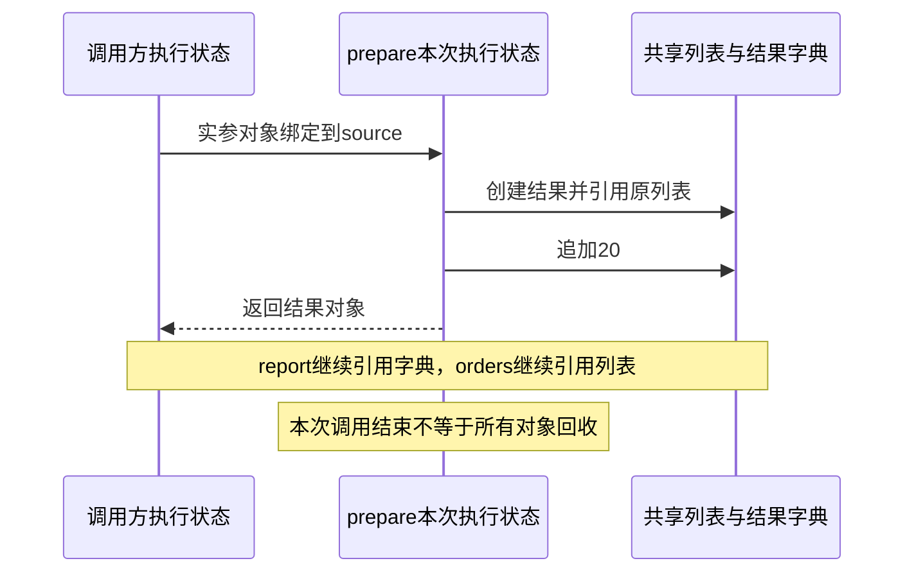

# 第04章　函数、作用域、闭包与装饰器

[上一章](03-容器、推导式与数据转换.md) · [全书目录](教材目录.md) · [下一章](05-迭代、生成器、异常与资源管理.md)

## 1. 学习目标与前置知识

能写清函数接收什么、返回什么，解释变量到哪里查找，并给函数增加日志等功能，同时保留原来的返回值和错误。前置：第1–3章。

**承接与本章主线：** 第3章的订单处理已经能运行，本章先把重复的步骤写成函数，再解释每次调用怎样保存参数和执行进度。需要保存配置时引入闭包，需要给已有函数增加功能时引入装饰器。下一章再处理失败、暂停和提前停止。

**本章从这里开始：** 同一段订单规则将被CLI、接口与工具重复使用。函数让它变成稳定的输入输出；闭包和装饰器则让行为可以配置与扩展。本章先写普通函数，再一步步得到这些机制。

**首遍路线：** 先走2.1–2.2的调用与返回，再读2.3的普通传参、默认值和“每次新建列表”；读懂后进入2.4的函数对象与闭包，最后读2.5的函数传递和2.6的包装与 `@`。2.3的哨兵、特殊签名，以及3.6的递归是独立的第二遍任务；先不同时处理所有语法。cell观察、类体/注解和CPython布局也可第二遍再看。

第一次阅读只需沿这条线走：**调用函数 → 函数本身可以传递 → 函数带着配置返回 → 用函数包装另一个函数**。每一步都先预测输出，再运行例子。参数的特殊写法、递归、cell内部观察和CPython实现可以第二遍回看；遇到实验里的 `assert`，把它读成“这个条件应当成立”。

各短例子独立运行；没有打印且断言通过时，终端可以没有输出。改输入做变式时，先写新预期并调整相应assert，不要把“旧断言不再成立”误认为新输入触发了语法错误。

## 2. 基础知识讲解

### 2.1 定义函数是建立一个可调用对象

假设终端程序和网页接口都要计算订单总额。复制两份代码后，规则一变就得改两处。我们先把计算写成函数，让两个入口调用同一份规则。接着再增加需求：每次计算的参数不同，某些规则要预先配置，还要统一记录调用日志。下面依次用参数、闭包和装饰器解决，不同时引入所有语法。

函数把一组步骤起个名字，调用时提供输入，再取得结果。`def`后写函数名和参数，缩进部分是函数体。执行`return`会结束本次调用，并把后面的值交回调用处；没有`return`或只写`return`时，返回`None`。`print`则只是把内容显示到终端：屏幕上看见结果，并不代表调用者拿到了这个值。

```python
def add_cents(left, right):
    total = left + right
    return total
amount = add_cents(100, 25)
assert amount == 125
```

定义中的`left`、`right`叫形参，调用时写下的`100`、`25`等表达式叫实参。进入函数后，这次调用中的`left`指向整数100，`right`指向整数25。这里“名称绑定到对象”就是“这个变量名指向哪个对象”；后面都可以先画成箭头理解。

把两次调用分开看：`add_cents(100, 25)`用100和25计算，返回125；`add_cents(200, 10)`用200和10计算，返回210。两次调用各有自己的参数名称和执行过程，不是让第二次直接覆盖第一次的局部变量。下一节解释Python怎样记录这些信息。

#### 案例推进：先得到一个能组合的返回值

```python
# study-example: S04A
def paid_total(orders):
    total = 0
    for order in orders:
        if order["status"] == "paid":
            total += order["amount_cents"]
    return total

rows = [{"status":"paid","amount_cents":1990}, {"status":"pending","amount_cents":500}]
assert paid_total(rows) == 1990
assert paid_total([]) == 0
```

执行def时建立函数，执行paid_total(rows)时才进入函数体。orders是本次调用的局部名称；return将结果交回调用处。如果把return改成print，终端虽然显示数字，调用者得到的却是None，无法可靠接入后续计算。

给函数写文档时，说明输入是否已校验、是否允许重复、是否修改输入、输出单位与失败行为。函数名不能替代这些条件；名字同为total，却可能一个统计原始行、另一个统计去重订单。

### 2.2 一次函数调用怎样建立帧、共享对象并返回

函数运行时，Python要记住本次传入的参数、已经建立的局部变量、执行到了哪一步，以及结果应返回哪里。这份执行记录叫**执行帧**。函数A调用函数B时，A尚未完成，B又有自己的执行记录；这些未结束的调用按先后关联起来，就是这里说的调用栈。

```python
# study-example: S04W
def prepare(source):
    local_total = 1000
    result = {"items": source, "total": local_total + 1}
    source.append(20)
    return result
orders = [10]
report = prepare(orders)
assert report["items"] is orders
assert report["total"] == 1001
assert orders == [10, 20]
```

| 时刻 | 执行状态 | 对象与引用 |
| --- | --- | --- |
| 执行def | 建立函数对象并绑定prepare | 函数保存代码及定义环境，不执行函数体 |
| 求实参 | 取得orders引用的列表 | 尚未要求复制列表 |
| 进入调用 | 本次帧中source绑定该列表 | 调用方与本次形参共享对象 |
| 执行函数体 | local_total、result属于本次局部绑定 | 新字典引用列表及计算结果 |
| return | 把结果对象交回调用处 | report接住字典，对象继续可达 |
| 调用结束 | 结束本次执行，释放不再需要的帧引用 | 返回的字典和列表不随局部名称一起消失 |

```text
prepare执行期间（逻辑调用关系，不是内存地址图）：
调用方：orders ───────────────────→ 列表A
   │                                  ↑
   └─ 本次prepare帧：source ────────────┘
                     result ──→ 字典B ──items──→ 列表A

返回后：调用方report ──→ 字典B ──items──→ 列表A
        调用方orders ───────────────────→ 列表A
```

因此，本次函数返回后，不能简单地说“里面创建的对象都消失了”。本例的`report`仍能找到返回的字典，字典又能找到列表，数据就仍可使用。后面的闭包也能留下继续访问某些数据的途径。帧本身还可能被调试器或异常记录保留，这是第二遍再了解的实现细节，不影响先追踪这些引用。

参数共享与重新绑定再看下面的独立实验：

传参时，函数得到一组自己的参数名称，这些名称指向调用时提供的对象。若函数里写`items = [99]`，只让里面的`items`改指新列表；调用者原来的名称没有改。若写`items.append(99)`，修改的则是双方都能找到的同一个列表，所以调用者也会看见变化。接下来用代码对照这两种动作。

```python
# study-example: S04Z
def change(items):
    original_object = items
    items.append(2)
    items = [99]
    return original_object, items
outside = [1]
shared, local = change(outside)
assert outside is shared and outside == [1, 2]
assert local == [99] and local is not outside
```

函数每次调用有自己的局部状态。局部名称怎样查找、默认值什么时候建立，以及返回的函数如何继续访问外层数据，分别在2.3和2.4用具体例子回答；先不把这些规则都压在一张调用帧图里。

#### 先后关系与存活关系分开画



图中执行状态的结束顺序体现调用栈；对象是否存活由仍被谁保留决定。之后学习闭包、生成器和协程时继续问这两个问题，不另背一套互不相关的存储口诀。

#### 第二遍选读：Python调用栈和原生C栈为什么不一一对应

常规CPython 3.12中，内部解释器帧记录局部引用和求值状态；常见调用可使用线程管理的帧存储，生成器/协程又有需跨暂停保存的状态。供Python调试观察的frame对象可按需要建立，不能说所有Python调用都必定分配一个完整可见的frame对象。

Python调用栈描述调用关系，不是承诺每层调用对应一层原生C递归。版本优化改变布局，却不改变本例的参数共享与返回语义。源码层资料见[3.12帧布局](https://raw.githubusercontent.com/python/cpython/3.12/Objects/frame_layout.md)、[帧API](https://docs.python.org/3.12/c-api/frame.html)和[调用优化说明](https://docs.python.org/3.12/whatsnew/3.11.html#inlined-python-function-calls)。初学不需要记内部字段或手工访问帧来编程。

### 2.3 参数怎样匹配

前面调用函数时，调用方都提供了完整输入。现在给一笔金额增加“数量”：通常买一份，偶尔买三份。先解决怎样传入，再讨论没传时从哪里取值。

#### 第一步：位置、名称和省略，是三种调用方式

```python
def subtotal(cents, count=1):
    return cents * count

assert subtotal(100, 3) == 300           # 按位置：100给cents，3给count
assert subtotal(count=3, cents=100) == 300  # 按名称：顺序可以不同
assert subtotal(100) == 100              # 没传count，使用默认值1
```

`count=1`写在函数定义里，表示“调用者没有提供count时使用1”。调用处的`count=3`则是在给这一次调用提供实参。显式传入的0也算提供了值，不会被默认值替换：`subtotal(100, count=0)`得到0。

#### 第二步：“执行def时求值”到底是什么意思

“求值”就是先算出一个表达式的结果。例如`default_count + 1`要先算成一个整数。下面把计算写在默认值的位置，观察它发生在哪个时刻：

```python
# study-example: S04I
default_count = 1

def subtotal(cents, count=default_count + 1):
    return cents * count

default_count = 9
assert subtotal(100) == 200
assert subtotal(100, count=4) == 400
```

| 时刻 | 发生什么 |
| --- | --- |
| 执行`default_count = 1` | 名称指向整数1 |
| 执行`def` | 算出`default_count + 1`为2，将这个结果保存为函数的默认值；还不执行函数体 |
| 执行`default_count = 9` | 这个名称改指9，已经保存的默认值不重新计算 |
| 调用`subtotal(100)` | 没提供count，使用保存的2，得到200 |
| 调用`subtotal(100, count=4)` | 本次显式传入4，不使用默认值 |

所以默认表达式不是“每次省略参数时再运行的配方”，而是在**每次执行这条def语句时**算出并保存的结果。下面把结果换成列表，就能看出这个时机为什么重要。

#### 第三步：默认列表为什么会留下上次的内容

先看一个故意共享状态的版本。两次调用都省略notes，请先预测第二次返回什么：

```python
# study-example: S04L
def add_note(note, notes=[]):
    notes.append(note)
    return notes

first = add_note("缺附件")
assert first == ["缺附件"]
second = add_note("待复核")
assert second == ["缺附件", "待复核"]
assert first is second
assert first == ["缺附件", "待复核"]
```

执行def时，`[]`创建了一个列表，函数保存了它。每次省略notes，当前形参都会指向这个列表；`append`修改列表，没有创建新列表。第二次调用因此接着改第一次用过的对象，连first观察到的内容也变了。

```text
两次调用各自使用notes时，都指向同一默认列表（不是两次同时执行）：
函数保存的默认值 ──→ 列表A
第一次调用的notes ──→ 列表A ←── first
第二次调用的notes ──→ 列表A ←── second
```

这不是“所有函数的列表都共享”，也不是返回值被偷偷复制；是**这个函数保存的这个默认对象**被重复使用了。如果需求是每次独立记录，就要把创建列表的动作移进函数体。

#### 第四步：用None表示“这次没有提供列表”

本例约定：省略notes或显式传None，都表示新建列表；显式传列表，则有意追加到调用方提供的列表。

```python
# study-example: S04O
def add_note(note, notes=None):
    if notes is None:
        notes = []
    notes.append(note)
    return notes

first = add_note("缺附件")
second = add_note("待复核")
assert first == ["缺附件"]
assert second == ["待复核"]
assert first is not second
assert add_note("新任务", None) == ["新任务"]

provided = []
result = add_note("调用方的记录", provided)
assert result is provided
assert provided == ["调用方的记录"]
```

默认值仍在def执行时保存，只不过这次保存的是None。每次调用进入函数体后，才检查notes是不是None；需要时执行一次`[]`，所以能得到各自独立的列表。None可以先理解成Python提供的“没有值”对象，`is None`检查是否就是它。

这里不能随意改成`if not notes`：调用者传来的空列表也是假值，但它仍是一个明确提供的列表。本例要保留并修改它，所以只判断None。

**暂停检查：** 如果每次调用都显式传入同一个列表，结果还会共享吗？会；这次共享来自调用者提供了同一个对象，和默认值没有关系。E07会让你再次观察函数保存默认对象的位置。

#### 第二遍：None也有业务含义时，再引入缺省哨兵

给订单修改备注时，可能需要区分三种意图：不传备注表示保留旧内容，传None表示清空，传字符串表示替换。如果默认值仍用None，不传与显式传None会进入同一种情况，无法表达前两种不同意图。

此时才需要一个**缺省哨兵**：专门代表“没有传入”的标记。`object()`每次创建一个独立对象；这里只创建一次，把它命名为`_MISSING`，以后用身份比较认出这个标记。

```python
# study-example: S04Y
_MISSING = object()

def update_note(current_note, note=_MISSING):
    if note is _MISSING:
        return current_note
    return note

assert update_note("原备注") == "原备注"       # 没传：保留
assert update_note("原备注", None) is None    # 明确传None：清空
assert update_note("原备注", "新备注") == "新备注"
assert update_note("原备注", "") == ""       # 空文本也是显式传入
```

执行def时保存的默认对象就是_MISSING指向的对象。省略note会拿到这个标记；传None则拿到另一个对象，因此两个分支可以区分。`is`检查“是不是同一个标记对象”，不需要比较业务内容。哨兵只解决“传没传”的区别；本例尚未检查备注类型，不能从这个分支判断输入已经合法。

| 接口需要什么 | 默认值如何选 |
| --- | --- |
| 省略时使用固定数量 | `count=1` |
| 省略或传None都表示新建容器 | `notes=None`，进入函数后再创建 |
| 省略和显式None必须表达不同含义 | 保存一个专用哨兵，用`is`区分 |

#### 第二遍：限制调用方式与收集额外参数

普通参数与默认值解决了大多数当前需求。只有接口需要强调调用方式时，再看这些签名语法：`/`之前的参数只能按位置传，单独`*`之后的参数只能写名称。`*rest`收集多余的位置实参为元组，`**options`收集多余的关键字实参为字典。

#### 案例推进：把签名当作小型接口

```python
# study-example: S04B
def subtotal(cents, /, *, count=1):
    return cents * count

assert subtotal(100, count=3) == 300
def collect(first, *rest, **options):
    return first, rest, options
assert collect("A", "B", "C", strict=True) == ("A", ("B", "C"), {"strict": True})
```

`subtotal(100, count=3)`中100按位置给cents，count必须写出来；`collect("A", "B", "C", strict=True)`则把B/C收进rest，把strict收进options。不要为了灵活把所有签名都改成`**kwargs`，否则允许哪些字段反而不清楚。

调用处的解包方向相反：已有元组`values = (100,)`和字典`options = {"count": 3}`时，`subtotal(*values, **options)`相当于`subtotal(100, count=3)`。星号本身不复制参数所指向的业务对象。

到这里解决的是“本次输入怎么来”。下一节再问：**如果返回的不是金额，而是另一个函数，它以后到哪里找配置？** 递归回答的是另一类调用问题，已单独放在3.6，不需要在参数章节里同时学习。

### 2.4 名称从哪里查找：从函数对象到闭包

这一节以订单门槛为主例子：**先配置门槛，再返回一个只接收金额的检查函数**。围绕它回答四个问题：

1. `def` 执行时发生了什么，调用时又发生了什么？
2. 内层函数用到的名字去哪里找？
3. 闭包到底留下了什么，为什么有时看到修改、有时看不到？
4. 为什么循环创建的多个函数最后都得到同一个值？

下面区分三件容易混淆的东西：写好的函数、某一次调用，以及它们使用的数据。函数本身也是对象；这张表是按作用分类，并不是三块不同的内存区域。

| 东西 | 何时建立 | 保存什么 | 何时结束 |
| --- | --- | --- | --- |
| 函数对象 | 执行`def`时 | 代码、默认值，以及所需的外部引用 | 后续调用还需要使用它时，就必须保留 |
| 一次调用的执行帧 | 每次开始执行函数时 | 本次参数、局部变量和执行位置 | 本次返回或因未处理异常退出后，执行结束 |
| 函数使用的数据对象 | 例如执行`[]`、`{}`等表达式时 | 列表、字典、整数等实际数据 | 只要仍有访问途径，就不能当作已消失 |

同一个函数可以调用多次，所以一次调用结束，函数本身仍可以留下供下次使用。函数也能作为数据交给其他代码：`sorted(rows, key=amount_of)`传入的是`amount_of`这个函数，让`sorted`需要时调用它；若写成`amount_of()`，则是现在调用，并把返回值传进去。2.5再学习这些用法。

#### 第一步：函数对象不是调用结果

在理解返回函数之前，先区别函数本身和调用结果。下面是独立例子：

```python
# study-example: S04V
def greet():
    return "你好"

action = greet       # 不调用；action与greet指向同一个函数
result = greet()     # 调用；result绑定返回的文本
assert action is greet
assert action() == "你好" and result == "你好"
```

`greet`是函数对象；`greet()`表示调用它并取得结果。`action()`还能调用，是因为action也指向这个函数。函数可以像其他对象一样作为参数传入或作为结果返回。下一步利用“返回函数”制作两套不同门槛。

#### 第二步：自由变量与闭包

订单检查需要两套门槛：一套是10分，另一套是100分。能否先配置门槛，之后只传待检查金额？先预测 `small(20)` 和 `large(20)`：

```python
# study-example: S04C
def at_least(minimum):
    def accepts(value):
        return value >= minimum
    return accepts

small = at_least(10)
large = at_least(100)
assert small(20) is True
assert large(20) is False
```

一步步走查：

1. 调用`at_least(10)`，这次调用中的`minimum`指向整数10。
2. 执行内层 `def` 创建 `accepts`；此时还没有执行比较。
3. `return accepts` 把函数本身交回，`small` 指向它。
4. 稍后调用`small(20)`，`value`是本次传入的20；`accepts`仍能读到创建它时那次外层调用中的`minimum`，也就是10，所以比较结果是True。
5. 再调用`at_least(100)`，会创建另一个`accepts`，它使用的`minimum`是100。因此`large(20)`比较的是20与100，得到False。

先看具体名字：`value`是内层函数自己的参数，`minimum`来自包住它的外层函数。后一种“函数用到了外层函数中的名字”，这里称为引用**自由变量**；函数保留这种访问能力，就形成了**闭包**。

**名字按什么顺序找？** 对这里的普通函数，可以按“本次局部→相关外层函数→定义所在模块→内置名称”理解，这个顺序简称LEGB。读模块里的全局变量与读外层函数变量不同：前者不因此构成闭包；参数或本次局部赋值的名字，也不是这里说的自由变量。

判断闭包只问三问：

1. 有没有内层函数？
2. 内层函数有没有引用一个不是自己参数、也不是自己局部赋值的名字？
3. 这个名字是不是来自外层**函数**的局部绑定？

三个都为“是”，才是闭包。只有嵌套、没有引用外层变量，不算闭包；引用模块全局变量，也不算闭包。

#### 第三步：cell 里装的是绑定，不是快照

外层调用已经返回，`accepts`为什么仍能读到`minimum`？Python为这个外层变量保留了一个**cell**。可以把它想成保存“当前对象引用”的小盒子：函数通过盒子找到对象，而不是复制一份当时的数值。如果共享这个盒子的另一个函数改变了其中的引用，之后读取时就会找到新对象。先理解这点，再看`__closure__`中的实际内容：

```text
small 的函数对象
   └── __closure__[0] → cell → 当前指向 10
large 的函数对象
   └── __closure__[0] → cell → 当前指向 100
```

所以读取`small.__closure__[0].cell_contents`得到10，而`large`对应的内容是100。需要留下的是函数继续访问这些外层变量的cell，不必因此保留整次调用的全部执行记录。调试器等也可能另行持有帧，那是另一条引用关系。

第一遍先理解行为即可；下面这个观察块可以第二遍再运行：

```python
# study-example: S04K
def at_least(minimum):
    def accepts(value):
        return value >= minimum
    return accepts

small = at_least(10)
large = at_least(100)
assert small(20) is True and large(20) is False
assert small.__closure__[0].cell_contents == 10
assert large.__closure__[0].cell_contents == 100
assert small.__closure__[0] is not large.__closure__[0]
```

`__closure__`是Python函数的可观察属性；本书在CPython 3.12中用它查看“捕获的是不同cell”。业务代码先按外部行为理解和设计，不需要通过这些内部观察来完成判断。

前面用整数观察不同配置，现在换成列表，检查闭包会不会自动复制它。仍用“名称→对象”的箭头看：名称可能不同，但箭头可以指向同一个列表；修改这个列表，与让某个名称改指新列表，是两件事。

```python
# study-example: S04Q
def make_reader():
    items = []

    def read():
        return items

    return read, items

read, outside = make_reader()
outside.append("缺少附件")
assert read() == ["缺少附件"]
assert read() is outside
```

`make_reader`返回后，`read`里的`items`与外面的`outside`仍指向同一个列表。执行`outside.append(...)`就是修改这个列表，随后`read()`自然能读到新内容。这里没有生成独立副本。

再把`outside.append("缺少附件")`换成`outside = ["新的列表"]`。这次新建了一个列表，只让外面的`outside`指向它；`read`仍通过外层的`items`找到原列表，所以读到的仍是空列表。不要只看名字是否相同，要看改动的是哪一个作用域中的名称。

#### 第四步：什么时候需要 nonlocal

如果我们想让闭包以后读到另一份列表，就需要实际改变外层函数的`items`绑定。让工厂额外返回一个更新函数：

```python
# study-example: S04R
def make_reader():
    items = []

    def read():
        return items

    def replace(new_items):
        nonlocal items
        items = new_items

    return read, replace, items

read, replace, original = make_reader()
original.append("旧发现")
assert read() == ["旧发现"]
replace(["新发现"])
assert read() == ["新发现"]
assert original == ["旧发现"]  # 原列表仍被original引用
```

`read`负责读`items`，`replace`负责让它改指新列表；它们使用的是同一次`make_reader`调用留下的那个外层变量。`nonlocal items`告诉Python：这里的赋值要改这个外层变量，而不是在`replace`里另建一个局部变量。`original`则仍指向旧列表。再调用一次`make_reader()`，会得到另一组独立的外层变量。

**先预测：** 调用`replace(["新发现"])`后，`original`会变成新列表吗？**核对：** 不会。`replace`改变的是外层`items`指向哪里，没有修改旧列表，也没有改变`original`的指向。

在本例中，闭包访问的绑定由cell保存。第二遍可以查看 `read.__closure__` 和其中的 `cell_contents`；不要依赖打印出来的地址推断业务行为。

#### 第四步补充：修改对象与重新绑定名称

下面的`add`先读取外层`items`，再调用列表的`append`修改内容；它没有给名称`items`赋值，所以不需要`nonlocal`：

```python
# study-example: S04S
def make_job():
    items = []

    def add(text):
        items.append(text)

    def read():
        return list(items)

    return add, read

add, read = make_job()
add("缺少附件")
assert read() == ["缺少附件"]
```

如果内层只写`items = ["新发现"]`而没有声明，Python会把它当作内层自己的局部变量，外层`items`不变。这种写法本身合法；只有想改变外层那个变量时，才需要`nonlocal items`。

`items += ["新发现"]`又多一步：它要先读取`items`，再把运算结果赋回这个名称。没有声明时，`items`会被当作局部变量，却在赋值前就被读取，因此这里会先报`UnboundLocalError`。所以不能把它直接当成`items.append(...)`。

计数器也一样：`count += 1`需要先读再赋值。下面是有意失败的预测例子，单独放进文件运行时会报`UnboundLocalError`；异常处理会在第5章学习。

```text
def make_wrong_counter():
    count = 0
    def wrong():
        count += 1  # count被判为局部，但这次读取前尚未赋值
        return count
    return wrong

wrong = make_wrong_counter()
wrong()              # UnboundLocalError
```

第二种写法显式更新外层绑定，是可以独立运行的正常例子：

```python
# study-example: S04T
def make_counter():
    count = 0

    def increment():
        nonlocal count
        count += 1
        return count

    return increment

increment = make_counter()
assert (increment(), increment()) == (1, 2)
```

`nonlocal`针对外层函数中的变量；`global`针对函数**定义所在模块**中的全局变量。例如函数定义在`rules.py`，这里的`global`就指向`rules.py`中的名称，不会因为另一个文件调用了它，就改为使用调用者的局部变量：

```python
# study-example: S04U
module_count = 0

def increment_global():
    global module_count
    module_count += 1

increment_global()
assert module_count == 1
```

需要的是函数自己的临时变量时，普通赋值即可，不必声明。需要维护任务状态时，也可以传入对象或使用类；`global`并非默认选择。两个概念记成一句话：**修改对象内容和重新绑定名称是两件事；要重新绑定外层函数或模块中的名称，才分别考虑nonlocal或global。**

#### 第五步：晚绑定与早绑定

下面的循环写在模块层级。三个函数以后调用时读取同一个模块全局名称`index`；循环结束时它是2，所以结果都是2：

```python
# study-example: S04X
functions = []
for index in range(3):
    def read_index():
        return index
    functions.append(read_index)
assert [fn() for fn in functions] == [2, 2, 2]

fixed = []
for index in range(3):
    def read_index(saved=index):
        return saved
    fixed.append(read_index)
assert [fn() for fn in fixed] == [0, 1, 2]
```

循环中的def每次创建一个新的函数对象，append把它留在列表中；相同的函数名只是循环下一次又绑定到新的对象。先不使用尚未讲解的lambda，2.5会介绍那种简写。

先看第一组：循环在模块顶层运行，`index`是一个全局变量。每个函数都在调用时读取它，调用发生在循环结束后，所以都读到2；这组没有外层函数，也没有闭包cell。

第二组每次执行`def`时，先算出当前的`index`，把它保存为各自的默认参数。后来调用时读取的是自己的`saved`，所以得到0、1、2。

若把创建函数的循环放进外层函数，内层函数就可能共享外层的循环变量，E08会演示这种闭包版本。工厂函数和2.5的`partial`也能保存每次需要的配置；保存对象仍不等于复制对象。

**和Java对比（选读）：** Java的lambda捕获局部变量时，要求该变量是final或effectively final，也就是初始化后不再重新赋值。Python闭包则允许相关外层变量后来改变，所以阅读时要问“调用时它指向谁”。两种语言中，保存了对象引用都不等于复制了对象；可变对象的内容仍可能被其他代码修改。

| 想做的事 | 先看什么 | 本节例子 |
| --- | --- | --- |
| 修改列表内容 | 是否有其他名称引用同一列表 | `outside.append(...)`，`read()`看到变化 |
| 让内层读到新的外层对象 | 是否重新绑定了同一个外层名称 | `replace()`使用`nonlocal items` |
| 在函数内建立自己的局部名称 | 赋值是否只打算影响本次调用 | 普通 `items = ...`，无需声明 |
| 重新绑定定义模块中的名称 | 赋值目标是否为模块全局 | `global module_count` |
| 保存每轮不同配置 | 名称是在创建时还是调用时读取 | 默认参数或工厂；可变对象另考虑复制 |

#### 第六步：类体、推导式、注解的边界（第二遍选读）

**类体。** 这是第6章的预览，初读可以跳过。普通方法不会把类体自动当成外层函数作用域。下面的独立文件故意不提供模块全局`rate_for_demo`，所以方法里的裸名称会失败；要访问类属性，可使用`self.rate_for_demo`或`type(self).rate_for_demo`：

```text
class Fee:
    rate_for_demo = 2

    def wrong(self):
        return rate_for_demo

    def correct(self):
        return self.rate_for_demo

print(Fee().correct())  # 2
print(Fee().wrong())    # NameError；若模块恰有同名全局，可能读到它
```

这里是普通方法的常见规则，不涵盖`__class__`等特殊机制；第6章继续学习属性查找。

**推导式。** 在Python 3中，列表推导式的循环名称不会像普通`for`那样留在外层。它的作用域与实现细节仍要结合Python版本和具体表达式理解：

```python
# study-example: S04H
name = "外层"
values = [name for name in ("A", "B")]
assert values == ["A", "B"] and name == "外层"
```

**注解。** 本项目使用Python 3.12。使用 `from __future__ import annotations` 时，函数注解会以字符串形式保存；之后用 `typing.get_type_hints()` 解析时仍需相应名称可用。它不是说所有Python版本的所有注解都采用同一求值方式。注解与类、推导式各有规则，不能只靠简化的LEGB口诀推断全部行为。

```python
# study-example: S04J
from __future__ import annotations  # 放在文件开头；前面可有注释或模块文档
from typing import get_type_hints

def describe(value: LaterType) -> LaterType:
    return value

assert describe.__annotations__["value"] == "LaterType"  # 注解先以文本保存
LaterType = int
assert get_type_hints(describe)["value"] is int  # 解析时名称已经存在
```

如果在`LaterType = int`之前调用`get_type_hints(describe)`，名称尚不可用，解析会报NameError。这个例子说明“保存注解”和“稍后解析注解”是不同动作；类型注解本身仍不会自动检查输入，第9章再系统讨论。请将本代码块当作独立文件运行，future导入必须放在文件开头允许的位置。

#### 一页总结：判断闭包、解释现象

先记三句话：

1. **内层函数还要使用外层函数的变量时，才需要本节讲的闭包。只有嵌套定义，或只读模块全局变量，都不够。**
2. **闭包保留访问外层变量的途径，不自动复制数据。修改列表内容，与改变某个名称指向哪个列表，要分开判断。**
3. **循环创建的函数可能在调用时才读取同一个变量；想保存每轮配置，可用默认参数、工厂函数或`partial`，并另行考虑是否需要复制可变对象。**

常见错误对照：

| 现象 | 真正原因 |
| --- | --- |
| `inner.__closure__ is None` | 内层没有引用外层自由变量 |
| 闭包看到外层后来的新值 | cell被重新绑定，调用时才读取 |
| `items.append(...)` 不需要 nonlocal | 只修改对象内容，没有重新绑定名称 |
| `items += ...` 报 UnboundLocalError | 增量赋值包含绑定，名称被判为局部 |
| 循环后所有函数都返回最后一个值 | 多个函数调用时读取同一个名称；模块层是全局名，外层函数闭包例子才是共享cell |
| 类方法里直接写类属性名报 NameError | 类体不是方法的外层作用域；若模块恰有同名全局，可能读到全局值，不应依赖 |

### 2.5 函数也可以作为数据

函数可以放进列表或字典，也可以传给另一个函数。下面先把一个函数交给`sorted`，让它为每条订单算出排序依据；再用`lambda`写出只需一个表达式的简短函数；最后用`partial`生成一个已经预先填好部分参数的新可调用对象。三种写法逐步比较，不要求一次记住。

#### 先把一个具名函数改成lambda

```python
# study-example: S04M
rows = [{"id": "B", "cents": 200}, {"id": "A", "cents": 100}]
def amount_key(row):
    return row["cents"]
assert amount_key(rows[0]) == 200
by_function = sorted(rows, key=amount_key)
by_lambda = sorted(rows, key=lambda row: row["cents"])
assert by_function == by_lambda
assert [row["id"] for row in by_lambda] == ["A", "B"]
assert rows[0]["id"] == "B"
```

先直接调用amount_key，确认它对一笔订单返回金额；再将函数本身传给sorted，让排序过程对每笔订单调用它。lambda的冒号前给出参数，后面一个表达式的结果作为返回值，本例与具名函数作用相同。`key=amount_key(rows[0])`会立刻计算得到整数，无法提供排序所需的可调用对象。规则需要多步校验时，用def逐步写清楚，再比较下文的多字段键与partial。

#### 案例推进：回调、lambda与partial怎样选择

```python
# study-example: S04E
from functools import partial
rows = [{"id":"B","amount_cents":10}, {"id":"A","amount_cents":10}, {"id":"C","amount_cents":5}]
ordered = sorted(rows, key=lambda row: (row["amount_cents"], row["id"]))
assert [row["id"] for row in ordered] == ["C", "A", "B"]
def multiply(value, factor):
    return value * factor
double = partial(multiply, factor=2)
assert double(7) == 14
```

先对照调用发生的时间：`key=某个函数`把函数交给`sorted`，由它逐条取排序依据；`lambda`只是把短函数换成表达式写法。排序依据若是tuple，就先比较第一项，相同再比较下一项。`partial`则预先保存部分参数，稍后调用时再补齐其余参数。闭包和`partial`都不会自动复制传入的可变对象。

### 2.6 从包装函数理解装饰器

现在已经知道函数能作为参数和返回值。假设每次相加前后都要记录事件，又不希望把记录代码写进每个计算函数：可以把原函数交给一个包装函数，由包装函数负责前后动作，再把原结果交回。

#### 案例推进：不用语法糖写出第一个装饰器

```python
# study-example: S04D
events = []
def recorded(fn):
    def wrapper(left, right):
        events.append("start")
        result = fn(left, right)
        events.append("success")
        return result
    return wrapper

def add(left, right):
    return left + right
add = recorded(add)
assert add(2, 3) == 5
assert events == ["start", "success"]
```

分两段看：执行 `add = recorded(add)` 时，先把原add函数交给recorded，得到wrapper，再让名称add指向wrapper；此时还没有做加法。稍后 `add(2, 3)` 才进入wrapper：记录start，调用它保存的原函数，记录success，返回5。

```text
包装前：add ──→ 原来的加法函数
包装后：add ──→ wrapper ──通过 fn──→ 原来的加法函数
```

上面的重新赋值完成后，名称add虽然指向了wrapper，原函数却没有丢：wrapper还能通过外层的fn找到它。还要注意`return result`：漏写这一步，就会出现“计算做完了，调用者却只拿到None”。

#### 再写成 @ 语法

下面是独立运行的等价例子；先预测事件顺序再运行：

```python
# study-example: S04N
events = []
def recorded(fn):
    def wrapper(left, right):
        events.append("start")
        result = fn(left, right)
        events.append("success")
        return result
    return wrapper

@recorded
def add(left, right):
    return left + right

assert events == []       # 定义和包装时还没调用add
assert add(2, 3) == 5
assert events == ["start", "success"]
```

这里 `@recorded` 紧贴函数定义；对这个例子，效果相当于先定义原函数，再执行 `add = recorded(add)`。不要把“定义时调用recorded创建包装器”和“以后调用add执行wrapper”当成同一时刻。

包装不同参数的函数时，可以用`*args, **kwargs`收集本次参数，再用`fn(*args, **kwargs)`原样转交，解包规则见2.3。

`functools.wraps(fn)`帮助保留名称、文档和`__wrapped__`等信息，让调试工具仍能识别原函数。它不替我们调用`fn`，也不替我们返回结果；这两步仍要写在wrapper里。

带参数和多层装饰器留到第二遍，先画出谁包住谁，再跟踪调用顺序。异步函数还需要相应的异步包装：仅得到协程对象，不代表里面的业务已经执行。

下面用一个独立例子观察元数据；这里已经理解 `@` 的应用过程，可以把 `@wraps(fn)` 读成“用wraps为wrapper补充原函数的信息”：

```python
# study-example: S04P
from functools import wraps

def recorded(fn):
    @wraps(fn)
    def wrapper(*args, **kwargs):
        return fn(*args, **kwargs)
    return wrapper

@recorded
def add(left, right):
    """相加两笔整数金额。"""
    return left + right

assert add(2, 3) == 5
assert add.__name__ == "add" and add.__doc__ == "相加两笔整数金额。"
assert add.__wrapped__(2, 3) == 5
```

如果去掉 `@wraps(fn)`，调用仍可计算，但 `add.__name__` 通常显示 `wrapper`，也不会由wraps建立 `__wrapped__`。这里调用原函数和返回结果仍是wrapper自己的责任；记录失败与清理的练习放到第5章。

这个首版只记录成功路径。异常时第二个append不运行；第五章学完try/except/finally后，再扩展为区分成功、失败与退出的包装。先把普通调用看清，再加入错误处理，避免一次出现三层函数和四种控制流。

## 3. 原理讲解与推导

### 3.1 把定义时与调用时画成两条时间线

先画两条时间线。执行`def`时：创建函数，计算并保存默认值；如果有装饰器，再进行包装。调用函数时：取得本次参数，执行函数体，最后返回结果。默认列表为什么共享、装饰器何时包装，都先放回对应时间线上分析。闭包中的变量则要继续问：它是在创建函数时保存了对象，还是留到调用时再读取？

本章2.2已经建立一次调用的完整时间线。现在区分def执行、参数绑定、函数体执行与return四个时刻，解释默认值、闭包和装饰器；不要把定义函数误当成已经执行函数体。

### 3.2 闭包保存访问绑定的能力

若多个函数共享同一个外层变量，后来调用时才读取，就可能都看到最后的内容，这称为晚绑定。要保存每轮不同配置，可以让工厂函数每次建立独立的外层变量，也可以用默认参数或`partial`预先保存对象。

下一步再问这些对象是否共享：保存一个列表，并不会自动复制它。需要各自独立的配置时，还要决定是否复制以及复制到哪一层。第二遍可分别用`__closure__`和`__defaults__`查看闭包cell与默认参数保存的对象。

### 3.3 包装要保留可观察行为

给函数加计时或日志后，仍要逐项检查：参数是否照常传入，结果是否照常返回，出错时调用者是否仍能收到错误。把异常藏起来、漏写`return`或误用异步包装，都可能改变原来的行为。用一组成功和失败输入观察事件顺序，比只看函数名更容易发现问题。

### 3.4 作用域由代码结构决定，不按调用者临时寻找

如果函数定义在`rules.py`，它查找全局名字时使用的是`rules.py`的环境；别的文件调用它，不会把调用者的局部变量交给它查。闭包也是根据定义时的嵌套关系找到相关外层变量，而不是沿当前调用链随意找同名变量。回调和测试替身中的名称查找，也按这个规则判断。

每次调用都有自己的参数和局部变量，但它们仍可能指向同一个默认列表、全局字典或闭包中的配置。递归也只是多了一次调用，不会把这些共享对象全部复制一遍。因此判断函数是否会受其他调用影响，要检查它读写了哪些对象，而不只看它有没有实例字段。

画图时分两步：先列出每次调用自己的名称，再画出它们指向的对象。最后标记赋值是在“换箭头”，还是在“改同一个对象的内容”。默认值、闭包和递归中的共享问题，都能用这套步骤分析。

#### 名称解析与对象存活放在同一张表里

| 场景 | 执行或查找依据 | 继续持有对象的可能位置 |
| --- | --- | --- |
| 本次普通局部名称 | 当前调用的局部状态 | 返回值、外部容器或其他引用 |
| 模块全局名称 | 定义模块的命名空间 | 模块及其使用者 |
| 默认参数 | def执行时保存的对象 | 函数对象的默认值 |
| 闭包访问的外层绑定 | 相关词法环境 | 闭包中的绑定/单元及其引用 |

这不是四块新的物理内存区域，而是四种访问和持有关系。作用域回答哪里能用一个名称，生命周期回答谁还持有对象；两者不能互相替代。LEGB各级名称已经在2.4讲解，底层具体存储不由这个口诀决定。

### 3.5 机制验证：预测、运行与回看

#### 验证实验 E07
默认参数表达式在 def 语句执行时求值一次，结果保存在函数对象的 **defaults** 里；之后每次调用若没传这个参数，就复用同一个对象。

```python
# experiment: E07
def accumulate(value, result=[]):
    result.append(value)
    return result
first = accumulate(1)
second = accumulate(2)
assert first is second and first == [1, 2]
assert accumulate.__defaults__[0] is first
def change(items):
    items.append(3)
    items = []
    return items
original = [1]
assert change(original) == []
assert original == [1, 3]
```

#### 验证实验 E08

先看时间，再预测下面 `wrong` 的结果：

| 时刻 | 发生的事 | 循环变量 n |
| --- | --- | --- |
| 第一轮 | 创建第一个函数，还没有调用 | 1 |
| 第二轮 | 创建第二个函数，还没有调用 | 2 |
| 第三轮 | 创建第三个函数，还没有调用 | 3 |
| 循环结束后 | 依次调用三个函数，它们读取共享的绑定 | 3 |

因此三个函数都得到30。下面的默认参数版本在每次创建函数时保存当时的对象，所以得到10、20、30；也可用工厂函数让每次调用产生各自的外层绑定。默认参数保存对象，并不深复制可变对象。
内层函数引用外层变量时，捕获的是那个变量的存储位置（cell）；调用时才去 cell 里读当前值。所以多个内层函数可能共享同一个 cell，循环结束后都读到最后一个值。

```python
# experiment: E08
def make_wrong():
    return [lambda value: value * n for n in (1, 2, 3)]
wrong = make_wrong()
assert [fn(10) for fn in wrong] == [30, 30, 30]
assert all(fn.__closure__[0].cell_contents == 3 for fn in wrong)
def make_fixed():
    return [lambda value, n=n: value * n for n in (1, 2, 3)]
fixed = make_fixed()
assert [fn(10) for fn in fixed] == [10, 20, 30]
assert fixed[0].__closure__ is None  # n由默认参数保存，不是自由变量

# make_multiplier 是三次 make_multiplier(n) 调用，
# 每次调用创建一个全新的局部作用域，factor 是这次调用的参数。
# 每次返回的 multiply 捕获的是自己那次调用的 factor cell。
def make_multiplier(factor):
    def multiply(value):
        return value * factor
    return multiply
by_factory = [make_multiplier(n) for n in (1, 2, 3)]
assert [fn(10) for fn in by_factory] == [10, 20, 30]

# a = counter()   # 创建 cell A，count_A = 0，返回 next_value_A
# b = counter()   # 创建 cell B，count_B = 0，返回 next_value_B
def counter():
    count = 0
    def next_value():
        nonlocal count
        count += 1
        return count
    return next_value
a, b = counter(), counter()
assert (a(), a(), b()) == (1, 2, 1)
```

#### 验证实验 E03

```python
# experiment: E03
events = []
def marker():
    events.append("called")
    return "fallback"
assert ("" or marker()) == "fallback"
assert ("ok" or marker()) == "ok"
assert events == ["called"]
assert (0 and marker()) == 0
assert bool("False") is True
assert isinstance(True, int) and True == 1
value = 0
assert (value or 10) == 10
assert (10 if value is None else value) == 0
```

### 3.6 第二遍：递归怎样一层层调用，再一层层返回

先回想2.2：一次调用有自己的参数、局部名称和返回位置。递归没有增加一种特殊调用机制，只是**当前函数又调用了同一个函数**。需要理解的是：它把什么工作交给下一次调用，下一次什么时候能停，以及本次怎样接住返回结果。

先用小整数的累计理解。`1 + 2 + 3`可以写成“3加上从1到2的和”；后者又能写成“2加上从1到1的和”。每次交出去的问题都小一点，到0时直接回答0，不再继续调用。

```python
# study-example: S04F
def countdown_total(n):
    if n == 0:
        return 0
    return n + countdown_total(n - 1)

assert countdown_total(0) == 0
assert countdown_total(3) == 6
assert countdown_total(4) == 10
```

`return n + countdown_total(n - 1)`不是立刻返回n；要先算出加法右边的调用结果，本层才能相加并返回。以输入3为例：

```text
往下调用，先留下尚未完成的加法：
countdown_total(3) 等待 3 + countdown_total(2)
countdown_total(2) 等待 2 + countdown_total(1)
countdown_total(1) 等待 1 + countdown_total(0)
countdown_total(0) 直接返回0，不再创建下一层调用

再往回交结果：
n=1的那次调用：1 + 0 = 1，返回1
n=2的那次调用：2 + 1 = 3，返回3
n=3的那次调用：3 + 3 = 6，返回6
```

这里同时有几次尚未完成的调用。它们的参数虽然都叫n，但各属于自己的调用；n=2不会把正在等待的n=3改掉。这就是“每次调用有独立局部执行状态”的具体含义，不需要想象函数把自己全部复制了一份。

**先预测：** 把`n - 1`错写成`n`会怎样？下一次问题没有变小，正数输入永远到不了0；Python最终会因递归深度限制报错。这个版本只约定接收小的非负整数，负数也不会向0靠近。第5章学会raise后，回做参数检查；第一遍不必为了处理错误先学习异常语法。

递归也不是累计数字的必选写法。同样的工作可以用循环：

```python
# study-example: S04
def countdown_total_loop(n):
    total = 0
    for value in range(1, n + 1):
        total += value
    return total

assert countdown_total_loop(4) == 10
```

循环版本不需要保留这么多层等待中的函数调用，这个例子通常直接用循环。递归在树形、层层嵌套的问题中更自然，后续遇到相应结构再练。最后连回对象模型：新的调用有新的局部名称，但若每层都收到同一个列表，各层仍可修改那个共享列表；调用层数增加并不自动深复制实参。

## 4. 示例与逐步走查

```python
# book-example: B04
def at_least(minimum):
    def predicate(value):
        return value >= minimum
    return predicate
small, large = at_least(10), at_least(100)
assert small(20) and not large(20)
```

### 4.1 沿输入到结果逐步解释

调用`at_least(10)`后，外层的`minimum`是10。创建`predicate`时，它需要继续读取这个外层变量，所以返回后仍保留相应的访问途径。`small`指向这个函数，以后调用它，仍能读到10。第二遍可用`__closure__`查看其中的cell。

再调用`at_least(100)`，得到的是另一个函数，它使用另一份`minimum`。所以`small(20)`比较20与10，`large(20)`比较20与100。两者运行同样的内层代码，却使用各自的配置；不需要复制整次外层调用的执行记录。

这也说明闭包不是一份过去输出。若保存的是可变配置对象，之后修改它，内层调用可能读到新状态；要不要固定当时值，是接口设计问题，不能用“闭包自动复制”解释。

### 4.2 把调用、作用域与闭包合成一幅图

参数回答本次调用绑定谁；作用域回答名称从哪里解析；默认值回答def执行时保存了谁；闭包回答返回后还能通过哪个绑定访问对象。四个问题都沿引用关系解释，不为每种语法发明独立的“内存区域”。在S04W基础上加入第二次调用，画出两个调用的独有字典及可能共享的输入列表。

### 4.3 进阶：已有调用模型后，再看对象存储实现

本节标注为**第二遍选读**：先能解释本章返回值与闭包案例，再研究下列结构。

#### 对象和元素引用的实现层

本段用于连接概念与实现，初读不要求记C字段。在常规CPython中，对象结构包含类型与引用管理等信息，不同类型的数据部分不同。全局名称常通过模块命名空间查找，函数局部名称可通过执行帧中的优化槽位访问；不能推断每个名称都存在独立字典，或都对应一个原生栈变量。

先拿两个具体对象对照：`count = 2`让名称关联一个整数对象，它的类型相关数据表示数值2；`rows = [2, 3]`则关联列表对象，列表的元素区域保存通向元素对象的引用。第1章3.5的对象存储推演解释由谁管理存储，这里进一步解释对象内部保存什么。

| 对象 | 理解其存储时先看什么 | 后续在哪深化 |
| --- | --- | --- |
| int、float | 类型相关的数值表示；整数与浮点表示不同 | 第2章精度与数值边界 |
| str、bytes | 文本与字节各自的内容表示；字符串内部表示不能直接当作UTF-8文件内容 | 第2章编码与解码 |
| list、tuple | 元素引用；多个容器可以引用同一元素对象 | 第3章嵌套结构与复制 |
| dict、set | 为键或成员查找组织的内部结构，同时保留相应对象引用 | 第3章键、哈希与相等 |
| bool、None | True、False、None等特殊对象；名称可以共同引用它们 | 本章真假、缺失与身份 |
| 函数、类、实例 | 代码和环境、类型行为、实例状态等相关信息与引用 | 第4章与第6章 |

这张表说明结构职责，不指定统一字节数或连续布局。对象存储还可能关联额外缓冲区；解释器能够缓存或复用内存。先从“名称→对象→它引用的其他对象”解释可见行为，测量内存占用与分配器细节留到性能章节。

#### 再向下看一层：对象和元素引用放在哪里

下面是常规CPython的概念图，不是可直接照抄的C结构定义，也不承诺字段偏移：

```text
名称绑定/执行帧中的引用
          │
          ▼
   列表对象：类型信息、引用管理信息、长度、元素存储信息
          │
          ├── 元素引用 ──→ 整数对象：自己的类型信息与整数数据
          └── 元素引用 ──→ 另一个对象
```

列表保存元素引用，不把所有元素的完整对象逐个嵌进列表本体。因此一个列表能引用不同类型，也能在多个位置引用同一对象。扩容可能更换内部元素存储区域，但外层列表仍是原对象，不能由内部缓冲区移动推出list的身份改变。

整数对象由其类型相关表示保存数值；执行加法读取这些数值并取得结果对象，不是通过first这个名称原地覆盖旧整数数据。名称重绑定和对象内部修改发生在不同层，后续容器复制、函数共享状态与并发问题都要先分清这两层。

引用管理同样不能机械理解成“每执行一次赋值，打印的引用计数就恰好加一”：解释器还可能保存临时引用，并存在特殊对象和实现优化。学习实验验证身份与可见状态，不固定对象大小、地址或引用计数。

#### 为什么不从内存地址猜程序结果

Python语义规定可观察行为；CPython结构解释某个版本如何实现；缓存、分配器和调试工具观察又是另一层。对象复用、内部缓冲区移动与引用计数变化不能替代语义推理。结合本章已学的帧与返回，以及第3章的容器引用图，区分实现方式与可见行为。

## 5. 动手练习

### 本章累计任务：封装规则与追踪调用

把第3章的订单整理、冲突检查、去重和汇总分别写成函数。用同一批记录调用，逐项说明传入什么、返回什么、原始记录是否被修改。连续运行两次，检查本应独立的结果有没有意外共享列表。

**未通过时怎样定位：** 第二次结果累积时检查默认可变对象；函数内重新绑定不影响外部名称，原地修改共享对象则会影响。先找到规则的输入输出，再考虑装饰器。

**带到下一步：** 第5章在这组函数外加入逐条读取、错误与清理。

下方专题练习用于补当前卡点；先完成这一项累计任务，不另将所有索引作为必须并行完成的进度。

完成默认参数、倍率闭包、调用记录装饰器；先普通注册函数再添加装饰器注册，不急着连接模型。

将练习连成一条线：先写paid_total并用两批订单检查结果与输入不变；再写at_least门槛函数并用10、100分别检查20；随后创建三种门槛，预测循环变量晚绑定并修复；最后用recorded包装一个计算函数，检查包装前后返回值相同、事件顺序正确。第5章学完异常再检查失败传播。若结果全是同一个门槛，先画创建时与调用时；若结果变None，先查wrapper有没有return。

### L07：函数签名与默认值（P11–12）

实现 append_note(note, notes=None)，传入列表时按明确约定追加，省略时每次新建。连续两次省略 notes，结果不能共享。再写一个要求 limit 只能按名称传入的函数，说明调用错误。

验收：能区分本题“有意修改传入列表”和订单分析“不修改输入”的两个接口约定；不将所有副作用一律视为错误。

换条件自测：连续两次省略notes，得到两份独立结果；显式传None也新建；显式传空列表则返回并修改原列表。若第三项失败，检查是否把`is None`错写成`if not notes`。第二遍再做备注更新：不传、传None、传空字符串必须保留三种不同意图，不照抄哨兵示例先写预期表。

### L08：闭包与晚绑定（P13）

先做判断练习：一个内层函数不引用外层变量、一个引用模块全局、一个引用外层函数局部、一个写在类体里。分别预测 `__closure__` 是 `None` 还是有 cell，再运行核对。

构造三个乘法函数，输入 10 时分别返回 10/20/30。先用循环中的 lambda 观察晚绑定，再用工厂函数或默认参数绑定修正。

再写带 nonlocal 的计数器工厂，两个工厂实例分别计数，状态不能串联。验收：解释“读自由变量的时间”和“默认参数求值时间”，并能说明 `items.append(...)` 与 `items = ...` 的区别。

### L09：装饰器行为（P15）

本章先实现成功路径包装；学完第5章异常后完整验收：实现带记录回调的同步装饰器，记录调用与完成/失败事件，保持原返回值，异常继续抛出，wraps保留原名称与文档。

验收：加法结果相同；原函数抛 ValueError 时调用者仍收到该异常；回调中不记录敏感实参。叠加两个装饰器预测事件顺序。异步函数需要单独设计，不直接套用同步包装。

### L02：真假值与边界（P03）

实现 choose_limit(value, default=10)：只有 None 使用默认值；0 是合法值；负数、bool 和非整数报 ValueError。用 0/None/False/空字符串/5 分别检查。对比 `value or default` 为什么破坏 0 的语义。

扩展：用 for/else 搜索目标，只在没有找到时报告不存在；与用标志变量的版本比较。

## 6. 验收与自测

**行为验收：** 多次调用状态符合约定；原函数错误不被吞掉；未知和重复注册明确失败。

**原理验收：** 合上资料解释本章一个机制，预测一个反例，说明规则属于语言语义、库约定还是实现观察。

### 6.1 先预测，再查看参考推导

为什么写key=get_amount与key=get_amount()含义不同？包装函数漏掉return又会怎样？

<details>
<summary>完成预测后查看解释</summary>

前者把函数交给排序，后者先调用函数并把其结果交给排序，常常在参数或可调用性上出错。包装器若不return原结果，成功调用仍返回None，这会改变原函数的可观察契约。

</details>

## 7. 面试问答与迁移

LEGB 有哪些适用边界？为什么闭包可能全得到最后一个值？装饰器交换顺序会影响什么？

**参考回答：**

1. LEGB概括普通函数中名称查找的常见层次：局部、外层函数、模块全局、内置。是否为局部名称通常由函数块内的绑定语句决定，不能理解成“这一行没找到就总去全局找”；赋值前读取局部名称可能抛 `UnboundLocalError`。类体不作为普通方法的外层函数作用域，推导式等结构也有自己的规则。
2. 闭包只在嵌套函数引用外层**自由变量**时形成，捕获的是变量绑定/cell，不是值快照或对象副本；只要闭包函数还活着，被引用的cell就活着。循环结束后调用多个闭包，可能读到同一个cell的最终值；默认参数在def执行时求值，工厂则给每次创建建立新cell。二者都不会自动复制可变对象：固定一个列表引用后，列表内容仍能被其他保留者修改。`items.append(...)`改对象内容，通常不需要nonlocal；`items = ...`重新绑定名称，才需要按作用域规则处理。
3. 多个装饰器自下向上应用，例如 `@outer`、`@inner` 对应 `outer(inner(func))`；每次调用再进入包装后的对象。典型包装器外层先进入、后退出，但是否调用内层、是否保留返回值与异常，取决于包装器实现。交换缓存和授权的顺序，可能使缓存命中绕过授权检查。

**换条件自测：** 画出“定义函数→改变外层绑定→调用函数”三个时刻；分别使用闭包、默认参数与可变默认对象预测结果。能解释绑定在何时读取，才算掌握，而不只是记住“晚绑定”。

## 8. 本章小结与参考

### 8.1 一页知识地图

**本章主问题：** 同一段订单规则被多处复用时，怎样把输入输出、名称查找和执行时机固定成契约？

**一条主线：**

```text
重复规则 → def 建立函数对象 → 调用时绑定参数、建立帧 → return 交付结果 → 闭包与装饰器携带配置和包装行为
```

**三个关键词：** 签名、作用域、包装。签名约定输入输出，作用域决定名称在哪里查找，包装在不改调用方式的前提下增加行为。

**最容易错：**

- 可变默认参数跨调用共享，第二次调用看到第一次的残留；
- 循环回调在调用时读取同一个名称的最终值；模块层可能读全局名称，外层函数中的闭包则可能共享 cell；
- 装饰器丢掉返回值或吞掉异常；
- 分不清修改对象与重新绑定名称，误判闭包是否需要 `nonlocal`。

**与前后章：** 第3章留下订单列表与复制边界，本章把重复规则收进函数并解释参数怎样共享对象。第5章要在函数调用上增加暂停、失败与清理，必须先分清定义时、调用时与退出时。

**学完应能：**

- 为一条订单规则写出签名，区分 return 与 print，并说明默认值的求值时机；
- 画出“定义→改外层绑定→调用”三个时刻，预测闭包结果；
- 手写一个保留返回值、异常与元数据的装饰器；
- 判断一次赋值是修改对象还是重新绑定名称。

### 8.2 日常工作注意事项

- 默认列表或字典可能跨调用共享。需要每次独立状态时用None等缺省标记，并在调用内建立容器。
- 循环创建回调时检查晚绑定；用工厂或明确的默认值绑定保存所需对象，并验证不同回调的结果。
- 装饰器必须返回被包装调用的结果并保留异常语义；使用wraps维护元数据，异步函数使用匹配的包装方式。

### 8.3 参考与后续学习

机制补充核对（2026-11-09）：[名称绑定与执行模型](https://docs.python.org/3.12/reference/executionmodel.html#naming-and-binding)。实验按本项目3.12解释器验证，其他构建或解释器需重新确认。

本章将输入、结果和执行时机组织为函数契约。下一章把“一次得到全部结果”扩展为逐步消费，并处理异常与资源退出。

官方参考：[本章资料](https://docs.python.org/zh-cn/3.12/tutorial/)。动态框架资料以2026-11-04核对的入口为准，具体SDK版本在实际实践时重新核对并记录锁文件。

[上一章](03-容器、推导式与数据转换.md) · [下一章](05-迭代、生成器、异常与资源管理.md)
