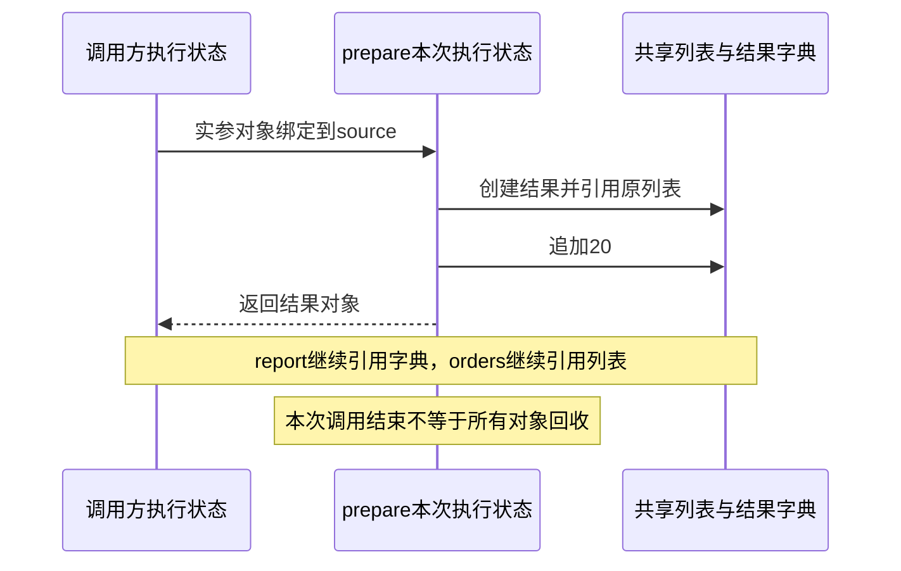

# 第04章　函数、作用域、闭包与装饰器

[上一章](03-容器、推导式与数据转换.md) · [全书目录](教材目录.md) · [下一章](05-迭代、生成器、异常与资源管理.md)

## 1. 学习目标与前置知识

能设计签名、解释名称解析并编写行为透明的包装。前置：第1–3章。

**承接与本章主线：** 在已有对象与容器上建立调用帧、参数和返回模型，再推导作用域、闭包及包装；下一章让调用可以暂停并处理异常退出。

**本章从这里开始：** 同一段订单规则将被CLI、接口与工具重复使用。函数让它变成稳定的输入输出；闭包和装饰器则让行为可以配置与扩展。本章先写普通函数，再一步步得到这些机制。

**首遍路线：** 先走 2.1–2.3 的普通函数、参数和 return；再读 2.4 的函数对象、自由变量与闭包、append 与 nonlocal；接着读 2.6 的包装函数和 `@`，最后做 L08。cell 的 `__closure__` 观察、global、类体/注解边界和 CPython 存储标为第二遍；第一遍不需要一次吞下所有细节。

第一次阅读只需沿这条线走：**调用函数 → 函数本身可以传递 → 函数带着配置返回 → 用函数包装另一个函数**。每一步都先预测输出，再运行例子。参数的特殊写法、递归、cell内部观察和CPython实现可以第二遍回看；遇到实验里的 `assert`，把它读成“这个条件应当成立”。

## 2. 基础知识讲解

### 2.1 定义函数是建立一个可调用对象

订单汇总在两个入口重复出现时，复制代码会让一次规则修改需要改两处。函数先解决“同一规则只维护一份”：调用方提供对象，函数执行规则并返回结果。随后还会遇到配置、共享状态与包装问题；参数、作用域、闭包和装饰器分别解决这些具体变化，不必一开始同时掌握所有函数语法。

函数将一项工作封装成输入与结果。`def`后写名称和参数，缩进体描述调用时执行的语句。return返回结果并结束本次调用；没有return或只写return得到None。print把信息写到输出，不等同返回可组合的数据。

```python
def add_cents(left, right):
    total = left + right
    return total
amount = add_cents(100, 25)
assert amount == 125
```

left/right是本次调用的局部名称，绑定到调用方提供的对象。局部名称重新赋值与修改可变参数不同；是否允许修改输入是接口的一部分。

对照两次调用：`add_cents(100, 25)`这一次绑定left=100、right=25，返回125；`add_cents(200, 10)`另一次绑定left=200、right=10，返回210。每次调用先求出实参，再为本次执行建立参数绑定；第一次的局部名称不会被第二次直接覆盖。下一节再用“调用帧”解释解释器为何要保存本次状态。

#### 案例推进：先得到一个能组合的返回值

```python
# study-example: S04A
def paid_total(orders):
    total = 0
    for order in orders:
        if order["status"] == "paid":
            total += order["amount_cents"]
    return total

rows = [{"status":"paid","amount_cents":1990}, {"status":"pending","amount_cents":500}]
assert paid_total(rows) == 1990
assert paid_total([]) == 0
```

执行def时建立函数，执行paid_total(rows)时才进入函数体。orders是本次调用的局部名称；return将结果交回调用处。如果把return改成print，终端虽然显示数字，调用者得到的却是None，无法可靠接入后续计算。

给函数写文档时，说明输入是否已校验、是否允许重复、是否修改输入、输出单位与失败行为。函数名不能替代这些条件；名字同为total，却可能一个统计原始行、另一个统计去重订单。

### 2.2 一次函数调用怎样建立帧、共享对象并返回

第1章区分了对象存储与执行上下文。现在把执行上下文具体化为**执行帧**：一次调用需要记住正在执行的代码、下一步位置、局部绑定、可访问的全局环境及临时计算状态。调用栈把尚未结束的调用关联起来，便于回到调用处或传播异常。

```python
# study-example: S04W
def prepare(source):
    local_total = 1000
    result = {"items": source, "total": local_total + 1}
    source.append(20)
    return result
orders = [10]
report = prepare(orders)
assert report["items"] is orders
assert report["total"] == 1001
assert orders == [10, 20]
```

| 时刻 | 执行状态 | 对象与引用 |
| --- | --- | --- |
| 执行def | 建立函数对象并绑定prepare | 函数保存代码及定义环境，不执行函数体 |
| 求实参 | 取得orders引用的列表 | 尚未要求复制列表 |
| 进入调用 | 本次帧中source绑定该列表 | 调用方与本次形参共享对象 |
| 执行函数体 | local_total、result属于本次局部绑定 | 新字典引用列表及计算结果 |
| return | 把结果对象交回调用处 | report接住字典，对象继续可达 |
| 调用结束 | 结束本次执行，释放不再需要的帧引用 | 返回的字典和列表不随局部名称一起消失 |

```text
prepare执行期间（逻辑调用关系，不是内存地址图）：
调用方：orders ───────────────────→ 列表A
   │                                  ↑
   └─ 本次prepare帧：source ────────────┘
                     result ──→ 字典B ──items──→ 列表A

返回后：调用方report ──→ 字典B ──items──→ 列表A
        调用方orders ───────────────────→ 列表A
```

所以“函数退出，局部变量释放”更准确地说是本次局部绑定和执行状态结束；对象是否继续存在要追踪剩余引用。返回值、容器、闭包和异常现场都可能保留对象。正常返回也不保证调试器或其他持有者未保存帧。

参数共享与重新绑定再看下面的独立实验：

调用时先计算实参，再把对象绑定到本次形参。它不是把调用者的名称本身交给函数；形参重绑定不会重新绑定调用者名称，原地修改共享对象则可被调用者看到。常说“传对象引用”应理解为这种共享对象与独立名称的关系。

```python
# study-example: S04Z
def change(items):
    original_object = items
    items.append(2)
    items = [99]
    return original_object, items
outside = [1]
shared, local = change(outside)
assert outside is shared and outside == [1, 2]
assert local == [99] and local is not outside
```

函数每次调用有自己的局部状态。局部名称怎样查找、默认值什么时候建立，以及返回的函数如何继续访问外层数据，分别在2.3和2.4用具体例子回答；先不把这些规则都压在一张调用帧图里。

#### 先后关系与存活关系分开画



图中执行状态的结束顺序体现调用栈；对象是否存活由仍被谁保留决定。之后学习闭包、生成器和协程时继续问这两个问题，不另背一套互不相关的存储口诀。

#### 第二遍选读：Python调用栈和原生C栈为什么不一一对应

常规CPython 3.12中，内部解释器帧记录局部引用和求值状态；常见调用可使用线程管理的帧存储，生成器/协程又有需跨暂停保存的状态。供Python调试观察的frame对象可按需要建立，不能说所有Python调用都必定分配一个完整可见的frame对象。

Python调用栈描述调用关系，不是承诺每层调用对应一层原生C递归。版本优化改变布局，却不改变本例的参数共享与返回语义。源码层资料见[3.12帧布局](https://raw.githubusercontent.com/python/cpython/3.12/Objects/frame_layout.md)、[帧API](https://docs.python.org/3.12/c-api/frame.html)和[调用优化说明](https://docs.python.org/3.12/whatsnew/3.11.html#inlined-python-function-calls)。初学不需要记内部字段或手工访问帧来编程。

### 2.3 参数怎样匹配

普通参数可以按位置或名称传入，默认参数用于省略值。`/`之前仅限位置传入，`*`之后仅限关键字传入。`*args` 收集额外位置参数，`**kwargs` 收集额外关键字参数；调用处的 `*` 与 `**` 则用于解包。
`/`和`*`都是参数分隔符，控制某些核心参数，只允许位置传，调用方不需要关注它内部是什么名字，以后改参数也不容易破坏调用方；某些参数强制显式写法，提高可读性。

默认值在执行def时求值。用列表作默认值可能跨调用共享，应按需求使用None、独立哨兵或工厂。不要为了灵活把所有签名写成 `**kwargs`，否则调用方和检查工具都更难理解允许字段。

#### 案例推进：把签名当作小型接口

```python
# study-example: S04B
def subtotal(cents, /, *, count=1):
    return cents * count

assert subtotal(100, count=3) == 300
def collect(first, *rest, **options):
    return first, rest, options
assert collect("A", "B", "C", strict=True) == ("A", ("B", "C"), {"strict": True})
```

`/`前仅按位置，`*`后仅按关键字；`*rest` 收集为元组，`**options` 收集为字典。调用时的 `*` 与 `**` 执行相反方向的解包。参数形式用于表达真实意图，不要求所有函数都写成灵活但不透明的 `**kwargs`。

#### 默认值、缺省哨兵与递归的边界

默认表达式在def执行时求值。若None表示“没有传入”，用None再创建容器；若None本身也是合法业务值，可用唯一object作为缺省哨兵，并用is判断。哨兵解决状态区分，不自动验证所有字段。

递归把同一问题缩小后再次调用自己，必须有停止条件。每次调用有独立局部执行状态，但共享对象不会自动复制。

```python
# study-example: S04F
def countdown_total(n):
    if n == 0:
        return 0
    return n + countdown_total(n - 1)
assert countdown_total(4) == 10
```

本例约定调用方只传非负整数，先观察调用与返回；第5章再添加非法输入的ValueError检查。它不适合无限深输入；常规Python有递归深度限制，也不保证尾调用优化。线性累计通常直接用循环。非法类型与负数是下一章回做的边界，不将本例用于未校验的外部输入。

### 2.4 名称从哪里查找：从函数对象到闭包

这一节以订单门槛为主例子：**先配置门槛，再返回一个只接收金额的检查函数**。围绕它回答四个问题：

1. `def` 执行时发生了什么，调用时又发生了什么？
2. 内层函数用到的名字去哪里找？
3. 闭包到底留下了什么，为什么有时看到修改、有时看不到？
4. 为什么循环创建的多个函数最后都得到同一个值？

先记住三层区别：

| 东西 | 何时建立 | 保存什么 | 何时结束 |
| --- | --- | --- | --- |
| 函数对象 | 执行 `def` 时 | 代码、默认值、闭包 cell、所属模块 | 没有引用时才回收 |
| 调用帧 | 每次调用时 | 本次参数和局部绑定、执行位置 | `return` 或异常退出时结束 |
| 对象 | 由表达式创建 | 实际数据（列表、字典、整数等） | 没有引用时才回收 |

函数对象可以比某一次调用活得久；调用帧结束，不等于函数对象消失。函数也可以作为参数交给别的代码，例如 `sorted(rows, key=amount_of)` 接收的是函数对象，而不是 `amount_of()` 的调用结果；`lambda`、`partial` 和更完整的回调例子放在 2.5。

#### 第一步：函数对象不是调用结果

在理解返回函数之前，先区别函数本身和调用结果。下面是独立例子：

```python
# study-example: S04V
def greet():
    return "你好"

action = greet       # 不调用；action与greet指向同一个函数
result = greet()     # 调用；result绑定返回的文本
assert action is greet
assert action() == "你好" and result == "你好"
```

`greet`是函数对象；`greet()`表示调用它并取得结果。`action()`还能调用，是因为action也指向这个函数。函数可以像其他对象一样作为参数传入或作为结果返回。下一步利用“返回函数”制作两套不同门槛。

#### 第二步：自由变量与闭包

订单检查需要两套门槛：一套是10分，另一套是100分。能否先配置门槛，之后只传待检查金额？先预测 `small(20)` 和 `large(20)`：

```python
# study-example: S04C
def at_least(minimum):
    def accepts(value):
        return value >= minimum
    return accepts

small = at_least(10)
large = at_least(100)
assert small(20) is True
assert large(20) is False
```

一步步走查：

1. 调用 `at_least(10)`，这次外层调用中 `minimum` 绑定到10。
2. 执行内层 `def` 创建 `accepts`；此时还没有执行比较。
3. `return accepts` 把函数本身交回，`small` 指向它。
4. 稍后调用 `small(20)`，内层的 `value` 绑定20，并从对应外层绑定读取10，得到True。
5. `at_least(100)` 是另一轮调用，建立另一份minimum绑定；因此 `large(20)` 得到False。

**名字按什么顺序找？** 普通函数里通常先看本次局部，再看相关外层函数绑定、模块全局和内置名称（LEGB）。但“内层函数用到的名字”不一定是自由变量：如果它是内层函数的参数或局部赋值，就属于局部；如果它来自模块全局，读到的是全局绑定，也不是闭包。**只有来自外层函数的自由变量，才形成闭包。**

判断闭包只问三问：

1. 有没有内层函数？
2. 内层函数有没有引用一个不是自己参数、也不是自己局部赋值的名字？
3. 这个名字是不是来自外层**函数**的局部绑定？

三个都为“是”，才是闭包。只有嵌套、没有引用外层变量，不算闭包；引用模块全局变量，也不算闭包。

#### 第三步：cell 里装的是绑定，不是快照

上例中 `minimum` 是内层函数的自由变量。Python 为它准备一个 **cell**（可以理解成一个小盒子），闭包保存的是“盒子”，不是盒子当时内容的照片：

```text
small 的函数对象
   └── __closure__[0] → cell → 当前指向 10
large 的函数对象
   └── __closure__[0] → cell → 当前指向 100
```

所以 `small.__closure__[0].cell_contents` 读到10，`large`读到100。外层调用结束后，不是整个栈帧都被保留，而是被闭包引用的cell继续存活；调试器或异常现场仍可能另行持有帧，不能由“有闭包”推断整个帧一定立即释放。

第一遍先理解行为即可；下面这个观察块可以第二遍再运行：

```python
# study-example: S04K
def at_least(minimum):
    def accepts(value):
        return value >= minimum
    return accepts

small = at_least(10)
large = at_least(100)
assert small(20) is True and large(20) is False
assert small.__closure__[0].cell_contents == 10
assert large.__closure__[0].cell_contents == 100
assert small.__closure__[0] is not large.__closure__[0]
```

`__closure__`是CPython暴露的函数属性；业务代码不应依赖它做逻辑，它只用于观察“捕获的是不同cell”。

现在换成可变列表，观察闭包是否拿到独立副本。这里“名称的绑定”先理解成一条箭头：**在某个作用域里，这个名称当前关联哪个对象**。

```python
# study-example: S04Q
def make_reader():
    items = []

    def read():
        return items

    return read, items

read, outside = make_reader()
outside.append("缺少附件")
assert read() == ["缺少附件"]
assert read() is outside
```

外层调用返回后，`read`能通过外层的`items`绑定访问原列表；`outside`也指向同一列表。`outside.append(...)`修改的是那个列表的内容，所以`read()`看到变化。闭包没有自动复制列表；它保留了访问相关外层绑定的能力。

现在把代码中 `outside.append("缺少附件")` 换成 `outside = ["新的列表"]`。这次只改变**模块中outside名称**指向的对象，没有改变闭包里的`items`绑定，所以`read()`仍返回原来的空列表。两个名称拼写不同，也可以拼写相同：关键是它们属于哪个作用域、是否指向同一对象。

#### 第四步：什么时候需要 nonlocal

如果我们想让闭包以后读到另一份列表，就需要实际改变外层函数的`items`绑定。让工厂额外返回一个更新函数：

```python
# study-example: S04R
def make_reader():
    items = []

    def read():
        return items

    def replace(new_items):
        nonlocal items
        items = new_items

    return read, replace, items

read, replace, original = make_reader()
original.append("旧发现")
assert read() == ["旧发现"]
replace(["新发现"])
assert read() == ["新发现"]
assert original == ["旧发现"]  # 原列表仍被original引用
```

`read`和`replace`访问的是同一轮`make_reader`里的`items`。`nonlocal items`声明：`replace`中的赋值要重新绑定最近的、已经存在于外层函数作用域的`items`。调用`replace`后，这条外层箭头改指新列表；模块中的`original`仍指向旧列表。另调用一次`make_reader()`会得到另一组独立的外层绑定。

**先预测：** 调用 `replace(["新发现"])` 之后，`original` 会变成新列表吗？先画箭头再运行。**核对：** 不会；`replace`改的是外层`items`的cell指向，`original`仍指向旧列表。

在本例中，闭包访问的绑定由cell保存。第二遍可以查看 `read.__closure__` 和其中的 `cell_contents`；不要依赖打印出来的地址推断业务行为。

#### 第四步补充：修改对象与重新绑定名称

下面的`add`先读取外层`items`，再调用列表的`append`修改内容；它没有给名称`items`赋值，所以不需要`nonlocal`：

```python
# study-example: S04S
def make_job():
    items = []

    def add(text):
        items.append(text)

    def read():
        return list(items)

    return add, read

add, read = make_job()
add("缺少附件")
assert read() == ["缺少附件"]
```

反过来，若在内层写 `items = ["新发现"]`，不声明时它通常是在**内层建立局部名称**，外层`items`不变；这本身合法，只有当意图是重新绑定外层名称时才需要`nonlocal items`。如果写`items += ["新发现"]`，它包含对名称的赋值；没有声明时，读取尚未赋值的局部`items`可能先引发`UnboundLocalError`，不能简单按`append`理解。

计数器也一样：`count += 1`需要先读再赋值。下面是有意失败的预测例子，单独放进文件运行时会报`UnboundLocalError`；异常处理会在第5章学习。

```text
def make_wrong_counter():
    count = 0
    def wrong():
        count += 1  # count被判为局部，但这次读取前尚未赋值
        return count
    return wrong

wrong = make_wrong_counter()
wrong()              # UnboundLocalError
```

第二种写法显式更新外层绑定，是可以独立运行的正常例子：

```python
# study-example: S04T
def make_counter():
    count = 0

    def increment():
        nonlocal count
        count += 1
        return count

    return increment

increment = make_counter()
assert (increment(), increment()) == (1, 2)
```

`global`指向函数**定义所在模块**的全局名称，而不是调用者的局部名称；它与`nonlocal`针对不同的作用域：

```python
# study-example: S04U
module_count = 0

def increment_global():
    global module_count
    module_count += 1

increment_global()
assert module_count == 1
```

需要的是函数自己的临时变量时，普通赋值即可，不必声明。需要维护任务状态时，也可以传入对象或使用类；`global`并非默认选择。两个概念记成一句话：**修改对象内容和重新绑定名称是两件事；要重新绑定外层函数或模块中的名称，才分别考虑nonlocal或global。**

#### 第五步：晚绑定与早绑定

下面的循环写在模块层级。三个函数以后调用时读取同一个模块全局名称`index`；循环结束时它是2，所以结果都是2：

```python
# study-example: S04X
functions = []
for index in range(3):
    functions.append(lambda: index)
assert [fn() for fn in functions] == [2, 2, 2]

fixed = []
for index in range(3):
    fixed.append(lambda index=index: index)
assert [fn() for fn in fixed] == [0, 1, 2]
```

第一个例子发生在模块作用域，`index`是全局名称，**不是外层函数闭包的cell**；但读取都推迟到调用时。第二个例子把当时的对象保存为每个函数的默认参数，并不深复制对象。若把同样的创建过程放进外层函数，内层函数会通过外层绑定访问循环变量，E08会演示那种闭包版本。想固定每次不同的配置，也可用工厂建立独立绑定，或用`functools.partial`预先提供参数。

**和 Java 对比：** Java 的 lambda 捕获局部变量时要求 effectively final，通常更接近“捕获值”；Python 捕获的是变量绑定/cell，所以外层后来重新赋值、循环结束后再调用，都会影响结果。需要“固定当时的值”时，Python 常用默认参数或工厂，这也是从 Java 过来最容易踩的差异之一。

| 想做的事 | 先看什么 | 本节例子 |
| --- | --- | --- |
| 修改列表内容 | 是否有其他名称引用同一列表 | `outside.append(...)`，`read()`看到变化 |
| 让内层读到新的外层对象 | 是否重新绑定了同一个外层名称 | `replace()`使用`nonlocal items` |
| 在函数内建立自己的局部名称 | 赋值是否只打算影响本次调用 | 普通 `items = ...`，无需声明 |
| 重新绑定定义模块中的名称 | 赋值目标是否为模块全局 | `global module_count` |
| 保存每轮不同配置 | 名称是在创建时还是调用时读取 | 默认参数或工厂；可变对象另考虑复制 |

#### 第六步：类体、推导式、注解的边界（第二遍选读）

**类体。** 这是第6章的预览，初读可以跳过。普通方法不会把类体自动当成外层函数作用域。下面的独立文件故意不提供模块全局`rate_for_demo`，所以方法里的裸名称会失败；要访问类属性，可使用`self.rate_for_demo`或`type(self).rate_for_demo`：

```text
class Fee:
    rate_for_demo = 2

    def wrong(self):
        return rate_for_demo

    def correct(self):
        return self.rate_for_demo

print(Fee().correct())  # 2
print(Fee().wrong())    # NameError；若模块恰有同名全局，可能读到它
```

这里是普通方法的常见规则，不涵盖`__class__`等特殊机制；第6章继续学习属性查找。

**推导式。** 在Python 3中，列表推导式的循环名称不会像普通`for`那样留在外层。它的作用域与实现细节仍要结合Python版本和具体表达式理解：

```python
# study-example: S04H
name = "外层"
values = [name for name in ("A", "B")]
assert values == ["A", "B"] and name == "外层"
```

**注解。** 本项目使用Python 3.12。使用 `from __future__ import annotations` 时，函数注解会以字符串形式保存；之后用 `typing.get_type_hints()` 解析时仍需相应名称可用。它不是说所有Python版本的所有注解都采用同一求值方式。注解与类、推导式各有规则，不能只靠简化的LEGB口诀推断全部行为。

```python
# study-example: S04J
from __future__ import annotations  # 放在文件开头；前面可有注释或模块文档
from typing import get_type_hints

def describe(value: LaterType) -> LaterType:
    return value

assert describe.__annotations__["value"] == "LaterType"  # 注解先以文本保存
LaterType = int
assert get_type_hints(describe)["value"] is int  # 解析时名称已经存在
```

如果在`LaterType = int`之前调用`get_type_hints(describe)`，名称尚不可用，解析会报NameError。这个例子说明“保存注解”和“稍后解析注解”是不同动作；类型注解本身仍不会自动检查输入，第9章再系统讨论。请将本代码块当作独立文件运行，future导入必须放在文件开头允许的位置。

#### 一页总结：判断闭包、解释现象

先记三句话：

1. **嵌套不引用外层自由变量，不是闭包。**
2. **闭包捕获 cell，不是值快照；`append` 改内容，`items = ...` 换绑定。**
3. **循环里的函数共享绑定，调用时才读；默认参数/工厂/partial 可以早绑定。**

常见错误对照：

| 现象 | 真正原因 |
| --- | --- |
| `inner.__closure__ is None` | 内层没有引用外层自由变量 |
| 闭包看到外层后来的新值 | cell被重新绑定，调用时才读取 |
| `items.append(...)` 不需要 nonlocal | 只修改对象内容，没有重新绑定名称 |
| `items += ...` 报 UnboundLocalError | 增量赋值包含绑定，名称被判为局部 |
| 循环后所有函数都返回最后一个值 | 多个函数调用时读取同一个名称；模块层是全局名，外层函数闭包例子才是共享cell |
| 类方法里直接写类属性名报 NameError | 类体不是方法的外层作用域；若模块恰有同名全局，可能读到全局值，不应依赖 |

### 2.5 函数也可以作为数据

可以把函数放进字典、传给另一个函数或从函数返回。sorted的key就是一个例子。lambda提供单表达式匿名函数，复杂逻辑最好用有名称的def。partial可以预先绑定一部分参数；这些工具的目的都是清楚表达依赖，而不是把代码压到最短。

#### 先把一个具名函数改成lambda

```python
# study-example: S04M
rows = [{"id": "B", "cents": 200}, {"id": "A", "cents": 100}]
def amount_key(row):
    return row["cents"]
assert amount_key(rows[0]) == 200
by_function = sorted(rows, key=amount_key)
by_lambda = sorted(rows, key=lambda row: row["cents"])
assert by_function == by_lambda
assert [row["id"] for row in by_lambda] == ["A", "B"]
assert rows[0]["id"] == "B"
```

先直接调用amount_key，确认它对一笔订单返回金额；再将函数本身传给sorted，让排序过程对每笔订单调用它。lambda的冒号前给出参数，后面一个表达式的结果作为返回值，本例与具名函数作用相同。`key=amount_key(rows[0])`会立刻计算得到整数，无法提供排序所需的可调用对象。规则需要多步校验时，用def逐步写清楚，再比较下文的多字段键与partial。

#### 案例推进：回调、lambda与partial怎样选择

```python
# study-example: S04E
from functools import partial
rows = [{"id":"B","amount_cents":10}, {"id":"A","amount_cents":10}, {"id":"C","amount_cents":5}]
ordered = sorted(rows, key=lambda row: (row["amount_cents"], row["id"]))
assert [row["id"] for row in ordered] == ["C", "A", "B"]
def multiply(value, factor):
    return value * factor
double = partial(multiply, factor=2)
assert double(7) == 14
```

key接收函数而不是它当场调用后的结果；lambda提供一个表达式，tuple键按位置逐项比较。复杂规则用具名函数说明意图。partial预先绑定部分参数，闭包则可以组织更自由的状态与行为，两者都不自动复制传入的可变配置。

### 2.6 从包装函数理解装饰器

现在已经知道函数能作为参数和返回值。假设每次相加前后都要记录事件，又不希望把记录代码写进每个计算函数：可以把原函数交给一个包装函数，由包装函数负责前后动作，再把原结果交回。

#### 案例推进：不用语法糖写出第一个装饰器

```python
# study-example: S04D
events = []
def recorded(fn):
    def wrapper(left, right):
        events.append("start")
        result = fn(left, right)
        events.append("success")
        return result
    return wrapper

def add(left, right):
    return left + right
add = recorded(add)
assert add(2, 3) == 5
assert events == ["start", "success"]
```

分两段看：执行 `add = recorded(add)` 时，先把原add函数交给recorded，得到wrapper，再让名称add指向wrapper；此时还没有做加法。稍后 `add(2, 3)` 才进入wrapper：记录start，调用它保存的原函数，记录success，返回5。

```text
包装前：add ──→ 原来的加法函数
包装后：add ──→ wrapper ──通过 fn──→ 原来的加法函数
```

原函数没有因为名称add改绑而消失：wrapper仍通过外层绑定fn访问它。漏写 `return result` 时，计算虽然发生，调用方得到的却是None。这也是上一节“函数作为参数和返回值”、本节“闭包保留外层绑定”的一次组合。

#### 再写成 @ 语法

下面是独立运行的等价例子；先预测事件顺序再运行：

```python
# study-example: S04N
events = []
def recorded(fn):
    def wrapper(left, right):
        events.append("start")
        result = fn(left, right)
        events.append("success")
        return result
    return wrapper

@recorded
def add(left, right):
    return left + right

assert events == []       # 定义和包装时还没调用add
assert add(2, 3) == 5
assert events == ["start", "success"]
```

这里 `@recorded` 紧贴函数定义；对这个例子，效果相当于先定义原函数，再执行 `add = recorded(add)`。不要把“定义时调用recorded创建包装器”和“以后调用add执行wrapper”当成同一时刻。

如果要包装不同签名的函数，可将wrapper参数改为 `*args, **kwargs`，再用 `fn(*args, **kwargs)` 转交；参数解包见2.3。`functools.wraps(fn)` 也是装饰器，可用于wrapper以保留常用名称、文档与 `__wrapped__` 等元数据；它不负责调用原函数或替你返回结果。带参和多层装饰器留作第二遍：先写出从内到外的包装关系，再跟踪调用时的进入与退出。异步函数需要匹配的异步包装；只创建协程对象不代表业务已执行。

下面用一个独立例子观察元数据；这里已经理解 `@` 的应用过程，可以把 `@wraps(fn)` 读成“用wraps为wrapper补充原函数的信息”：

```python
# study-example: S04P
from functools import wraps

def recorded(fn):
    @wraps(fn)
    def wrapper(*args, **kwargs):
        return fn(*args, **kwargs)
    return wrapper

@recorded
def add(left, right):
    """相加两笔整数金额。"""
    return left + right

assert add(2, 3) == 5
assert add.__name__ == "add" and add.__doc__ == "相加两笔整数金额。"
assert add.__wrapped__(2, 3) == 5
```

如果去掉 `@wraps(fn)`，调用仍可计算，但 `add.__name__` 通常显示 `wrapper`，也不会由wraps建立 `__wrapped__`。这里调用原函数和返回结果仍是wrapper自己的责任；记录失败与清理的练习放到第5章。

这个首版只记录成功路径。异常时第二个append不运行；第五章学完try/except/finally后，再扩展为区分成功、失败与退出的包装。先把普通调用看清，再加入错误处理，避免一次出现三层函数和四种控制流。

## 3. 原理讲解与推导

### 3.1 把定义时与调用时画成两条时间线

执行def时创建函数对象、求默认值并完成装饰；调用时才绑定本次参数、进入函数体、解析名称并产生返回值。默认列表共享、闭包晚绑定和装饰器注册时机，都可从这条时间线推导。

本章2.2已经建立一次调用的完整时间线。现在区分def执行、参数绑定、函数体执行与return四个时刻，解释默认值、闭包和装饰器；不要把定义函数误当成已经执行函数体。

### 3.2 闭包保存访问绑定的能力

循环中的多个闭包可能访问同一个外层变量，调用时看到其最后状态。**这是晚绑定：闭包捕获变量绑定/cell，不是每次迭代的值快照。** 使用工厂可以为每个闭包建立新的cell；默认参数在def执行时把当前对象保存到`__defaults__`，属于早绑定；`functools.partial`也可以预先绑定参数。二者都不会自动深复制对象，固定一个可变配置后，其他持有者仍能修改其内容。选择修复方式要符合配置是否应独立的要求，可用函数的`__closure__`/`__defaults__`观察实际绑定。

### 3.3 包装要保留可观察行为

装饰器有意增加计时、注册或访问检查，除此之外应保持契约。吞异常、漏return、改变参数或把同步包装直接套在异步函数上，都会产生隐蔽变化。用事件顺序与失败案例检查这些行为。

### 3.4 作用域由代码结构决定，不按调用者临时寻找

函数使用哪个模块全局命名空间，与它定义时所在模块有关，不会因为被另一个模块调用就自动切换到调用者的局部变量。闭包查找相关外层绑定，也不是沿任意调用栈向上寻找同名变量。这是阅读回调、注册函数与测试替身时的重要前提。

函数每次调用有自己的局部执行状态，但可能共同访问模块对象、默认参数或闭包引用的对象。递归产生新的调用层，并不自动复制全部共享状态；缓存、全局列表与可变配置仍需明确设计。所谓“函数没有实例字段”不足以证明它无状态或线程安全。

把默认值、闭包和递归统一画成两部分：本次调用独有的名称，以及它们指向的可能共享对象。然后标出哪些操作只重新绑定、哪些会修改共享对象，即可解释很多看似不同的副作用问题。

#### 名称解析与对象存活放在同一张表里

| 场景 | 执行或查找依据 | 继续持有对象的可能位置 |
| --- | --- | --- |
| 本次普通局部名称 | 当前调用的局部状态 | 返回值、外部容器或其他引用 |
| 模块全局名称 | 定义模块的命名空间 | 模块及其使用者 |
| 默认参数 | def执行时保存的对象 | 函数对象的默认值 |
| 闭包访问的外层绑定 | 相关词法环境 | 闭包中的绑定/单元及其引用 |

这不是四块新的物理内存区域，而是四种访问和持有关系。作用域回答哪里能用一个名称，生命周期回答谁还持有对象；两者不能互相替代。LEGB各级名称已经在2.4讲解，底层具体存储不由这个口诀决定。

### 3.5 机制验证：预测、运行与回看

#### 验证实验 E07

```python
# experiment: E07
def accumulate(value, result=[]):
    result.append(value)
    return result
first = accumulate(1)
second = accumulate(2)
assert first is second and first == [1, 2]
assert accumulate.__defaults__[0] is first
def change(items):
    items.append(3)
    items = []
    return items
original = [1]
assert change(original) == []
assert original == [1, 3]
```

#### 验证实验 E08

先看时间，再预测下面 `wrong` 的结果：

| 时刻 | 发生的事 | 循环变量 n |
| --- | --- | --- |
| 第一轮 | 创建第一个函数，还没有调用 | 1 |
| 第二轮 | 创建第二个函数，还没有调用 | 2 |
| 第三轮 | 创建第三个函数，还没有调用 | 3 |
| 循环结束后 | 依次调用三个函数，它们读取共享的绑定 | 3 |

因此三个函数都得到30。下面的默认参数版本在每次创建函数时保存当时的对象，所以得到10、20、30；也可用工厂函数让每次调用产生各自的外层绑定。默认参数保存对象，并不深复制可变对象。

```python
# experiment: E08
def make_wrong():
    return [lambda value: value * n for n in (1, 2, 3)]
wrong = make_wrong()
assert [fn(10) for fn in wrong] == [30, 30, 30]
assert all(fn.__closure__[0].cell_contents == 3 for fn in wrong)
def make_fixed():
    return [lambda value, n=n: value * n for n in (1, 2, 3)]
fixed = make_fixed()
assert [fn(10) for fn in fixed] == [10, 20, 30]
assert fixed[0].__closure__ is None  # n由默认参数保存，不是自由变量
def make_multiplier(factor):
    def multiply(value):
        return value * factor
    return multiply
by_factory = [make_multiplier(n) for n in (1, 2, 3)]
assert [fn(10) for fn in by_factory] == [10, 20, 30]
def counter():
    count = 0
    def next_value():
        nonlocal count
        count += 1
        return count
    return next_value
a, b = counter(), counter()
assert (a(), a(), b()) == (1, 2, 1)
```

#### 验证实验 E03

```python
# experiment: E03
events = []
def marker():
    events.append("called")
    return "fallback"
assert ("" or marker()) == "fallback"
assert ("ok" or marker()) == "ok"
assert events == ["called"]
assert (0 and marker()) == 0
assert bool("False") is True
assert isinstance(True, int) and True == 1
value = 0
assert (value or 10) == 10
assert (10 if value is None else value) == 0
```

## 4. 示例与逐步走查

```python
# book-example: B04
def at_least(minimum):
    def predicate(value):
        return value >= minimum
    return predicate
small, large = at_least(10), at_least(100)
assert small(20) and not large(20)
```

### 4.1 沿输入到结果逐步解释

at_least(10)开始一次外层调用，minimum绑定10；创建predicate时，它需要访问这个外层绑定，然后返回函数本身。外层调用已经结束，但small仍持有这个函数，所以之后还能访问相应minimum。第二遍可用`__closure__`观察保存绑定的cell。

at_least(100)是另一轮外层调用，建立另一份绑定。small(20)比较20>=10为真，large(20)比较20>=100为假；内层函数代码相同，差异来自各自访问的外层绑定，不需要把整次外层调用复制一遍。

这也说明闭包不是一份过去输出。若保存的是可变配置对象，之后修改它，内层调用可能读到新状态；要不要固定当时值，是接口设计问题，不能用“闭包自动复制”解释。

### 4.2 把调用、作用域与闭包合成一幅图

参数回答本次调用绑定谁；作用域回答名称从哪里解析；默认值回答def执行时保存了谁；闭包回答返回后还能通过哪个绑定访问对象。四个问题都沿引用关系解释，不为每种语法发明独立的“内存区域”。在S04W基础上加入第二次调用，画出两个调用的独有字典及可能共享的输入列表。

### 4.3 进阶：已有调用模型后，再看对象存储实现

本节标注为**第二遍选读**：先能解释本章返回值与闭包案例，再研究下列结构。

#### 对象和元素引用的实现层

本段用于连接概念与实现，初读不要求记C字段。在常规CPython中，对象结构包含类型与引用管理等信息，不同类型的数据部分不同。全局名称常通过模块命名空间查找，函数局部名称可通过执行帧中的优化槽位访问；不能推断每个名称都存在独立字典，或都对应一个原生栈变量。

先拿两个具体对象对照：`count = 2`让名称关联一个整数对象，它的类型相关数据表示数值2；`rows = [2, 3]`则关联列表对象，列表的元素区域保存通向元素对象的引用。第1章3.5的对象存储推演解释由谁管理存储，这里进一步解释对象内部保存什么。

| 对象 | 理解其存储时先看什么 | 后续在哪深化 |
| --- | --- | --- |
| int、float | 类型相关的数值表示；整数与浮点表示不同 | 第2章精度与数值边界 |
| str、bytes | 文本与字节各自的内容表示；字符串内部表示不能直接当作UTF-8文件内容 | 第2章编码与解码 |
| list、tuple | 元素引用；多个容器可以引用同一元素对象 | 第3章嵌套结构与复制 |
| dict、set | 为键或成员查找组织的内部结构，同时保留相应对象引用 | 第3章键、哈希与相等 |
| bool、None | True、False、None等特殊对象；名称可以共同引用它们 | 本章真假、缺失与身份 |
| 函数、类、实例 | 代码和环境、类型行为、实例状态等相关信息与引用 | 第4章与第6章 |

这张表说明结构职责，不指定统一字节数或连续布局。对象存储还可能关联额外缓冲区；解释器能够缓存或复用内存。先从“名称→对象→它引用的其他对象”解释可见行为，测量内存占用与分配器细节留到性能章节。

#### 再向下看一层：对象和元素引用放在哪里

下面是常规CPython的概念图，不是可直接照抄的C结构定义，也不承诺字段偏移：

```text
名称绑定/执行帧中的引用
          │
          ▼
   列表对象：类型信息、引用管理信息、长度、元素存储信息
          │
          ├── 元素引用 ──→ 整数对象：自己的类型信息与整数数据
          └── 元素引用 ──→ 另一个对象
```

列表保存元素引用，不把所有元素的完整对象逐个嵌进列表本体。因此一个列表能引用不同类型，也能在多个位置引用同一对象。扩容可能更换内部元素存储区域，但外层列表仍是原对象，不能由内部缓冲区移动推出list的身份改变。

整数对象由其类型相关表示保存数值；执行加法读取这些数值并取得结果对象，不是通过first这个名称原地覆盖旧整数数据。名称重绑定和对象内部修改发生在不同层，后续容器复制、函数共享状态与并发问题都要先分清这两层。

引用管理同样不能机械理解成“每执行一次赋值，打印的引用计数就恰好加一”：解释器还可能保存临时引用，并存在特殊对象和实现优化。学习实验验证身份与可见状态，不固定对象大小、地址或引用计数。

#### 为什么不从内存地址猜程序结果

Python语义规定可观察行为；CPython结构解释某个版本如何实现；缓存、分配器和调试工具观察又是另一层。对象复用、内部缓冲区移动与引用计数变化不能替代语义推理。结合本章已学的帧与返回，以及第3章的容器引用图，区分实现方式与可见行为。

## 5. 动手练习

### 本章累计任务：封装规则与追踪调用

将第3章的规范化、冲突去重和汇总分别写成函数。传入同一批记录，追踪实参、形参、返回值和输入未变；连续调用两次结果应独立。

**未通过时怎样定位：** 第二次结果累积时检查默认可变对象；函数内重新绑定不影响外部名称，原地修改共享对象则会影响。先找到规则的输入输出，再考虑装饰器。

**带到下一步：** 第5章在这组函数外加入逐条读取、错误与清理。

下方专题练习用于补当前卡点；先完成这一项累计任务，不另将所有索引作为必须并行完成的进度。

完成默认参数、倍率闭包、调用记录装饰器；先普通注册函数再添加装饰器注册，不急着连接模型。

将练习连成一条线：先写paid_total并用两批订单检查结果与输入不变；再写at_least门槛函数并用10、100分别检查20；随后创建三种门槛，预测循环变量晚绑定并修复；最后用recorded包装一个计算函数，检查包装前后返回值相同、事件顺序正确。第5章学完异常再检查失败传播。若结果全是同一个门槛，先画创建时与调用时；若结果变None，先查wrapper有没有return。

### L07：函数签名与默认值（P11–12）

实现 append_note(note, notes=None)，传入列表时按明确约定追加，省略时每次新建。连续两次省略 notes，结果不能共享。再写一个要求 limit 只能按名称传入的函数，说明调用错误。

验收：能区分本题“有意修改传入列表”和订单分析“不修改输入”的两个接口约定；不将所有副作用一律视为错误。

### L08：闭包与晚绑定（P13）

先做判断练习：一个内层函数不引用外层变量、一个引用模块全局、一个引用外层函数局部、一个写在类体里。分别预测 `__closure__` 是 `None` 还是有 cell，再运行核对。

构造三个乘法函数，输入 10 时分别返回 10/20/30。先用循环中的 lambda 观察晚绑定，再用工厂函数或默认参数绑定修正。

再写带 nonlocal 的计数器工厂，两个工厂实例分别计数，状态不能串联。验收：解释“读自由变量的时间”和“默认参数求值时间”，并能说明 `items.append(...)` 与 `items = ...` 的区别。

### L09：装饰器行为（P15）

本章先实现成功路径包装；学完第5章异常后完整验收：实现带记录回调的同步装饰器，记录调用与完成/失败事件，保持原返回值，异常继续抛出，wraps保留原名称与文档。

验收：加法结果相同；原函数抛 ValueError 时调用者仍收到该异常；回调中不记录敏感实参。叠加两个装饰器预测事件顺序。异步函数需要单独设计，不直接套用同步包装。

### L02：真假值与边界（P03）

实现 choose_limit(value, default=10)：只有 None 使用默认值；0 是合法值；负数、bool 和非整数报 ValueError。用 0/None/False/空字符串/5 分别检查。对比 `value or default` 为什么破坏 0 的语义。

扩展：用 for/else 搜索目标，只在没有找到时报告不存在；与用标志变量的版本比较。

## 6. 验收与自测

**行为验收：** 多次调用状态符合约定；原函数错误不被吞掉；未知和重复注册明确失败。

**原理验收：** 合上资料解释本章一个机制，预测一个反例，说明规则属于语言语义、库约定还是实现观察。

### 6.1 先预测，再查看参考推导

为什么写key=get_amount与key=get_amount()含义不同？包装函数漏掉return又会怎样？

<details>
<summary>完成预测后查看解释</summary>

前者把函数交给排序，后者先调用函数并把其结果交给排序，常常在参数或可调用性上出错。包装器若不return原结果，成功调用仍返回None，这会改变原函数的可观察契约。

</details>

## 7. 面试问答与迁移

LEGB 有哪些适用边界？为什么闭包可能全得到最后一个值？装饰器交换顺序会影响什么？

**参考回答：**

1. LEGB概括普通函数中名称查找的常见层次：局部、外层函数、模块全局、内置。是否为局部名称通常由函数块内的绑定语句决定，不能理解成“这一行没找到就总去全局找”；赋值前读取局部名称可能抛 `UnboundLocalError`。类体不作为普通方法的外层函数作用域，推导式等结构也有自己的规则。
2. 闭包只在嵌套函数引用外层**自由变量**时形成，捕获的是变量绑定/cell，不是值快照或对象副本；只要闭包函数还活着，被引用的cell就活着。循环结束后调用多个闭包，可能读到同一个cell的最终值；默认参数在def执行时求值，工厂则给每次创建建立新cell。二者都不会自动复制可变对象：固定一个列表引用后，列表内容仍能被其他保留者修改。`items.append(...)`改对象内容，通常不需要nonlocal；`items = ...`重新绑定名称，才需要按作用域规则处理。
3. 多个装饰器自下向上应用，例如 `@outer`、`@inner` 对应 `outer(inner(func))`；每次调用再进入包装后的对象。典型包装器外层先进入、后退出，但是否调用内层、是否保留返回值与异常，取决于包装器实现。交换缓存和授权的顺序，可能使缓存命中绕过授权检查。

**换条件自测：** 画出“定义函数→改变外层绑定→调用函数”三个时刻；分别使用闭包、默认参数与可变默认对象预测结果。能解释绑定在何时读取，才算掌握，而不只是记住“晚绑定”。

## 8. 本章小结与参考

### 8.1 一页知识地图

**本章主问题：** 同一段订单规则被多处复用时，怎样把输入输出、名称查找和执行时机固定成契约？

**一条主线：**

```text
重复规则 → def 建立函数对象 → 调用时绑定参数、建立帧 → return 交付结果 → 闭包与装饰器携带配置和包装行为
```

**三个关键词：** 签名、作用域、包装。签名约定输入输出，作用域决定名称在哪里查找，包装在不改调用方式的前提下增加行为。

**最容易错：**

- 可变默认参数跨调用共享，第二次调用看到第一次的残留；
- 循环回调在调用时读取同一个名称的最终值；模块层可能读全局名称，外层函数中的闭包则可能共享 cell；
- 装饰器丢掉返回值或吞掉异常；
- 分不清修改对象与重新绑定名称，误判闭包是否需要 `nonlocal`。

**与前后章：** 第3章留下订单列表与复制边界，本章把重复规则收进函数并解释参数怎样共享对象。第5章要在函数调用上增加暂停、失败与清理，必须先分清定义时、调用时与退出时。

**学完应能：**

- 为一条订单规则写出签名，区分 return 与 print，并说明默认值的求值时机；
- 画出“定义→改外层绑定→调用”三个时刻，预测闭包结果；
- 手写一个保留返回值、异常与元数据的装饰器；
- 判断一次赋值是修改对象还是重新绑定名称。

### 8.2 日常工作注意事项

- 默认列表或字典可能跨调用共享。需要每次独立状态时用None等缺省标记，并在调用内建立容器。
- 循环创建回调时检查晚绑定；用工厂或明确的默认值绑定保存所需对象，并验证不同回调的结果。
- 装饰器必须返回被包装调用的结果并保留异常语义；使用wraps维护元数据，异步函数使用匹配的包装方式。

### 8.3 参考与后续学习

机制补充核对（2026-11-09）：[名称绑定与执行模型](https://docs.python.org/3.12/reference/executionmodel.html#naming-and-binding)。实验按本项目3.12解释器验证，其他构建或任务工厂需重新确认。

本章将输入、结果和执行时机组织为函数契约。下一章把“一次得到全部结果”扩展为逐步消费，并处理异常与资源退出。

官方参考：[本章资料](https://docs.python.org/zh-cn/3.12/tutorial/)。动态框架资料以2026-11-04核对的入口为准，具体SDK版本在实际实践时重新核对并记录锁文件。

[上一章](03-容器、推导式与数据转换.md) · [下一章](05-迭代、生成器、异常与资源管理.md)
