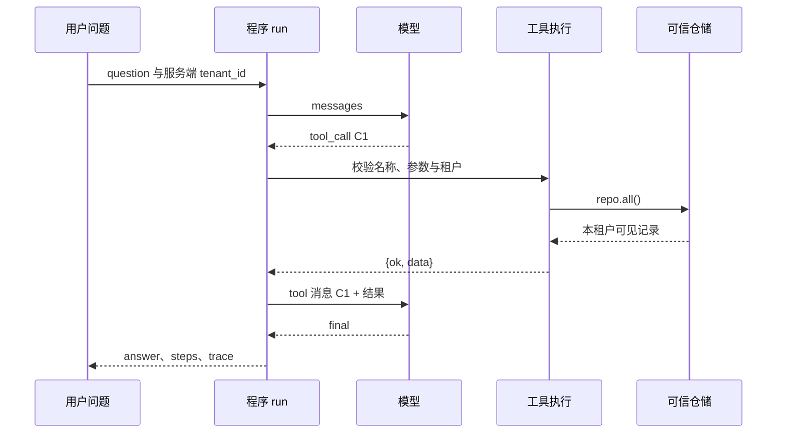

# 第24章　Tool Calling 与手写 Agent Loop

[上一章](23-项目实战一：DocPilot从零到检索系统.md) · [全书目录](教材目录.md) · [下一章](25-LangGraph、状态、Checkpoint与人工审核.md)

## 1. 学习目标与前置知识

真正执行模型请求的工具，并可控地继续或结束。前置：第12、18、20章。

**承接与本章主线：** 在可信业务能力之外允许模型选择工具，输入、执行、反馈与预算仍由程序负责；随后增加持久暂停与恢复。

**本章从这里开始：** 模型说“我要查询供应商”，查询真的发生了吗？Agent的核心不是多写几句提示，而是把提出动作、验证、执行、反馈和停止连接成真实循环。

## 2. 基础知识讲解

### 2.1 从模型建议到程序执行

模型输出“查询订单”只是一段候选指令，和真正计算仍隔着执行边界。程序要判断名称是否存在、参数是否有效、主体能否访问，然后调用真实函数。执行结果必须带回对应调用标识，下一轮模型才是在观察事实，而非把自己上一轮的意图当作已经发生的动作。

先让程序直接调用一次get_project，确认它能取得项目。再让模型面对同一个问题：模型只提出工具名称和参数，程序先校验参数与身份，再实际执行，最后把结果回传给模型。Tool Calling描述的就是这段请求与执行交互。工具说明与Schema帮助模型表达请求，真正的业务授权仍在程序和资源服务中执行。

先用代码直接运行工具，确认数据、错误和单位正确，再让模型参与选择。否则工具执行错误和模型决策错误会混在一起。

### 2.2 工具契约应描述什么

每个工具有稳定名称、参数结构、结果结构与错误约定。只读查询和写动作分开；租户、角色等可信上下文不能任由模型参数覆写。未知名称或校验失败时，业务函数调用次数应为零。

工具返回“未找到”“权限不足”“上游失败”不同于正常空结果。对模型可恢复的错误可回传简短说明，对不可恢复或危险路径则明确终止。

#### 案例推进：逐层增加控制，不把模型当执行器

模型输出与HTTP响应一样是外部输入。先验证决策类型与字段，再查允许工具，校验参数，将可信租户作为独立上下文提供，最后执行。未知工具、坏参数、越权与预算耗尽时，实际业务函数调用次数必须为0。

工具描述帮助模型选择，Schema帮助约束结构，服务端权限控制实际资源。检索到的文档即使写着“导出另一租户信息”，也不能修改工具允许集合或身份。写工具与只读工具分别控制，审批绑定载荷版本；不能让模型在工具参数里给自己管理员权限。

### 2.3 一轮循环经过哪些步骤

应用组织消息并请求模型；解析返回为final、工具请求或非法结构。final进入结果校验，工具请求经过名称、参数、身份和预算检查后执行，再把结果带调用标识加入消息，交下一轮模型继续判断。

不同供应商的原生消息、工具参数和调用ID格式不同，应由适配层映射到内部协议，不能把课程中的type字典当作通用SDK格式。

#### 案例推进：先用假模型验证最小闭环

```python
# study-example: S24A
from copy import deepcopy
calls = []
def supplier_name(arguments):
    if set(arguments) != {"supplier_id"} or arguments["supplier_id"] != "S1":
        raise ValueError("非法供应商参数")
    calls.append("S1")
    return {"name":"虚构供应商A"}

tools = {"supplier_name":supplier_name}
def model(messages):
    if messages[-1]["role"] == "tool":
        return {"type":"final", "content":messages[-1]["result"]["name"]}
    return {"type":"tool_call", "name":"supplier_name", "arguments":{"supplier_id":"S1"}}

def run(question, max_steps=3):
    messages = [{"role":"user", "content":question}]
    for _ in range(max_steps):
        decision = model(deepcopy(messages))
        if decision["type"] == "final":
            return decision["content"]
        name = decision["name"]
        if name not in tools:
            raise ValueError("未知工具")
        result = tools[name](decision["arguments"])
        messages.append({"role":"tool", "name":name, "result":result})
    raise RuntimeError("达到步数上限")

assert run("查供应商") == "虚构供应商A"
assert calls == ["S1"]
```

这是课程内部的单调用协议，不是任何供应商的原生消息格式。它有意省略通用Schema、可信身份、call_id、超时和日志，以便先看见两轮闭环：第一轮提出请求，程序调用真实函数，第二轮读取真实结果。扩展为多工具/并行调用时，必须补充唯一调用标识与结果对应关系。

#### 案例推进：同一道查制度题，先跑工具协议再接模型

沿用第18章2.5准备的本地Ollama服务。先运行 `uv run --frozen python -m practice.enterprise_ai.policy_agent`。打开一行输出，从 `trace` 找到实际调用过的工具，从 `answer` 找到上限及来源，再看 `supported` 如何比较二者。替身固定先发工具请求、再读取程序送回的结果。打开 `practice/enterprise_ai/data/retrieval_cases.json`，把 `historical_limit` 的 `as_of` 从 2026-06-01 改成 2026-07-01，预测同一业务函数会返回哪一版（`policy_agent` 当前没有日期参数，日期来自夹具）。本章继续用真实模型替换作决定的替身。

**消息流。** 模型提出 `get_prepayment_limit({})`，服务端从任务上下文取得租户和日期，执行查询并追加 tool 消息，模型再给最终 JSON。输入证据缺失、结构解析失败、数字与证据不符分别由不同层报告。追踪保留工具名、来源和可取得的用量，评测标签仅在调用结束后使用。先能手画这两轮消息，再对照本章的执行器与循环边界。[配套参考实现](../../practice/enterprise_ai/policy_agent.py) · [Ollama 消息与工具协议](https://docs.ollama.com/capabilities/tool-calling)

### 2.4 循环必须能够结束

最大步骤约束决策次数，单调用超时约束一次等待，总任务时限约束完整流程，token/费用预算约束资源。它们不能互相替代。简单问题可直接结束，复杂问题可以多步，但不为了展示Agent强迫每题调用固定次数。

#### 案例推进：停止条件与完成证据同等重要

最大步骤、单调用超时、总时限、调用与费用预算分别约束不同方面。模型重复同一失败、没有资料或总不final时，按规则终止或交人工复核。轨迹保留意图、实际调用、结果和退出原因；最终文本正确不单独证明工具真的执行。

固定工作流适合步骤已知任务，Agent适合在允许范围内需要动态选择的任务。先对照固定流程，再决定模型决策是否值得增加不确定性。后续框架只改变组织方式，不应绕过已有边界。

### 2.5 轨迹如何证明任务完成

保存每轮决策、实际工具调用、参数、结果和退出原因，金额回到确定性工具核对。最终文本碰巧正确，不说明查询真的执行；假模型测试必须检查下一轮是否收到真实工具结果。

ReAct类思路强调行动与观察反馈，工程中记录可审核的决策和证据即可，不需要把不可验证的内部推理叙述当作执行凭证。

### 2.6 上下文预算与工具调用标识：循环的两条数据契约

多轮Agent会积累指令、用户问题、历史、检索块与工具返回。全部拼接可能超过窗口，随意截断又可能丢掉任务条件或证据。先确定必须保留什么，再把有限预算分给可选材料；实际计数使用对应模型/服务规则，还要预留输出与协议开销。

下面故意使用字符数演示装箱算法，不是token计数器，也不能用于计费。预算放不下必要约束时明确失败，不悄悄删除约束后继续执行。

```python
# study-example: S24B
def pack_context(required, candidates, budget):
    if type(budget) is not int or budget < 0:
        raise ValueError("budget必须为非负整数")
    used = sum(len(text) for text in required)
    if used > budget:
        raise ValueError("必要内容超出预算")
    selected = list(required)
    for text in candidates:
        if used + len(text) <= budget:
            selected.append(text)
            used += len(text)
    return selected
assert pack_context(["规则", "问题"], ["证据A", "很长的历史记录"], 7) == ["规则", "问题", "证据A"]
try:
    pack_context(["必要规则"], [], 1)
except ValueError:
    pass
else:
    raise AssertionError("不能丢掉必要规则后继续")
```

required包含当前可信约束与任务，并不使任意用户文本都获得系统权威。candidates也不能仅凭短就优先，要按证据相关性、来源、版本、去重与完整性排序；切掉表格条件或否定句可能改变事实。摘要只缩减表示，不提高可信度，引用ID与原始来源应能找回。

多个工具结果还必须严格对应调用。返回顺序可能不同于请求顺序，使用call_id关联，而不是默认第一个结果属于第一个工具。

```python
# study-example: S24C
def correlate(requests, results):
    wanted = [request["call_id"] for request in requests]
    received = [result["call_id"] for result in results]
    if len(set(wanted)) != len(wanted) or len(set(received)) != len(received):
        raise ValueError("调用标识重复")
    if set(wanted) != set(received):
        raise ValueError("结果缺失或出现未知调用")
    by_id = {result["call_id"]:result for result in results}
    return [by_id[call_id] for call_id in wanted]
requests = [{"call_id":"C1"}, {"call_id":"C2"}]
results = [{"call_id":"C2","value":20}, {"call_id":"C1","value":10}]
assert [r["value"] for r in correlate(requests, results)] == [10, 20]
try:
    correlate(requests, results[:1])
except ValueError:
    pass
else:
    raise AssertionError("缺失结果不能默认为成功")
```

例子验证集合与顺序关系，尚需验证每条请求/结果Schema与业务名称。并行工具还要评估依赖、写入顺序、取消和局部失败；供应商协议可能要求保留特定助手消息和工具结果形式，适配层按实际契约转换。最终回答中的来源ID仅能来自本次已授权观察，不接受凭空新增引用。

## 3. 原理讲解与推导

### 3.1 模型决策与执行控制分离

模型输出是外部输入，像HTTP或文件内容一样需要验证。程序的白名单、权限、资源约束和确定性规则才决定允许发生什么，这使概率生成可以接入可控系统。

### 3.2 工具结果是下一轮的新证据

如果没有把执行结果回传，模型只能继续猜测；如果多个调用ID混淆，可能把另一项结果当依据。完整循环不仅要有函数调用，还要维持消息与结果的对应关系。

## 4. 示例与逐步走查

### 两步工具走查

```json
{"type":"tool_call","call_id":"C1","name":"get_paid_total","arguments":{"user":"Alice"}}
```

程序先校验并实际计算，再回传：

```json
{"role":"tool","call_id":"C1","name":"get_paid_total","content":{"ok":true,"data":{"paid_amount_cents":79800}}}
```

下一轮模型根据该结果组织说明。若直接把第一轮请求当成已执行，最终答案即使碰巧正确，也没有证明系统完成了查询。按本书练习区实现循环并检查第二轮收到的消息。

### 4.1 沿输入到结果逐步解释

第一条JSON表示模型想调用get_paid_total，并给出了call_id=C1。应用先查工具注册和参数，再用可信身份限定访问，真实计算后得到79800分。

返回消息带同一C1，是为了让下一轮把结果关联到这次查询。若工具没有执行却直接生成“已查询”，结论即使碰巧正确，也无法证明系统完成任务；若结果误标成另一调用ID，则模型可能使用错证据。

工具失败也应回传可区分错误，不能把超时当成已支付金额0。这样下一轮才有条件停止、复核或采取受限的下一步。

### 4.2 从零 12 步：写出可验收的工具循环

上一节解释了机制，这一节把它变成一项可独立完成的工程。2.3 的玩具为了先看闭环省略了 call_id；正式契约每轮都要求唯一 call_id，即使只有一个工具。新建 `learner_agent.py`，只需要标准库；每完成一步，用同一组契约检查：

```powershell
uv run --frozen python -m pytest tests/learner/contract_agent.py --learner-module learner_agent --through-step 1 -q
```

把 `--through-step` 从 1 推到 12，前面步骤持续回归，未到达的步骤显示 deselected，不是通过。契约与完整提示见[学习者验收](../../tests/learner/练习说明.md#工具循环契约agent)。下面的四段累计代码依次写入同一文件，后一组调用前一组函数。

| 步骤 | 契约 | 检查什么 |
| --- | --- | --- |
| 1 | s01 | 工具名称、参数与只读标记 |
| 2–5 | s02–s05 | 执行结果、未知工具、参数、租户与字段白名单 |
| 6–7 | s06–s07 | 只接受 tool_call / final 两种结构 |
| 8–9 | s08–s09 | 循环、call_id、tool 消息与 trace |
| 10–12 | s10–s12 | 预算、重复 call_id、坏决策与 final |



**步骤1–5，先固定工具契约与执行边界。** 工具只有名称、参数名和只读标记；租户不属于参数。未知名称、缺参数、额外参数（包括伪造 tenant_id）都必须在调用仓储之前失败，业务函数调用次数为 0。参与查询的金额必须是整数分，bool、float、字符串和负数一律拒绝；状态必须在允许集合内，**先验证本次查询涉及的全部记录，再筛选“已支付”**，不能把 `paidd` 悄悄排除。返回给模型的订单只允许 id、user、amount_cents、status，tenant_id、access_token 等内部字段不能出现在工具结果里。

```python
from copy import deepcopy

TOOLS = {
    "get_paid_total": {"readonly": True, "parameters": ("user",)},
    "get_order": {"readonly": True, "parameters": ("order_id",)},
}
ORDER_FIELDS = ("id", "user", "amount_cents", "status")
ORDER_STATUSES = {"paid", "pending", "cancelled"}

def _text(value, name):
    if not isinstance(value, str) or not value.strip():
        raise ValueError(f"{name} must be nonempty text")
    return value.strip()

def _cents(value, order_id):
    if type(value) is not int or value < 0:
        raise ValueError(f"order {order_id} has invalid amount_cents")
    return value

def _order_view(row):
    missing = [field for field in ORDER_FIELDS if field not in row]
    if missing:
        raise ValueError("order missing required fields")
    order_id = _text(row["id"], "id")
    user = _text(row["user"], "user")
    status = row["status"]
    if not isinstance(status, str) or status not in ORDER_STATUSES:
        raise ValueError(f"order {order_id} has invalid status")
    return {"id": order_id, "user": user,
            "amount_cents": _cents(row["amount_cents"], order_id), "status": status}

def tool_specs():
    return {name: {"readonly": spec["readonly"], "parameters": list(spec["parameters"])}
            for name, spec in TOOLS.items()}

def _arguments(arguments, expected):
    if not isinstance(arguments, dict) or set(arguments) != set(expected):
        raise ValueError("arguments do not match the tool contract")
    return {name: _text(arguments[name], name) for name in expected}

def execute_tool(name, arguments, *, tenant_id, repo):
    tenant_id = _text(tenant_id, "tenant_id")
    if name not in TOOLS:
        raise ValueError("unknown tool")
    values = _arguments(arguments, TOOLS[name]["parameters"])
    rows = [deepcopy(row) for row in repo.all()]
    visible = [row for row in rows if row.get("tenant_id") == tenant_id]
    if name == "get_paid_total":
        matched = [row for row in visible if row.get("user") == values["user"]]
        views = [_order_view(row) for row in matched]
        paid = [row for row in views if row["status"] == "paid"]
        return {"ok": True, "data": {
            "user": values["user"], "found": bool(matched), "paid_count": len(paid),
            "paid_amount_cents": sum(row["amount_cents"] for row in paid)}}
    matched = [row for row in visible if row.get("id") == values["order_id"]]
    if not matched:
        return {"ok": True, "data": {"found": False, "order": None}}
    return {"ok": True, "data": {"found": True, "order": _order_view(matched[0])}}
```

**步骤6–7，只接受两种决策形状。** `tool_call` 必须恰好有 type、call_id、name、arguments；`final` 必须恰好有 type、content。字符串 `"false"` 不能当 bool；空 call_id、空 content、未知工具、arguments 为列表都拒绝。解析阶段不执行任何业务。

```python
def parse_decision(raw):
    if not isinstance(raw, dict):
        raise ValueError("decision must be an object")
    kind = raw.get("type")
    if kind == "tool_call":
        if set(raw) != {"type", "call_id", "name", "arguments"}:
            raise ValueError("unexpected tool_call fields")
        call_id = _text(raw["call_id"], "call_id")
        name = _text(raw["name"], "name")
        if name not in TOOLS:
            raise ValueError("unknown tool")
        if not isinstance(raw["arguments"], dict):
            raise ValueError("arguments must be an object")
        return {"type": "tool_call", "call_id": call_id, "name": name,
                "arguments": deepcopy(raw["arguments"])}
    if kind == "final":
        if set(raw) != {"type", "content"}:
            raise ValueError("unexpected final fields")
        return {"type": "final", "content": _text(raw["content"], "content")}
    raise ValueError("unknown decision type")
```

**步骤8–9，把观察放回下一轮。** 每轮先把决策复制给模型可见的消息，再执行并把同一 call_id 的结果追加为 tool 消息。`trace` 保存 step、call_id、名称、参数和结果；`steps` 是模型调用次数，`tool_calls` 是实际执行次数，两者不能混用。

```python
def run(question, *, model, tenant_id, repo, max_steps=4):
    question = _text(question, "question")
    tenant_id = _text(tenant_id, "tenant_id")
    if type(max_steps) is not int or not 1 <= max_steps <= 10:
        raise ValueError("max_steps must be an integer in 1..10")
    messages = [
        {"role": "system", "content": "Use read-only tools when needed. "
                                      "Answer with one final JSON object."},
        {"role": "user", "content": question},
    ]
    trace, seen = [], set()
    for step in range(1, max_steps + 1):
        decision = parse_decision(model(deepcopy(messages)))
        if decision["type"] == "final":
            return {"answer": decision["content"], "steps": step,
                    "tool_calls": len(trace), "trace": trace}
        call_id = decision["call_id"]
        if call_id in seen:
            raise ValueError("duplicate call_id")
        seen.add(call_id)
        result = execute_tool(decision["name"], decision["arguments"],
                              tenant_id=tenant_id, repo=repo)
        messages.append({"role": "assistant", "content": deepcopy(decision)})
        messages.append({"role": "tool", "call_id": call_id, "name": decision["name"],
                         "content": deepcopy(result)})
        trace.append({"step": step, "call_id": call_id, "name": decision["name"],
                      "arguments": deepcopy(decision["arguments"]), "result": deepcopy(result)})
    raise RuntimeError("step budget exhausted")
```

**步骤10–12，让失败也可验收。** 模型永远不 final 时按 `max_steps` 停止；同一 call_id 重复出现时拒绝；坏决策在执行前失败，仓储调用为 0；空 final 拒绝。下面用一个内存仓储和脚本模型走通两步：

```python
class DemoRepo:
    def all(self):
        return [{"id": "A1", "tenant_id": "a", "user": "Alice",
                 "amount_cents": 79800, "status": "paid"}]

def demo_model(messages):
    if messages[-1]["role"] == "tool":
        return {"type": "final", "content": "Alice 已支付 798 元"}
    return {"type": "tool_call", "call_id": "C1", "name": "get_paid_total",
            "arguments": {"user": "Alice"}}

outcome = run("Alice 付了多少", model=demo_model, tenant_id="a", repo=DemoRepo())
assert outcome["answer"] == "Alice 已支付 798 元"
assert outcome["steps"] == 2 and outcome["tool_calls"] == 1
assert outcome["trace"][0]["call_id"] == "C1"
```

这 12 步只覆盖执行边界：它不证明模型选对工具、不证明真实供应商协议、不包含审批与跨进程恢复。接真实模型时在外层适配器完成消息格式转换；审批绑定与重复恢复接[审批契约](../../tests/learner/练习说明.md#审批与幂等契约)，第26章再把两者组合。

## 5. 动手练习

### 本章累计任务：看见真正工具执行

按 4.2 的 12 步写自己的 `learner_agent.py`，用 `--through-step` 逐步通过契约；再保存一轮 assistant 调用、校验、执行、tool 结果与最终回答。分别注入未知工具、额外租户参数和未调用工具却宣称完成，核对执行次数。

**未通过时怎样定位：** 工具描述不能授予权限；不完整流式参数不能提前执行；猜对结果不表示有本次工具证据。

**带到下一步：** 第25章使这个流程能够暂停并跨进程续接。

下方专题练习用于补当前卡点；先完成这一项累计任务，不另将所有索引作为必须并行完成的进度。

### 练习一：确定性工具执行器

用[练习数据](../../practice/enterprise_ai/虚构数据说明.md)实现按ID查项目、查供应商、查制度与计算规则四类只读能力。名称、参数、结果与错误契约明确，可信租户由程序注入。未知名称、坏参数或越权请求不得进入业务处理器。

### 练习二：两轮真实反馈

假模型第一轮请求一个工具，第二轮只有在收到匹配call_id的真实执行结果后才返回答案。检查执行次数、第二轮消息、结果引用与最终状态；不允许预设答案绕过工具。

### 练习三：有界失败

分别提供永远请求工具、反复坏参数、工具超时与无资料的假模型/工具。达到步骤或总预算后明确停止，保留轨迹，缺资料交复核。再在同题集比较固定流程与单Agent，判断模型决策是否带来实际收益。

### 用真实模型完成同一轮工具调用

先设置 `$env:LAB_MODEL` 为本机已安装且支持原生工具调用的 Ollama 模型标签，再运行 `uv run --frozen python -m practice.enterprise_ai.policy_agent --model $env:LAB_MODEL`。变量未设置或为空时，命令会明确报错，不会静默回退替身；显式省略 `--model` 才走同一执行与评分路径的替身。比较输出中的模型标识、两轮用量、实际来源和退出原因。参考实现限定一个只读工具、至多一次执行、两次模型请求，每次请求限制生成长度。函数参数以空对象为契约，可信身份来自服务端。HTTP 等待超时和整项任务截止时间是不同约束；扩成长期服务时按第 11、14 章继续传递剩余预算。

从一次失败开始：让替身先返回带额外租户参数的调用，预测工具执行次数；再让它跳过工具，直接给 20% 和一个来源号。前者在执行前失败，后者即使数字猜对，也没有本次工具观察支持。合上实现，独立增加一个只读的“查询项目预算”工具：只接收 project_id、按服务端身份过滤、返回整数分；用 P200、P900 和不存在的项目分别验收。第26章将重复这一套试验比较提示版本。[原生工具调用参考实现](../../practice/enterprise_ai/policy_agent.py)

### 补强练习：从本节示例迁移

给pack_context加入真实计数器注入点、输出预留和完整证据单元策略。对correlate测试重复ID、未知ID、缺结果与乱序，并验证业务函数执行结果确实进入下一轮消息。

## 6. 验收与自测

**行为验收：** 真实执行且回传结果；不能只返回预设答案；停止条件有效；缺资料不推断合规。

**原理验收：** 合上资料解释本章一个机制，预测一个反例，说明规则属于语言语义、库约定还是实现观察。

### 6.1 先预测，再查看参考推导

如果删掉messages.append工具结果，但把最终答案硬编码为正确名称，算闭环通过吗？

<details>
<summary>完成预测后查看解释</summary>

不算。没有将实际观察交给下一轮，模型无法依执行结果更新行为。测试应改变工具结果并检查下一轮消息和最终结果随之改变，而不只核对固定答案。

</details>

## 7. 面试问答与迁移

工具描述属于授权吗？如何证明 Agent 真正调用了工具？为什么多步任务不能只看最终文本？

**参考回答：**

1. 工具描述帮助模型提出请求，不授予权限。执行器从可信会话取得身份，按允许工具、参数Schema和资源权限逐层检查；模型自带的tenant_id或提示里的“已批准”不能覆盖服务端身份与批准记录。
2. trace中的call_id把请求和结果关联，再用真实业务函数的调用记录或效果账本证明执行；模型自己打印一段“已调用”不算。call_id也不天然是持久业务幂等键：跨轮、重试与恢复的动作身份需另行约定。
3. 脚本模型可确定性覆盖解析、工具执行、结果回传与预算分支，不证明真实模型会选对工具。真实模型还需逐题检查工具选择、参数、任务完成与成本。最终文本可能碰巧正确，不能替代轨迹；反之，并非每个合法任务都必须调用工具，应按任务契约判断。
4. max_steps限制模型决策轮次，不限制单次调用时间、结果大小或金额预算。这些上限分别由执行器和客户端约束，不能只靠循环次数防止资源失控。

**换条件自测：** 保持最后文本不变，让模型跳过必须查证的工具；评测应捕获证据缺失。再让一个工具迟迟不返回，解释为什么12步契约全绿仍未证明端到端时限成立。

## 8. 本章小结与参考

### 8.1 一页知识地图

**本章主问题：** 模型说“我要查询供应商”时，程序凭什么、按什么顺序让这次查询真的发生并可控结束？

**一条主线：**
```text
模型给出工具意图 → 名称、参数、身份与预算校验后执行、按 call_id 回填结果 → 下一轮决策或明确终止
```

**三个关键词：** 执行边界、call_id、停止条件。执行边界决定什么能发生，call_id 保证结果对得上，停止条件让循环有界。

**最容易错：**
- 把工具描述或 Schema 当成授权，允许模型在参数里自带 tenant_id。
- 没执行工具却接受模型说的“已查询”，最终文本碰巧正确不算闭环。
- 多个工具结果按返回顺序对应，而不是按 call_id 关联。
- 只设 max_steps，忘了单调用超时、总时限、费用与上下文预算各管一段。

**与前后章：** 第 23 章的证据链在这里加上动作；本章的循环与轨迹，第 25 章再改成可暂停、可恢复的图。

**学完应能：**
- 写出只接受 tool_call 与 final 的解析器，坏决策在任何业务调用前失败。
- 实现带 call_id、trace、步骤数与调用次数分开计数的循环，并演示未知工具与越权参数零执行。
- 用轨迹证明工具真的执行过，而不是只看最终回答。

### 8.2 日常工作注意事项

- 工具名使用允许列表，额外参数和非法类型在执行前拒绝；不要将模型文本直接当成任意代码或Shell命令。
- 有写入效果的工具在重试前检查审批、幂等与载荷，查询成功也不等于获得写入授权。
- 执行轨迹核对工具是否真的调用、返回了什么；达到预算或缺资料时给出明确状态，不只让模型口头宣称完成。

### 8.3 参考与后续学习

本章先用普通Python实现有边界的工具循环。下一章在确有恢复与分支需求时，将相同状态和动作迁移为图。

官方参考：[本章资料](https://docs.ollama.com/capabilities/tool-calling)。动态框架资料以2026-11-04核对的入口为准，具体SDK版本在实际实践时重新核对并记录锁文件。

[上一章](23-项目实战一：DocPilot从零到检索系统.md) · [下一章](25-LangGraph、状态、Checkpoint与人工审核.md)
