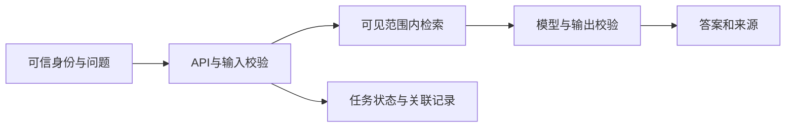

# 第30章　转行准备、项目讲述与系统设计面试

[上一章](29-原理面试：语言、工程与AI的追问.md) · [全书目录](教材目录.md) · [附录与面试卡](附录F-术语与面试手册.md)

## 1. 学习目标与前置知识

形成真实可展示的项目和有证据的个人叙述。前置：第27–29章及实际项目。

**本章从这里开始：** 转行面试不只问你知道多少术语，还要判断你能否独立交付并解释取舍。将同一项目的需求、代码、实验和限制组织起来，而不是堆工具名称。

## 2. 基础知识讲解

### 2.1 把已有经验与新能力连接起来

Java后端中的接口、事务、权限、测试、运维和架构取舍可以迁移，但Python对象与异步机制、概率模型和证据链需要新的实践。项目叙述应说明自己实际完成的部分，而非把所有技术名称列成经历。

### 2.2 写出有证据的项目一页纸

先说明需求、用户和数据范围，再给基线与具体失败，接着写本次选择和验证结果，最后说明代价、限制与下一步。记录模型、数据、环境和样本口径，让指标能够复查。

个人项目、阅读理解、设计方案和真实工作经历分别表达。没有测过生产流量，就写限定样本实验；未实现的恢复或权限不能因为教材讨论过就写成完成。

#### 案例推进：把项目讲述压到可复查事实

先说用户与问题，再说基线失败、自己的改动、验证与代价。例如“在固定题集上比较关键词与融合检索”应附题集、口径、环境及逐题导出，不能只写“准确率大幅提高”。个人实验、方案设计与真实生产经历分别表述。

### 2.3 系统设计从约束开始

先问文档类型、更新频率、数据敏感性、用户与租户、读写动作、质量和时限，再画最小链路。决定哪些步骤确定性执行、哪些由模型选择，以及证据、权限和资源怎样传递。

在链路上逐点注入模型故障、检索无证据、越权、写入重放与子任务超时，再说明反馈和恢复。图画得完整还不够，关键状态必须能用案例走通。

#### 案例推进：从约束开始设计系统

假设用户需要查询内部制度，先问文档格式、更新频率、租户与权限、是否需要写动作、质量与时限，再画最小链路。下面是设计示意，不是已部署架构。



固定流程能完成时先采用固定流程；需要动态选择才加入Agent；需要跨暂停恢复再评估图与持久状态。每次复杂度增加都回答：解决哪种已观察问题、增加什么代价、怎样验证、怎样回退。

### 2.4 给演进方案设置采用条件

说明何时从关键词走向向量、何时需要重排、何时引入图和多Agent，给出可以观察的收益和代价。默认方案不是框架最多的版本，而是当前约束下可维护、可验证的一版。

### 2.5 用模拟面试改进真实材料

语言代码、工程调试和AI系统设计分别练习，每轮记录解释不清、缺证据和方案取舍薄弱处。把问题转回下一次实验与文档修改，而不是只积累更多标准答案。

#### 案例推进：用演示验证材料一致

README命令、代码版本、数据与简历描述应指向同一个已完成版本。准备正常、无证据、越权和恢复案例，并接受一次新条件：新增租户、更新制度、模型不可用或批准后改载荷。能指出契约、状态、测试与部署影响，比复述架构图更能证明掌握。

Java接口、事务和服务经验可以迁移，但Python对象、协程取消与概率生成仍需要新的证据。把可迁移经验与亲手验证的新能力连接起来，形成可信的职业叙述。

## 3. 原理讲解与推导

### 3.1 可信叙述来自可复现决策

“为什么采用、怎样验证、付出什么代价”能把工具使用变成工程判断。代码、案例、失败记录和环境使这个判断可以被别人复查。

### 3.2 系统掌握是持续闭环

学习形成机制解释，实践暴露边界，测试约束行为，项目验证组合，面试追问检查迁移。薄弱点回流到教材与实验，而不是另开一套重复路线。

## 4. 示例与逐步走查

### 项目一页纸模板

```text
项目定位：个人实践 / 实际工作（按真实情况选择）
业务范围与数据：填写已实现功能、虚构/授权数据来源、样本数量
基线与问题：填写具体失败，不写泛泛“效果不好”
改进与证据：填写实测指标、环境、模型/数据版本、样本口径
代价与限制：填写延迟/费用/维护变化及未实现能力
演示与复现：填写仓库、启动命令、固定请求与预期
```

数字留给自己的测量，不套用教材示例。系统设计题先讲假设，再画链路，最后逐项注入故障、越权和重复请求。

### 4.1 沿输入到结果逐步解释

项目模板中的数字必须由自己的测量填写。讲述先给约束和基线，再展示一次实际改变及其证据；面试官改变数据或故障条件时，沿同一机制解释影响，明确尚未验证的部分。

## 5. 动手练习

### 练习一：项目材料一致

准备DocPilot和ProcureAgent各一份一页纸，列出问题、完成范围、基线、设计、实测、代价和局限。与仓库README、演示脚本和简历逐项核对，未实现项不写成完成。

### 练习二：三轮模拟面试

语言代码轮现场解释对象/作用域/异步中的两题；工程轮定位一次故障并讨论幂等；AI设计轮从用户、数据、权限、质量和时限开始，走通检索或工具链路。每轮保留追问与改进项。

### 练习三：一次需求演进

随机选择增加租户、制度更新、模型不可用或审批后变更参数，指出受影响的契约、状态、测试与部署。给出最小可行改法、验证方式和未解决风险，再把实际修改写回项目材料。

## 6. 验收与自测

**行为验收：** 能运行、能定位失败、能解释舍弃方案；简历指标可复查；缺口有学习安排。

**原理验收：** 合上资料解释本章一个机制，预测一个反例，说明规则属于语言语义、库约定还是实现观察。

**提交证据：** 实现位置、运行命令、正常案例、至少一个错误/边界案例、一次失败原因和修复记录。自动检查只证明其覆盖行为；未实现任务不因示例通过而算完成。

### 6.1 先预测，再查看参考推导

如何回答“你这个项目能承受多少并发”？

<details>
<summary>完成预测后查看解释</summary>

先说明实际环境、请求形态、输入长度、依赖和测试口径，再给实测；没有测量就明确为估计并给出压测计划。并发数字脱离延迟、失败率和资源预算没有完整意义。

</details>

## 7. 面试问答与迁移

设计企业文档审查系统：需求、权限、数据版本、引用、写入审批、恢复、评测与部署怎样协作？

回答顺序：定义与边界 → 机制 → 小例子 → 项目影响 → 验证方式。不确定的实现细节明确说明版本和查证办法。

## 8. 本章小结与参考

全书以“概念解释→机制推导→独立实现→行为验收→项目组合→新条件迁移”形成闭环。按实际失败定位回到对应章节，再以修改后的行为与证据重新验收。

官方参考：[本章资料](https://github.com/datawhalechina/hello-agents)。动态框架资料以2026-11-04核对的入口为准，具体SDK版本在实际实践时重新核对并记录锁文件。

[上一章](29-原理面试：语言、工程与AI的追问.md) · [附录与面试卡](附录F-术语与面试手册.md)
